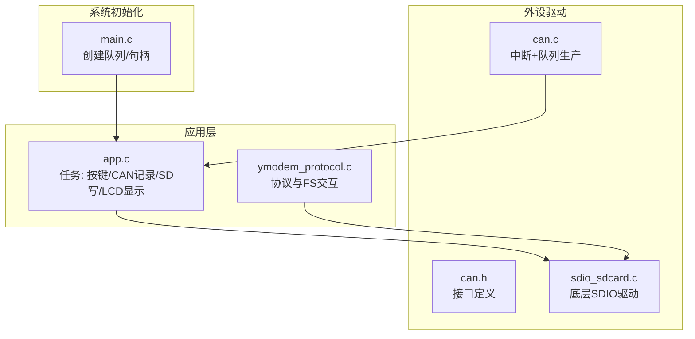
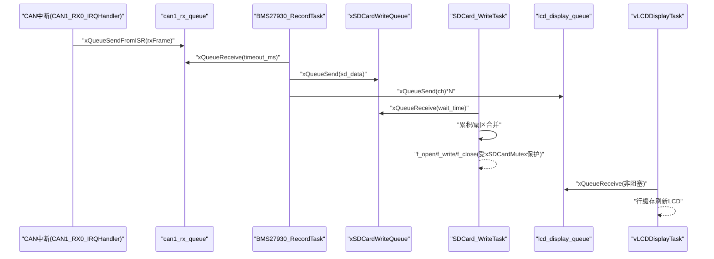
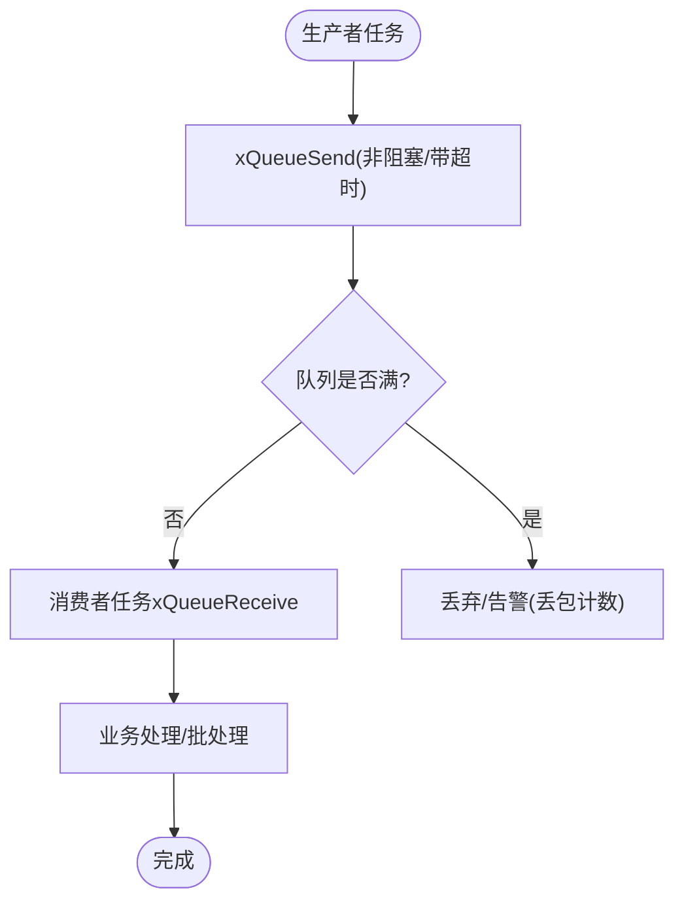
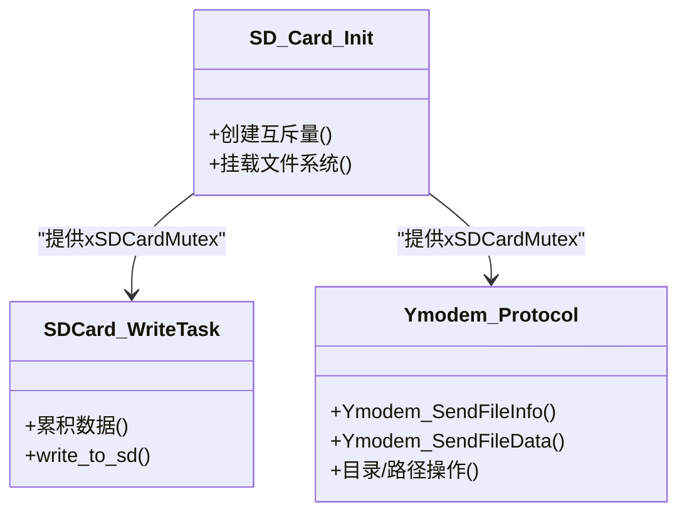
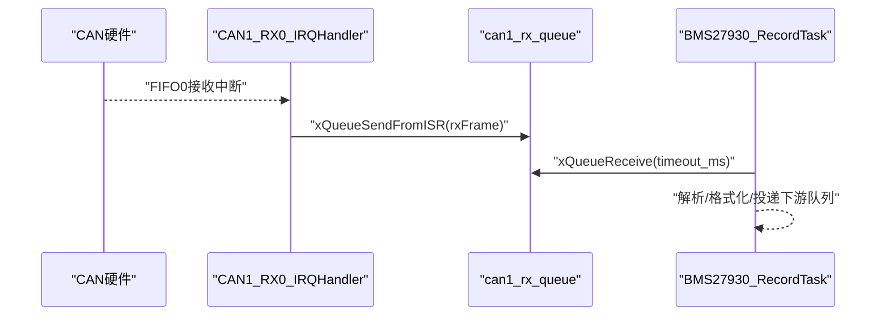
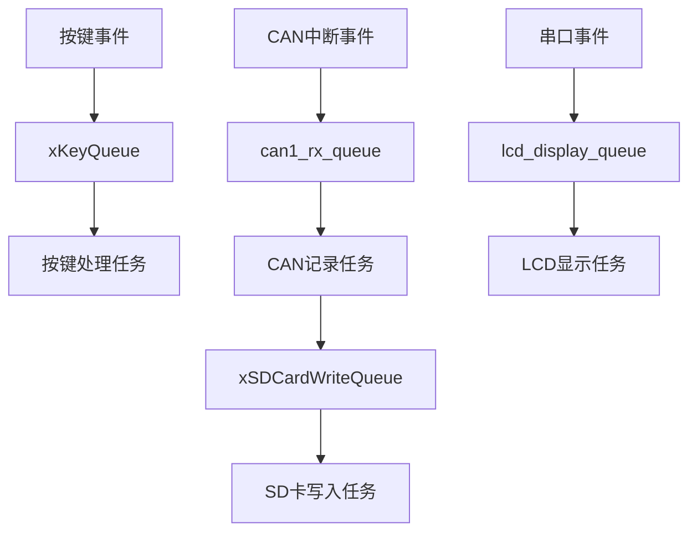
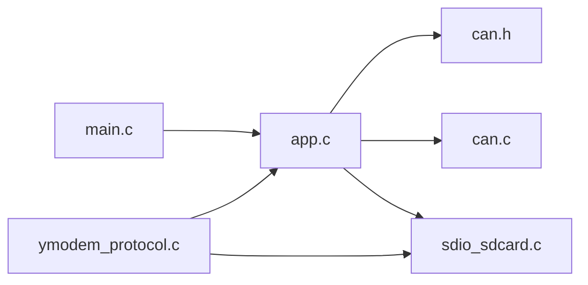

# 模块通信机制

<cite>
**本文引用的文件**   
- [main.c](file://_gbk_backup/User/main.c)
- [app.c](file://_gbk_backup/User/app.c)
- [can.h](file://_gbk_backup/Driver/BSP/can.h)
- [can.c](file://_gbk_backup/Driver/BSP/can.c)
- [sdio_sdcard.c](file://_gbk_backup/Driver/BSP/sdio_sdcard.c)
- [ymodem_protocol.c](file://_gbk_backup/User/ymodem_protocol.c)
</cite>

## 目录
1. [引言](#引言)
2. [项目结构](#项目结构)
3. [核心组件](#核心组件)
4. [架构总览](#架构总览)
5. [详细组件分析](#详细组件分析)
6. [依赖关系分析](#依赖关系分析)
7. [性能考虑](#性能考虑)
8. [故障排查指南](#故障排查指南)
9. [结论](#结论)

## 引言
本文面向STM32 CAN Tracker的模块通信机制，聚焦FreeRTOS消息传递与同步原语在系统中的落地实现。文档围绕以下主题展开：
- 基于队列的消息传递：xKeyQueue（按键）、xSDCardWriteQueue（SD卡写入）、lcd_display_queue（LCD显示）
- 生产者-消费者模式：CAN接收任务作为生产者，协议解析与存储任务作为消费者
- 信号量与互斥量：xSDCardMutex用于SD卡访问保护
- 中断到任务的通信：CAN中断通过队列将报文传递给任务消费
- 事件驱动架构：以队列和定时器为触发源的任务协作
- 性能优化：批量处理、缓冲合并、超时控制与丢包统计

## 项目结构
本项目的通信相关代码主要分布在用户层与应用层：
- 用户层初始化与全局对象创建：main.c
- 应用任务与业务逻辑：app.c
- CAN驱动与中断处理：can.h / can.c
- SD卡底层驱动与内部互斥：sdio_sdcard.c
- Ymodem协议与文件系统交互：ymodem_protocol.c

图表来源
- [main.c:23-55](file://_gbk_backup/User/main.c#L23-L55)
- [can.h:17-47](file://_gbk_backup/Driver/BSP/can.h#L17-L47)
- [can.c:17-141](file://_gbk_backup/Driver/BSP/can.c#L17-L141)
- [sdio_sdcard.c:13-28](file://_gbk_backup/Driver/BSP/sdio_sdcard.c#L13-L28)
- [app.c:25-32](file://_gbk_backup/User/app.c#L25-L32)

章节来源
- [main.c:23-55](file://_gbk_backup/User/main.c#L23-L55)
- [app.c:529-541](file://_gbk_backup/User/app.c#L529-L541)

## 核心组件
- 队列
  - xKeyQueue：按键事件队列，生产者是按键扫描任务，消费者是按键处理任务
  - xSDCardWriteQueue：SD卡写入请求队列，生产者是CAN记录任务，消费者是SD卡写入任务
  - lcd_display_queue：LCD显示字符队列，生产者包括CAN记录任务与串口任务，消费者是LCD显示任务
- 互斥量
  - xSDCardMutex：全局互斥量，保护FATFS文件系统访问（打开/关闭/读写/目录遍历等）
- 数据结构
  - Can1RxFrame：CAN接收帧结构体（扩展ID、数据负载、长度码）
  - SDCardWriteData_t：SD卡写入数据块（日志缓冲区）

章节来源
- [main.c:23-55](file://_gbk_backup/User/main.c#L23-L55)
- [can.h:21-47](file://_gbk_backup/Driver/BSP/can.h#L21-L47)
- [app.c:34-71](file://_gbk_backup/User/app.c#L34-L71)

## 架构总览
系统采用“中断/任务 → 队列 → 任务”的事件驱动架构。CAN硬件中断将报文推入队列，CAN记录任务从队列取数并做解析与格式化；随后分别投递到SD卡写入队列与LCD显示队列。SD卡写入任务对数据进行扇区级批量化合并后统一落盘，并通过互斥量保护文件系统操作。

图表来源
- [can.c:186-224](file://_gbk_backup/Driver/BSP/can.c#L186-L224)
- [app.c:200-309](file://_gbk_backup/User/app.c#L200-L309)
- [app.c:311-366](file://_gbk_backup/User/app.c#L311-L366)
- [app.c:452-521](file://_gbk_backup/User/app.c#L452-L521)

## 详细组件分析

### 队列与生产者-消费者模型
- xKeyQueue（按键）
  - 生产者：vKeyScanTask（按键扫描），根据短按、双击、长按状态机生成键值并发送
  - 消费者：vKeyProcessTask（按键处理），根据键值执行背光开关或打印任务栈信息
  - 特点：非阻塞发送（超时0），避免扫描任务被阻塞；消费者使用portMAX_DELAY等待，保证不丢键

- xSDCardWriteQueue（SD卡写入）
  - 生产者：BMS27930_RecordTask（CAN记录），将格式化后的日志字符串放入队列
  - 消费者：SDCard_WriteTask，按时间窗口与扇区大小进行批量化合并，减少频繁I/O
  - 特点：带超时等待的接收，支持“无新数据时自动落盘”，降低掉电丢失风险

- lcd_display_queue（LCD显示）
  - 生产者：BMS27930_RecordTask（CAN记录）与串口任务（USART），逐字节投递
  - 消费者：vLCDDisplayTask，周期性（100ms）批量读取并刷新屏幕，行级缓存滚动显示
  - 特点：非阻塞读取+周期刷新，兼顾实时性与显示流畅度

图表来源
- [app.c:94-152](file://_gbk_backup/User/app.c#L94-L152)
- [app.c:368-412](file://_gbk_backup/User/app.c#L368-L412)
- [app.c:200-309](file://_gbk_backup/User/app.c#L200-L309)
- [app.c:311-366](file://_gbk_backup/User/app.c#L311-L366)
- [app.c:452-521](file://_gbk_backup/User/app.c#L452-L521)

章节来源
- [app.c:94-152](file://_gbk_backup/User/app.c#L94-L152)
- [app.c:368-412](file://_gbk_backup/User/app.c#L368-L412)
- [app.c:200-309](file://_gbk_backup/User/app.c#L200-L309)
- [app.c:311-366](file://_gbk_backup/User/app.c#L311-L366)
- [app.c:452-521](file://_gbk_backup/User/app.c#L452-L521)

### 信号量与互斥量（xSDCardMutex）
- 用途：保护FATFS文件系统的全局状态，防止多任务并发访问导致文件损坏或状态不一致
- 创建：SD_Card_Init任务中创建并挂载文件系统
- 使用点：
  - SD卡写入任务：打开/写入/关闭文件
  - Ymodem协议：发送文件信息/数据、目录浏览、切换目录等

图表来源
- [app.c:414-450](file://_gbk_backup/User/app.c#L414-L450)
- [app.c:34-71](file://_gbk_backup/User/app.c#L34-L71)
- [ymodem_protocol.c:311-394](file://_gbk_backup/User/ymodem_protocol.c#L311-L394)
- [ymodem_protocol.c:443-540](file://_gbk_backup/User/ymodem_protocol.c#L443-L540)

章节来源
- [app.c:414-450](file://_gbk_backup/User/app.c#L414-L450)
- [app.c:34-71](file://_gbk_backup/User/app.c#L34-L71)
- [ymodem_protocol.c:311-394](file://_gbk_backup/User/ymodem_protocol.c#L311-L394)
- [ymodem_protocol.c:443-540](file://_gbk_backup/User/ymodem_protocol.c#L443-L540)

### 中断与任务通信（CAN中断→任务）
- 中断侧：CAN1_RX0_IRQHandler从FIFO0读取报文，构造Can1RxFrame并通过xQueueSendFromISR发送到can1_rx_queue
- 任务侧：BMS27930_RecordTask通过can1_receive_msg从队列取数，进行去重、解析与格式化，再投递到SD卡与LCD队列
- 丢包统计：当队列满时，中断侧记录丢包计数，便于监控拥塞情况

图表来源
- [can.c:186-224](file://_gbk_backup/Driver/BSP/can.c#L186-L224)
- [can.c:116-141](file://_gbk_backup/Driver/BSP/can.c#L116-L141)
- [app.c:200-309](file://_gbk_backup/User/app.c#L200-L309)

章节来源
- [can.c:186-224](file://_gbk_backup/Driver/BSP/can.c#L186-L224)
- [can.c:116-141](file://_gbk_backup/Driver/BSP/can.c#L116-L141)
- [app.c:200-309](file://_gbk_backup/User/app.c#L200-L309)

### 事件驱动架构设计
- 事件源
  - 按键扫描：定时轮询按键电平变化，产生按键事件
  - CAN中断：硬件中断触发，产生CAN报文事件
  - 串口中断：外部设备数据到达，产生显示/协议事件
  - 软件定时器：LED闪烁、电池低电量检测等周期性事件
- 事件分发
  - 通过队列解耦生产者与消费者，任务仅关注自身消费逻辑
  - 通过互斥量保护共享资源（文件系统）
- 典型流程
  - CAN记录任务：接收→解析→格式化→并行投递（SD卡队列、LCD队列）
  - LCD显示任务：周期批量读取→行缓存→刷新屏幕
  - SD卡写入任务：超时/扇区阈值触发→批量写入→释放互斥量

图表来源
- [app.c:94-152](file://_gbk_backup/User/app.c#L94-L152)
- [app.c:200-309](file://_gbk_backup/User/app.c#L200-L309)
- [app.c:452-521](file://_gbk_backup/User/app.c#L452-L521)
- [app.c:311-366](file://_gbk_backup/User/app.c#L311-L366)

## 依赖关系分析
- 模块耦合
  - main.c：负责创建全局队列与互斥量，是所有任务与资源的入口
  - app.c：包含所有应用任务，依赖main.c创建的队列与互斥量
  - can.c：对外暴露can1_receive_msg/can1_send_msg，内部维护can1_rx_queue
  - sdio_sdcard.c：底层SDIO驱动，内部维护g_sdio_mutex用于DMA/传输保护
  - ymodem_protocol.c：通过xSDCardMutex访问FATFS，与SD卡写入任务共享文件系统
- 潜在循环依赖
  - 无直接循环依赖；各模块通过FreeRTOS原语与全局句柄解耦

图表来源
- [main.c:23-55](file://_gbk_backup/User/main.c#L23-L55)
- [app.c:25-32](file://_gbk_backup/User/app.c#L25-L32)
- [can.h:17-47](file://_gbk_backup/Driver/BSP/can.h#L17-L47)
- [can.c:17-141](file://_gbk_backup/Driver/BSP/can.c#L17-L141)
- [sdio_sdcard.c:13-28](file://_gbk_backup/Driver/BSP/sdio_sdcard.c#L13-L28)
- [ymodem_protocol.c:311-394](file://_gbk_backup/User/ymodem_protocol.c#L311-L394)

章节来源
- [main.c:23-55](file://_gbk_backup/User/main.c#L23-L55)
- [app.c:25-32](file://_gbk_backup/User/app.c#L25-L32)
- [can.h:17-47](file://_gbk_backup/Driver/BSP/can.h#L17-L47)
- [can.c:17-141](file://_gbk_backup/Driver/BSP/can.c#L17-L141)
- [sdio_sdcard.c:13-28](file://_gbk_backup/Driver/BSP/sdio_sdcard.c#L13-L28)
- [ymodem_protocol.c:311-394](file://_gbk_backup/User/ymodem_protocol.c#L311-L394)

## 性能考虑
- 批量处理与缓冲
  - SD卡写入：累积至512字节扇区或1分钟无新数据时写入，减少频繁I/O，延长SD卡寿命
  - LCD显示：100ms周期批量读取队列内容，行缓存滚动刷新，降低刷屏开销
- 超时与退避
  - CAN记录任务向SD卡队列发送时使用短时超时，避免阻塞CAN处理链路
  - LCD显示任务使用非阻塞读取，配合周期刷新，避免长时间占用CPU
- 丢包统计与监控
  - CAN中断侧记录队列满导致的丢包计数，便于评估总线负载与队列深度配置
- 内存与栈空间
  - 关键任务分配足够栈空间（如SD卡写入、LCD显示任务），并通过任务监控打印剩余栈空间

章节来源
- [app.c:200-309](file://_gbk_backup/User/app.c#L200-L309)
- [app.c:311-366](file://_gbk_backup/User/app.c#L311-L366)
- [app.c:452-521](file://_gbk_backup/User/app.c#L452-L521)
- [can.c:186-224](file://_gbk_backup/Driver/BSP/can.c#L186-L224)

## 故障排查指南
- 现象：LCD显示卡顿或丢字
  - 检查lcd_display_queue的使用率（剩余空间与等待消息数），必要时增大队列深度
  - 确认生产者投递频率与消费者刷新周期匹配
- 现象：SD卡写入失败或文件损坏
  - 检查xSDCardMutex是否正确获取与释放，确保所有FATFS操作均受保护
  - 观察write_to_sd的错误码与返回长度，定位文件系统错误
- 现象：CAN报文丢失
  - 查看can1_rx_lost_count增长情况，评估总线负载与队列深度
  - 调整CAN波特率或过滤策略，减少无效报文进入队列
- 现象：按键响应异常
  - 检查按键扫描状态机与键值发送时机，确认未发生重复触发或漏发

章节来源
- [app.c:270-302](file://_gbk_backup/User/app.c#L270-L302)
- [app.c:34-71](file://_gbk_backup/User/app.c#L34-L71)
- [can.c:186-224](file://_gbk_backup/Driver/BSP/can.c#L186-L224)
- [app.c:94-152](file://_gbk_backup/User/app.c#L94-L152)

## 结论
本项目通过FreeRTOS的队列与互斥量构建了清晰的生产者-消费者模型，实现了CAN中断到任务的高效通信，并在SD卡写入与LCD显示环节采用了批量处理与缓冲策略，显著提升了系统稳定性与性能。xSDCardMutex确保了文件系统访问的线程安全，而丢包统计与任务监控为系统调优提供了依据。整体架构具备良好的可扩展性，便于后续增加新的传感器或通信通道。