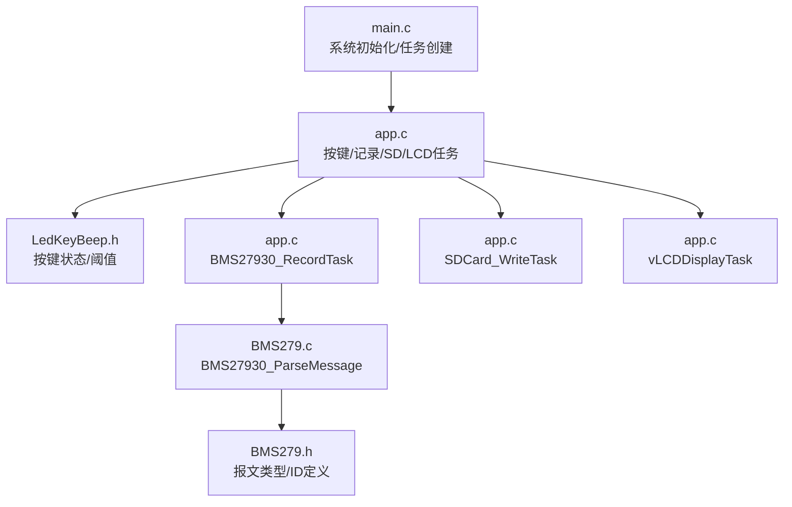
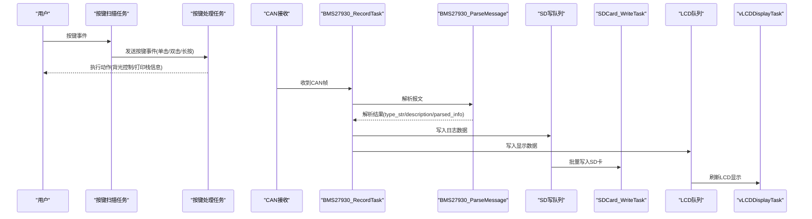
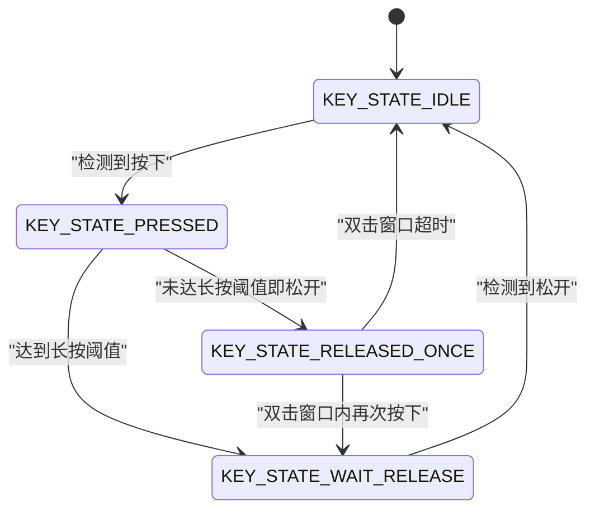
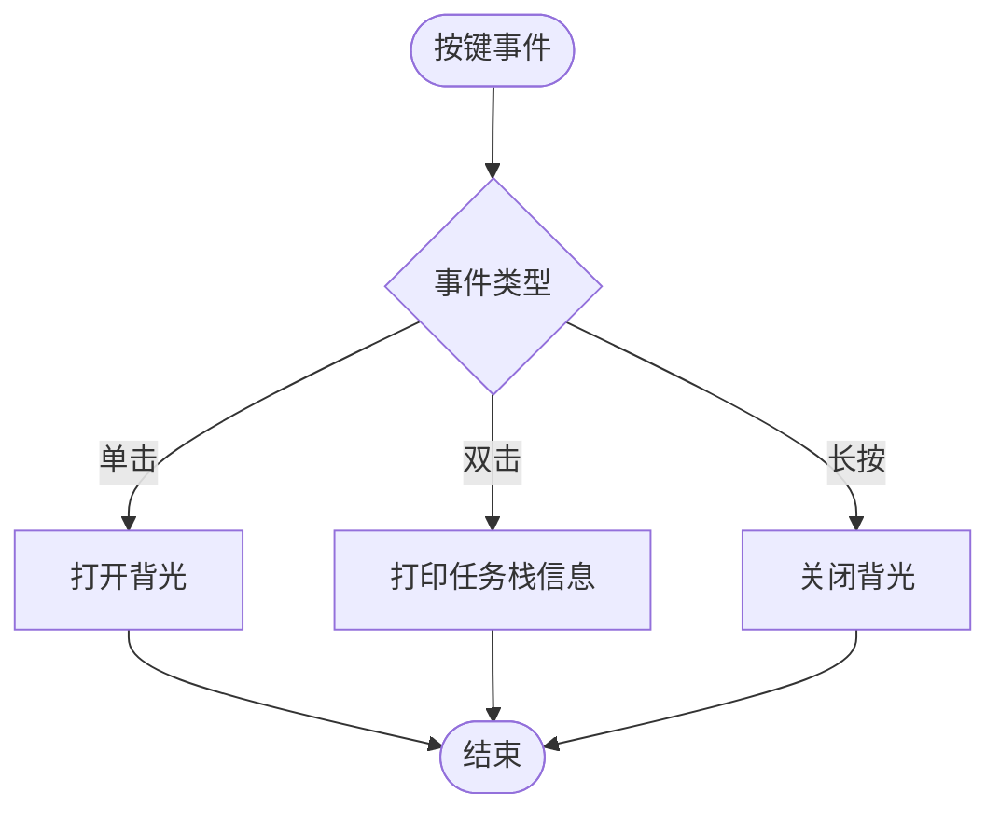
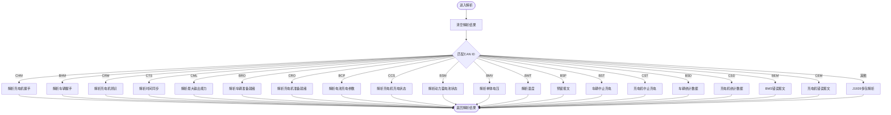
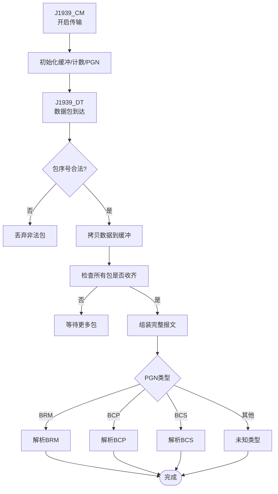
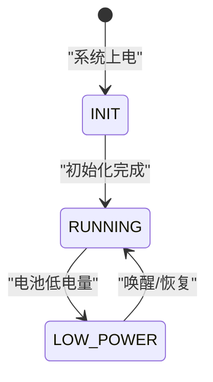
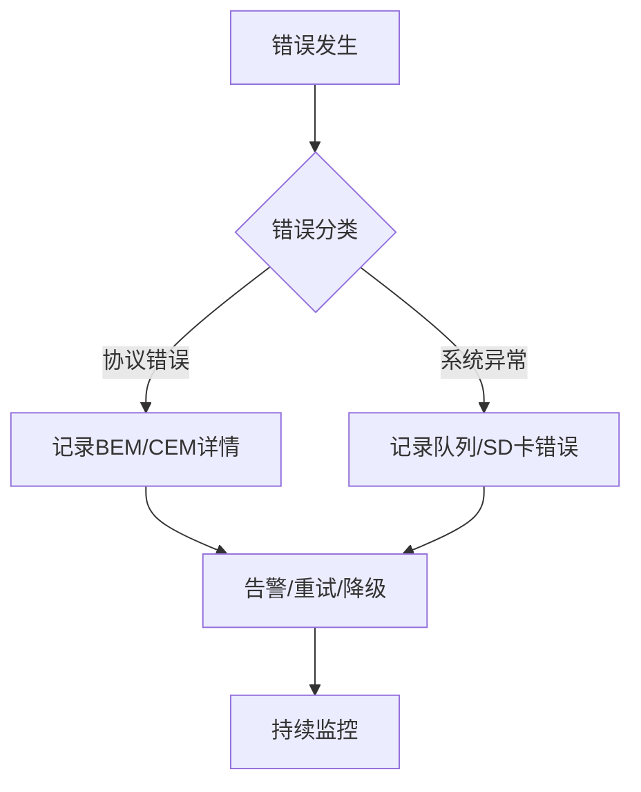
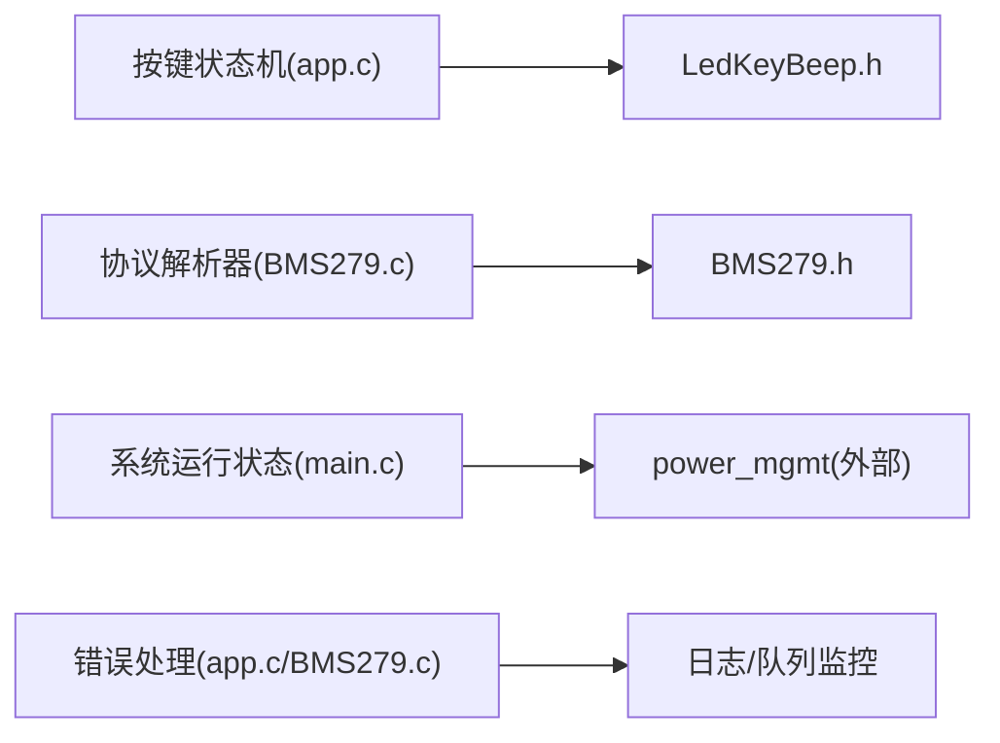

# 状态机设计

<cite>
**本文引用的文件**   
- [app.c](file://_gbk_backup/User/app.c)
- [LedKeyBeep.h](file://_gbk_backup/Driver/BSP/LedKeyBeep.h)
- [BMS279.h](file://_gbk_backup/User/BMS279.h)
- [BMS279.c](file://_gbk_backup/User/BMS279.c)
- [main.c](file://_gbk_backup/User/main.c)
</cite>

## 目录
1. [引言](#引言)
2. [项目结构](#项目结构)
3. [核心组件](#核心组件)
4. [架构总览](#架构总览)
5. [详细组件分析](#详细组件分析)
6. [依赖关系分析](#依赖关系分析)
7. [性能与实时性考虑](#性能与实时性考虑)
8. [故障诊断与测试方法](#故障诊断与测试方法)
9. [结论](#结论)

## 引言
本文件面向STM32 CAN Tracker的状态机设计，聚焦以下四类状态机：
- 按键状态机：实现短按、长按、双击检测及防抖/防重入。
- 协议解析状态机：基于GB/T 27930的报文类型分发与J1939多包组包解析。
- 系统运行状态机：初始化、正常运行、低功耗等运行模式切换。
- 错误处理状态机：异常检测、告警与恢复策略。

文档将给出状态转换图、触发条件、关键数据结构与流程，并提供调试与测试建议。

## 项目结构
本项目采用FreeRTOS任务化架构，关键路径如下：
- main.c：系统初始化、外设初始化、队列/互斥量创建、任务创建与调度启动。
- app.c：按键扫描与处理、LED定时回调、CAN记录任务、SD卡写入任务、LCD显示任务、任务工厂。
- LedKeyBeep.h：按键宏定义、按键状态枚举、周期与阈值常量。
- BMS279.h/.c：GB/T 27930协议解析接口与各报文类型的字段解析；J1939多包组包与PGN识别。

图表来源
- [main.c:34-60](file://_gbk_backup/User/main.c#L34-L60)
- [app.c:529-541](file://_gbk_backup/User/app.c#L529-L541)
- [BMS279.c:42-114](file://_gbk_backup/User/BMS279.c#L42-L114)
- [BMS279.h:21-44](file://_gbk_backup/User/BMS279.h#L21-L44)

章节来源
- [main.c:34-60](file://_gbk_backup/User/main.c#L34-L60)
- [app.c:529-541](file://_gbk_backup/User/app.c#L529-L541)

## 核心组件
- 按键状态机：在按键扫描任务中实现，使用有限状态机（FSM）区分空闲、按下、释放一次、等待释放四种状态，结合周期轮询与时间阈值完成单击、双击、长按判定。
- 协议解析器：根据CAN ID分派到具体报文解析函数，统一输出结构化结果；对J1939多包传输进行组包、校验与重组后解析。
- 系统运行状态机：由main.c初始化阶段与power_mgmt模块共同决定系统进入正常或低功耗模式；电池低电量触发低功耗。
- 错误处理状态机：通过BMS279错误报文解析与系统级日志/队列监控进行异常检测与告警。

章节来源
- [app.c:94-152](file://_gbk_backup/User/app.c#L94-L152)
- [LedKeyBeep.h:6-21](file://_gbk_backup/Driver/BSP/LedKeyBeep.h#L6-L21)
- [BMS279.c:42-114](file://_gbk_backup/User/BMS279.c#L42-L114)
- [BMS279.h:186-194](file://_gbk_backup/User/BMS279.h#L186-L194)
- [app.c:154-179](file://_gbk_backup/User/app.c#L154-L179)

## 架构总览
下图展示从按键输入、CAN数据接收、协议解析到存储与显示的端到端流程，以及各状态机的交互点。

图表来源
- [app.c:94-152](file://_gbk_backup/User/app.c#L94-L152)
- [app.c:200-309](file://_gbk_backup/User/app.c#L200-L309)
- [BMS279.c:42-114](file://_gbk_backup/User/BMS279.c#L42-L114)

## 详细组件分析

### 按键状态机
按键状态机包含四个状态：
- KEY_STATE_IDLE：等待按键按下。
- KEY_STATE_PRESSED：已检测到按下，开始计时，判断是否长按。
- KEY_STATE_RELEASED_ONCE：松开一次，等待是否在双击窗口内再次按下。
- KEY_STATE_WAIT_RELEASE：长按或双击后进入，防止立即重复触发，直到松开回到空闲。

关键参数：
- TASK_PERIOD_MS：扫描周期（20ms）。
- LONG_PRESS_TICKS：长按阈值（800ms）。
- DOUBLE_CLICK_TICKS：双击窗口（300ms）。

状态转换逻辑：
- 从IDLE到PRESSED：检测到按键有效电平。
- 从PRESSED到WAIT_RELEASE：达到长按阈值，触发长按事件。
- 从PRESSED到RELEASED_ONCE：未达长按阈值即松开。
- 从RELEASED_ONCE到WAIT_RELEASE：在双击窗口内再次按下，触发双击事件。
- 从RELEASED_ONCE到IDLE：双击窗口超时，触发单击事件。
- 从WAIT_RELEASE到IDLE：检测到松开。

图表来源
- [app.c:94-152](file://_gbk_backup/User/app.c#L94-L152)
- [LedKeyBeep.h:11-21](file://_gbk_backup/Driver/BSP/LedKeyBeep.h#L11-L21)

按键事件处理：
- 单击：点亮屏幕背光。
- 双击：打印任务栈使用情况。
- 长按：关闭屏幕背光。

图表来源
- [app.c:368-412](file://_gbk_backup/User/app.c#L368-L412)

章节来源
- [app.c:94-152](file://_gbk_backup/User/app.c#L94-L152)
- [app.c:368-412](file://_gbk_backup/User/app.c#L368-L412)
- [LedKeyBeep.h:6-21](file://_gbk_backup/Driver/BSP/LedKeyBeep.h#L6-L21)

### 协议解析状态机（GB/T 27930）
协议解析器以CAN ID为入口，分派到对应报文解析函数，统一填充ParseResult_t（type_str、description、parsed_info）。支持的主要报文包括CHM、BHM、CRM、CTS、CML、BRO、CRO、BCP、CCS、BSM、BMV、BMT、BSP、BST、CST、BSD、CSD、BEM、CEM等。

解析主流程：
- 清空解析结果。
- 根据CAN ID选择解析函数。
- 各解析函数负责长度检查、字段解码与格式化输出。

图表来源
- [BMS279.c:42-114](file://_gbk_backup/User/BMS279.c#L42-L114)
- [BMS279.h:21-44](file://_gbk_backup/User/BMS279.h#L21-L44)

J1939多包组包解析：
- 连接管理（CM）：开启传输，携带总字节数、包个数、PGN。
- 确认（CM_ACK）：确认接收或接收完成。
- 数据传送（DT）：按包序号写入缓冲区，完成后按PGN类型解析BRM/BCP/BCS等。

图表来源
- [BMS279.c:557-708](file://_gbk_backup/User/BMS279.c#L557-L708)

章节来源
- [BMS279.c:42-114](file://_gbk_backup/User/BMS279.c#L42-L114)
- [BMS279.c:557-708](file://_gbk_backup/User/BMS279.c#L557-L708)
- [BMS279.h:46-51](file://_gbk_backup/User/BMS279.h#L46-L51)

### 系统运行状态机
系统运行状态机由初始化阶段与电源管理共同驱动：
- 初始化状态：外设初始化、队列/互斥量创建、任务创建。
- 正常运行状态：按键、CAN记录、SD写入、LCD显示、Ymodem等任务并发运行。
- 低功耗状态：当VBAT低于阈值时进入低功耗模式，避免频繁唤醒。

图表来源
- [main.c:34-60](file://_gbk_backup/User/main.c#L34-L60)
- [app.c:154-179](file://_gbk_backup/User/app.c#L154-L179)

章节来源
- [main.c:34-60](file://_gbk_backup/User/main.c#L34-L60)
- [app.c:154-179](file://_gbk_backup/User/app.c#L154-L179)

### 错误处理状态机
错误处理主要来源于两类：
- 协议层错误：BEM/CEM报文中的接收超时、格式错误、其他错误标志。
- 系统层异常：队列满、SD卡写入失败、LCD队列拥塞等。

处理策略：
- 解析错误报文并输出详细信息。
- 对队列拥塞进行告警（如LCD队列使用率超过阈值）。
- 对SD卡写入失败进行日志记录。

图表来源
- [BMS279.c:515-552](file://_gbk_backup/User/BMS279.c#L515-L552)
- [app.c:263-305](file://_gbk_backup/User/app.c#L263-L305)

章节来源
- [BMS279.c:515-552](file://_gbk_backup/User/BMS279.c#L515-L552)
- [app.c:263-305](file://_gbk_backup/User/app.c#L263-L305)

## 依赖关系分析
- 按键状态机依赖LedKeyBeep.h中的宏与枚举，并在app.c中实现状态机逻辑。
- 协议解析器依赖BMS279.h定义的CAN ID与数据结构，BMS279.c实现具体解析。
- 系统运行状态机依赖main.c的初始化流程与power_mgmt的低功耗控制。
- 错误处理贯穿协议解析与系统任务，通过日志与队列监控反馈。

图表来源
- [app.c:94-152](file://_gbk_backup/User/app.c#L94-L152)
- [LedKeyBeep.h:6-21](file://_gbk_backup/Driver/BSP/LedKeyBeep.h#L6-L21)
- [BMS279.c:42-114](file://_gbk_backup/User/BMS279.c#L42-L114)
- [BMS279.h:21-44](file://_gbk_backup/User/BMS279.h#L21-L44)
- [main.c:34-60](file://_gbk_backup/User/main.c#L34-L60)

章节来源
- [app.c:94-152](file://_gbk_backup/User/app.c#L94-L152)
- [BMS279.c:42-114](file://_gbk_backup/User/BMS279.c#L42-L114)
- [main.c:34-60](file://_gbk_backup/User/main.c#L34-L60)

## 性能与实时性考虑
- 按键扫描周期为20ms，长按阈值800ms，双击窗口300ms，确保响应及时且不误判。
- CAN记录任务每100ms尝试接收一帧，减少阻塞；相同报文仅记录原始数据，不同报文才解析并格式化，降低CPU开销。
- SD卡写入任务采用扇区累积与超时写入策略，避免频繁IO损坏存储介质。
- LCD显示任务批量读取队列并按行缓存刷新，降低刷屏频率。

[本节为通用指导，不直接分析具体文件]

## 故障诊断与测试方法
- 按键测试：
  - 单击：观察背光开关。
  - 双击：打印任务列表与最小栈空间，验证任务健康度。
  - 长按：关闭背光，验证防重入逻辑。
- 协议解析测试：
  - 注入GB/T 27930典型报文（CHM/BHM/CRM/CTS/CML/BRO/CRO/BCP/CCS/BSM/BMV/BMT/BSP/BST/CST/BSD/CSD/BEM/CEM），核对type_str、description、parsed_info是否正确。
  - 注入J1939多包序列（CM→DT×N→CM_ACK），验证组包完整性与PGN类型解析。
- 系统运行测试：
  - 模拟低电量场景，验证低功耗模式进入与恢复。
- 错误处理测试：
  - 注入BEM/CEM错误报文，检查错误码解析与日志输出。
  - 压测LCD队列与SD队列，观察拥塞告警与丢包行为。

章节来源
- [app.c:368-412](file://_gbk_backup/User/app.c#L368-L412)
- [BMS279.c:42-114](file://_gbk_backup/User/BMS279.c#L42-L114)
- [BMS279.c:557-708](file://_gbk_backup/User/BMS279.c#L557-L708)
- [app.c:154-179](file://_gbk_backup/User/app.c#L154-L179)

## 结论
本设计通过清晰的按键状态机、健壮的GB/T 27930协议解析器、可配置的系统运行状态机与完善的错误处理机制，实现了STM32 CAN Tracker的高可靠性与可维护性。按键状态机提供直观的人机交互；协议解析器覆盖主流充电报文与J1939多包传输；系统运行状态机保证低功耗与正常模式的平滑切换；错误处理状态机确保异常可观测与可恢复。建议在后续迭代中增加更丰富的状态可视化与自动化测试用例，进一步提升稳定性与可测试性。