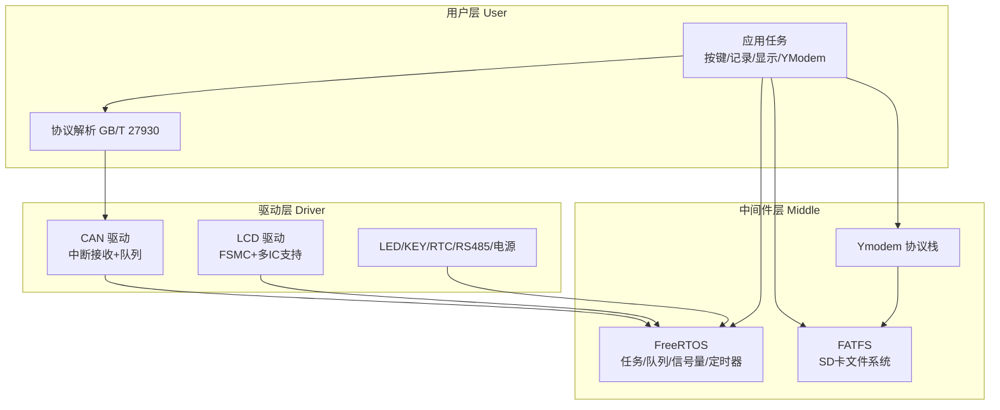
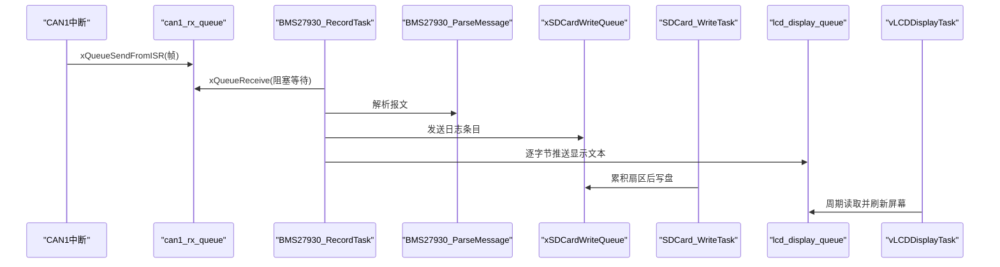
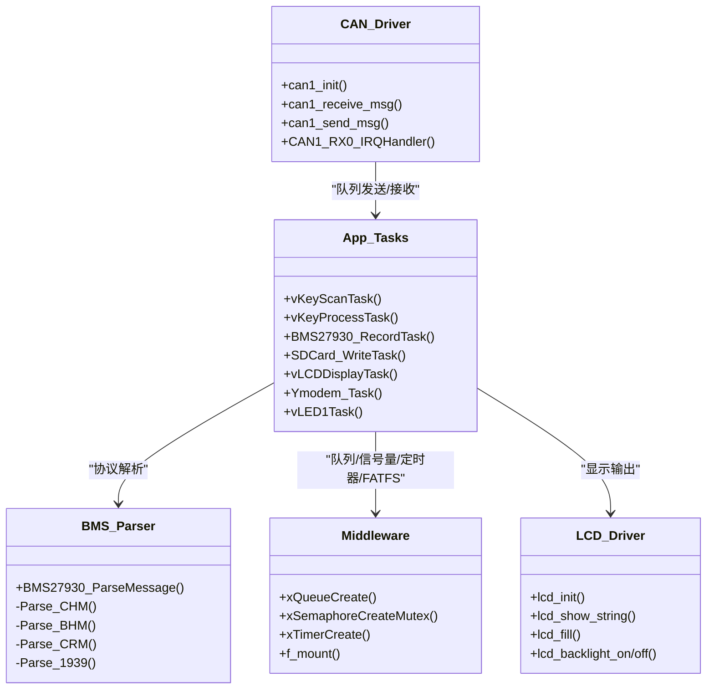

# 系统架构设计

<cite>
**本文引用的文件**   
- [main.c](file://_gbk_backup\User\main.c)
- [app.c](file://_gbk_backup\User\app.c)
- [app.h](file://_gbk_backup\User\app.h)
- [can.c](file://_gbk_backup\Driver\BSP\can.c)
- [can.h](file://_gbk_backup\Driver\BSP\can.h)
- [BMS279.c](file://_gbk_backup\User\BMS279.c)
- [BMS279.h](file://_gbk_backup\User\BMS279.h)
- [ymodem_protocol.c](file://_gbk_backup\User\ymodem_protocol.c)
- [ymodem_protocol.h](file://_gbk_backup\User\ymodem_protocol.h)
- [lcd.c](file://_gbk_backup\Driver\BSP\LCD\lcd.c)
- [lcd.h](file://_gbk_backup\Driver\BSP\LCD\lcd.h)
- [LedKeyBeep.c](file://_gbk_backup\Driver\BSP\LedKeyBeep.c)
- [LedKeyBeep.h](file://_gbk_backup\Driver\BSP\LedKeyBeep.h)
</cite>

## 目录
1. [引言](#引言)
2. [项目结构](#项目结构)
3. [核心组件](#核心组件)
4. [架构总览](#架构总览)
5. [详细组件分析](#详细组件分析)
6. [依赖关系分析](#依赖关系分析)
7. [性能与实时性](#性能与实时性)
8. [故障诊断与排错](#故障诊断与排错)
9. [结论](#结论)

## 引言
本文件为 STM32 CAN Tracker 系统的分层架构文档，面向硬件驱动层（Driver）、中间件层（Middle）与应用层（User），重点说明 FreeRTOS 任务调度、模块间通信机制、数据流路径、系统状态机与错误处理策略。该系统基于 STM32F407 + FreeRTOS，实现 CAN 总线数据采集、GB/T 27930 协议解析、SD 卡日志存储、串口 Ymodem 文件传输以及 LCD 显示输出。

## 项目结构
工程采用分层组织：
- Driver 层：外设驱动与 BSP，如 CAN、LCD、LED/Key、RTC、RS485、电源管理等。
- Middle 层：FreeRTOS 内核、队列/信号量、FATFS、内存管理、Ymodem 协议等。
- User 层：应用任务、协议解析、业务逻辑与系统集成。

图表来源
- [main.c:34-60](file://_gbk_backup\User\main.c#L34-L60)
- [app.c:529-541](file://_gbk_backup\User\app.c#L529-L541)
- [can.c:40-106](file://_gbk_backup\Driver\BSP\can.c#L40-L106)
- [lcd.c:593-800](file://_gbk_backup\Driver\BSP\LCD\lcd.c#L593-L800)

章节来源
- [main.c:34-60](file://_gbk_backup\User\main.c#L34-L60)
- [app.c:529-541](file://_gbk_backup\User\app.c#L529-L541)

## 核心组件
- CAN 驱动层：提供 CAN1 中断接收、扩展帧过滤、队列生产；CAN2 仅发送。
- 协议解析层：GB/T 27930 报文按 ID 分发到具体解析器，并支持 J1939 多包组包。
- 应用任务层：按键扫描与处理、BMS 记录任务、SD 卡写入任务、LCD 显示任务、Ymodem 任务、LED 定时任务。
- 中间件层：FreeRTOS 任务调度、队列/信号量同步、FATFS 文件系统、Ymodem 协议栈。
- 显示与交互层：LCD 刷新、串口命令交互、按键事件、LED 指示。

章节来源
- [can.c:40-106](file://_gbk_backup\Driver\BSP\can.c#L40-L106)
- [BMS279.c:42-114](file://_gbk_backup\User\BMS279.c#L42-L114)
- [app.c:94-152](file://_gbk_backup\User\app.c#L94-L152)
- [app.c:201-309](file://_gbk_backup\User\app.c#L201-L309)
- [app.c:313-366](file://_gbk_backup\User\app.c#L313-L366)
- [app.c:454-521](file://_gbk_backup\User\app.c#L454-L521)
- [ymodem_protocol.c:711-748](file://_gbk_backup\User\ymodem_protocol.c#L711-L748)

## 架构总览
系统以 FreeRTOS 为核心调度器，各任务通过队列和信号量进行解耦通信。CAN 中断作为高优先级生产者，将报文推入队列；BMS 记录任务消费报文，完成协议解析后分别写入 SD 卡与 LCD 显示；Ymodem 任务负责串口命令与文件传输；LCD 任务周期性刷新显示。

图表来源
- [can.c:186-224](file://_gbk_backup\Driver\BSP\can.c#L186-L224)
- [app.c:201-309](file://_gbk_backup\User\app.c#L201-L309)
- [app.c:313-366](file://_gbk_backup\User\app.c#L313-L366)
- [app.c:454-521](file://_gbk_backup\User\app.c#L454-L521)

## 详细组件分析

### 硬件驱动层（Driver）
- CAN 驱动
  - CAN1 初始化配置 GPIO、时钟、过滤器、NVIC 中断，启用 FIFO0 接收中断。
  - 中断服务函数从 FIFO 读取报文，封装为自定义帧结构并通过 FromISR 版本队列发送。
  - 提供 can1_receive_msg 供任务阻塞/非阻塞读取。
  - CAN2 仅初始化与发送，用于测试或回环。
- LCD 驱动
  - FSMC 驱动 TFT LCD，支持多种驱动 IC（ILI9341/ST7789/ST7796/NT35310/SSD1963/ILI9806）。
  - 提供显示方向、窗口设置、画点/线/矩形、字符串显示、背光控制等接口。
- LED/Key/RTC/RS485/电源管理
  - LED 控制翻转与开关。
  - Key 扫描使用状态机识别单击、双击、长按。
  - RTC 提供时间戳与日期时间设置。
  - RS485 与电源管理用于低功耗与外部通信扩展。

章节来源
- [can.c:40-106](file://_gbk_backup\Driver\BSP\can.c#L40-L106)
- [can.c:186-224](file://_gbk_backup\Driver\BSP\can.c#L186-L224)
- [can.c:245-303](file://_gbk_backup\Driver\BSP\can.c#L245-L303)
- [lcd.c:593-800](file://_gbk_backup\Driver\BSP\LCD\lcd.c#L593-L800)
- [LedKeyBeep.c:6-42](file://_gbk_backup\Driver\BSP\LedKeyBeep.c#L6-L42)
- [LedKeyBeep.c:53-68](file://_gbk_backup\Driver\BSP\LedKeyBeep.c#L53-L68)

### 中间件层（Middle）
- FreeRTOS
  - 任务创建与调度：按键扫描、按键处理、BMS 记录、SD 卡写入、Ymodem、LCD 显示、LED 定时。
  - 队列：can1_rx_queue、xSDCardWriteQueue、lcd_display_queue、ymodem_rx_queue。
  - 信号量：xSDCardMutex 保护 FATFS 访问。
  - 定时器：软件定时器驱动 LED 闪烁与电池电量检测。
- FATFS
  - 挂载 SD 卡，提供 f_open/f_write/f_close 等接口。
- Ymodem 协议栈
  - 实现 CRC16、数据包发送、ACK/NAK/CRC 模式握手、文件信息包与数据块传输。
  - 提供命令行交互（help/ls/cd/pwd/get/settime/exit）。

章节来源
- [app.c:529-541](file://_gbk_backup\User\app.c#L529-L541)
- [app.c:415-450](file://_gbk_backup\User\app.c#L415-L450)
- [ymodem_protocol.c:36-82](file://_gbk_backup\User\ymodem_protocol.c#L36-L82)
- [ymodem_protocol.c:125-191](file://_gbk_backup\User\ymodem_protocol.c#L125-L191)
- [ymodem_protocol.c:303-428](file://_gbk_backup\User\ymodem_protocol.c#L303-L428)
- [ymodem_protocol.c:589-685](file://_gbk_backup\User\ymodem_protocol.c#L589-L685)

### 应用层（User）
- 按键扫描与处理
  - vKeyScanTask 使用状态机识别单击、双击、长按，并将键值发送到 xKeyQueue。
  - vKeyProcessTask 消费键值，执行背光开关与任务栈打印。
- BMS 记录任务
  - 从 can1_receive_msg 获取报文，比较是否重复帧，重复则仅记录原始数据，不同则调用 BMS27930_ParseMessage 解析。
  - 将日志写入 xSDCardWriteQueue，同时将显示文本逐字节推送到 lcd_display_queue。
- SD 卡写入任务
  - 累积缓冲区至 512 字节或超时（默认 60s）后写盘，避免频繁写入损坏 SD 卡。
  - 使用 xSDCardMutex 保护 FATFS 操作。
- LCD 显示任务
  - 每 100ms 批量读取 lcd_display_queue，解析行缓存并刷新 LCD。
- Ymodem 任务
  - 从 ymodem_rx_queue 读取字符，回显并解析命令，触发 get 下载文件。
- LED 定时任务
  - 软件定时器回调中翻转 LED，读取 VBAT，低电量时进入低功耗模式。

章节来源
- [app.c:94-152](file://_gbk_backup\User\app.c#L94-L152)
- [app.c:369-412](file://_gbk_backup\User\app.c#L369-L412)
- [app.c:201-309](file://_gbk_backup\User\app.c#L201-L309)
- [app.c:313-366](file://_gbk_backup\User\app.c#L313-L366)
- [app.c:454-521](file://_gbk_backup\User\app.c#L454-L521)
- [ymodem_protocol.c:711-748](file://_gbk_backup\User\ymodem_protocol.c#L711-L748)
- [app.c:155-198](file://_gbk_backup\User\app.c#L155-L198)

## 依赖关系分析
- 任务与队列
  - CAN1 中断 → can1_rx_queue → BMS27930_RecordTask
  - BMS27930_RecordTask → xSDCardWriteQueue → SDCard_WriteTask
  - BMS27930_RecordTask → lcd_display_queue → vLCDDisplayTask
  - USART1 中断/轮询 → ymodem_rx_queue → Ymodem_Task
- 互斥量
  - xSDCardMutex 保护 FATFS 的打开、读写、关闭操作，避免多任务并发访问导致文件系统损坏。
- 定时器
  - 软件定时器驱动 LED 与电池电量检测，回调中可触发低功耗模式。

图表来源
- [can.c:40-106](file://_gbk_backup\Driver\BSP\can.c#L40-L106)
- [BMS279.c:42-114](file://_gbk_backup\User\BMS279.c#L42-L114)
- [app.c:529-541](file://_gbk_backup\User\app.c#L529-L541)
- [lcd.c:593-800](file://_gbk_backup\Driver\BSP\LCD\lcd.c#L593-L800)

章节来源
- [can.c:40-106](file://_gbk_backup\Driver\BSP\can.c#L40-L106)
- [BMS279.c:42-114](file://_gbk_backup\User\BMS279.c#L42-L114)
- [app.c:529-541](file://_gbk_backup\User\app.c#L529-L541)
- [lcd.c:593-800](file://_gbk_backup\Driver\BSP\LCD\lcd.c#L593-L800)

## 性能与实时性
- 中断优先级
  - CAN1 中断抢占优先级设置为 5，符合 FreeRTOS 要求，确保及时响应 CAN 报文。
- 队列深度与丢包
  - can1_rx_queue 深度为 10，若队列满会丢弃报文并计数丢包；建议在高负载场景下增大队列深度或提高消费任务优先级。
- SD 卡写入策略
  - 累积 512 字节或 60s 无新数据才写盘，降低频繁 I/O 对 SD 卡的磨损。
- LCD 刷新频率
  - 每 100ms 批量刷新一次，减少刷屏开销；若数据过快可能丢失，可通过增大 lcd_display_queue 缓冲缓解。
- 任务栈监控
  - 提供任务列表与最小栈空间打印，便于评估栈溢出风险。

章节来源
- [can.c:95-106](file://_gbk_backup\Driver\BSP\can.c#L95-L106)
- [can.h:18-18](file://_gbk_backup\Driver\BSP\can.h#L18-L18)
- [app.c:313-366](file://_gbk_backup\User\app.c#L313-L366)
- [app.c:454-521](file://_gbk_backup\User\app.c#L454-L521)
- [app.c:74-91](file://_gbk_backup\User\app.c#L74-L91)

## 故障诊断与排错
- CAN 丢包
  - 检查 can1_rx_queue 是否频繁满；必要时增加队列深度或提升 BMS 记录任务优先级。
- SD 卡写入失败
  - 确认 xSDCardMutex 是否正确创建与释放；检查 FATFS 挂载是否成功；查看 f_open/f_write 返回码。
- LCD 显示异常
  - 检查 lcd_display_queue 是否积压过多；调整刷新周期或增大缓冲；确认 LCD 初始化与方向设置正确。
- Ymodem 传输失败
  - 确认串口队列 ymodem_rx_queue 可用；检查 ACK/NAK/CRC 握手流程；验证目标设备端 Ymodem 接收程序。
- 低功耗模式未触发
  - 检查 ADC 读取与阈值判断逻辑；确认 enter_low_power_mode 实现与唤醒源配置。

章节来源
- [can.c:186-224](file://_gbk_backup\Driver\BSP\can.c#L186-L224)
- [app.c:35-71](file://_gbk_backup\User\app.c#L35-L71)
- [app.c:415-450](file://_gbk_backup\User\app.c#L415-L450)
- [app.c:454-521](file://_gbk_backup\User\app.c#L454-L521)
- [ymodem_protocol.c:303-428](file://_gbk_backup\User\ymodem_protocol.c#L303-L428)
- [app.c:155-179](file://_gbk_backup\User\app.c#L155-L179)

## 结论
STM32 CAN Tracker 系统通过清晰的三层架构与 FreeRTOS 任务调度，实现了 CAN 数据采集、协议解析、持久化存储与可视化显示的完整链路。模块间通过队列与信号量解耦，提升了系统的可扩展性与稳定性。针对高频 CAN 报文与 SD 卡 I/O，系统采用了队列缓冲与扇区累积策略，有效平衡了实时性与可靠性。未来可在以下方面进一步优化：
- 动态调整队列深度与任务优先级以适应不同负载场景。
- 引入环形缓冲区与零拷贝优化，减少内存拷贝开销。
- 增强错误恢复与自诊断能力，提供更完善的运行状态上报。