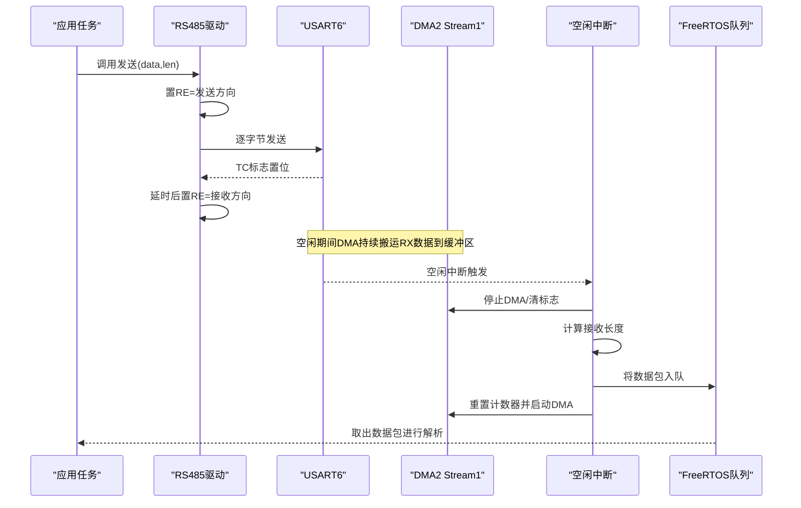
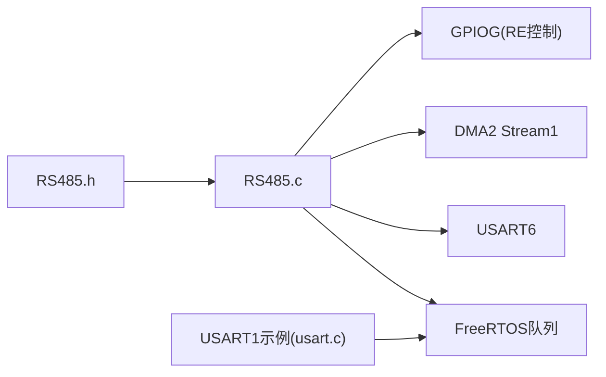
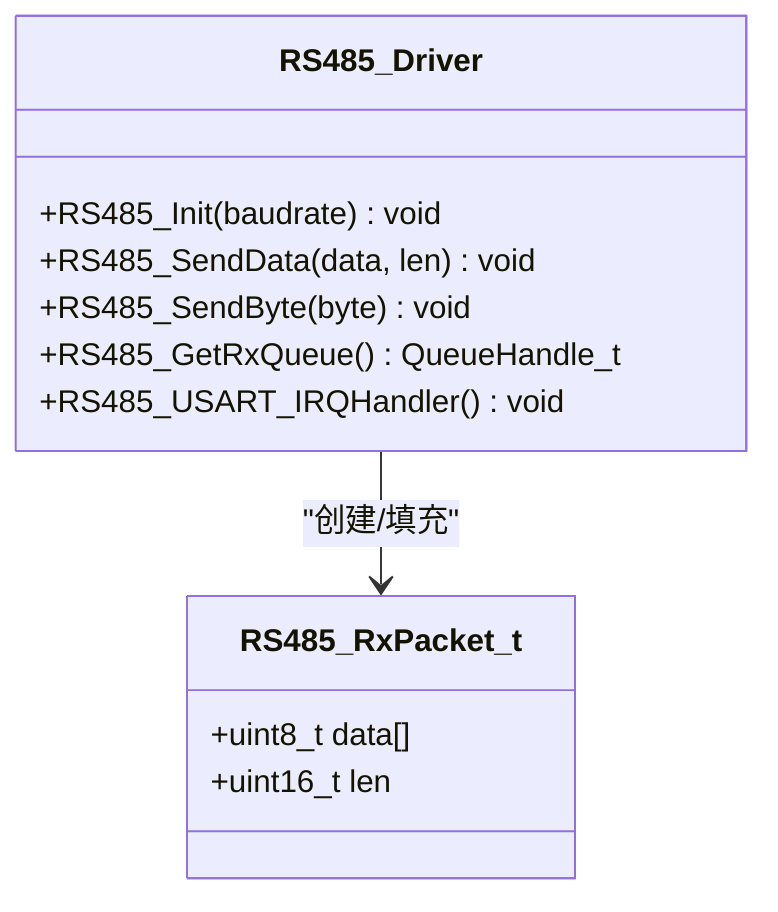
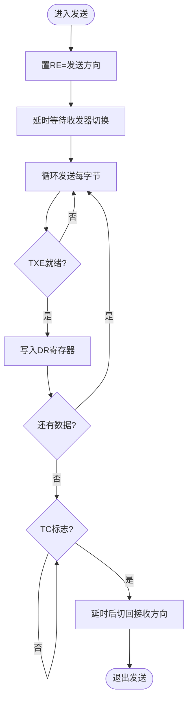

# RS485通信接口

<cite>
**本文引用的文件**   
- [RS485.c](file://_gbk_backup/Driver/BSP/RS485.c)
- [RS485.h](file://_gbk_backup/Driver/BSP/RS485.h)
- [usart.c](file://_gbk_backup/Driver/SYSTEM/usart.c)
- [usart.h](file://_gbk_backup/Driver/SYSTEM/usart.h)
</cite>

## 目录
1. [简介](#简介)
2. [项目结构](#项目结构)
3. [核心组件](#核心组件)
4. [架构总览](#架构总览)
5. [详细组件分析](#详细组件分析)
6. [依赖关系分析](#依赖关系分析)
7. [性能与实时性](#性能与实时性)
8. [故障排查指南](#故障排查指南)
9. [结论](#结论)
10. [附录](#附录)

## 简介
本技术文档围绕工程中的RS485通信实现，系统化说明硬件接口配置、半双工方向控制、DMA+空闲中断接收机制、FreeRTOS队列数据流、以及面向多节点网络的拓扑与帧格式建议。同时给出时序控制要点、冲突检测与错误恢复策略、布线与EMC注意事项，帮助读者在现有代码基础上扩展出稳定可靠的RS485多点通信系统。

## 项目结构
本项目基于STM32F4系列，使用USART6作为RS485物理通道，结合DMA与空闲中断完成高效接收；通过GPIO控制RE引脚实现半双工收发切换；接收数据经FreeRTOS队列上送应用层处理。

```mermaid
graph TB
subgraph "MCU外设"
USART6["USART6"]
DMA2S1["DMA2 Stream1"]
GPIOG["GPIOG(复用TX/RX, RE控制)"]
end
subgraph "驱动层"
RS485Drv["RS485驱动<br/>初始化/发送/中断处理"]
Queue["FreeRTOS队列"]
end
subgraph "应用层"
AppTask["应用任务<br/>解析/业务处理"]
end
subgraph "物理层"
RS485Bus["RS485总线(T+/T-)"]
Nodes["从节点(地址化)"]
end
USART6 < --> DMA2S1
USART6 < --> GPIOG
RS485Drv --> USART6
RS485Drv --> DMA2S1
RS485Drv --> Queue
Queue --> AppTask
RS485Drv --> RS485Bus
RS485Bus --> Nodes
```

图表来源
- [RS485.c:15-102](file://_gbk_backup/Driver/BSP/RS485.c#L15-L102)
- [RS485.c:160-198](file://_gbk_backup/Driver/BSP/RS485.c#L160-L198)
- [RS485.h:8-33](file://_gbk_backup/Driver/BSP/RS485.h#L8-L33)

章节来源
- [RS485.c:15-102](file://_gbk_backup/Driver/BSP/RS485.c#L15-L102)
- [RS485.h:8-33](file://_gbk_backup/Driver/BSP/RS485.h#L8-L33)

## 核心组件
- RS485硬件抽象与驱动：封装USART6、DMA、NVIC、GPIO方向控制，提供初始化、发送、接收队列获取等API。
- FreeRTOS队列：ISR中打包数据包并投递到队列，应用任务消费。
- 串口通用示例（USART1）：展示DMA+空闲中断的通用用法，便于参考移植。

关键职责
- 初始化：时钟使能、GPIO复用、USART参数、DMA通道、NVIC优先级、默认接收模式。
- 发送：置RE为发送方向，延时等待芯片切换，轮询发送字节，等待TC后切回接收。
- 接收：空闲中断触发，停止DMA，计算长度，拷贝至包结构，入队，重启DMA。

章节来源
- [RS485.c:15-102](file://_gbk_backup/Driver/BSP/RS485.c#L15-L102)
- [RS485.c:110-135](file://_gbk_backup/Driver/BSP/RS485.c#L110-L135)
- [RS485.c:160-198](file://_gbk_backup/Driver/BSP/RS485.c#L160-L198)
- [RS485.h:8-43](file://_gbk_backup/Driver/BSP/RS485.h#L8-L43)

## 架构总览
下图展示一次完整的数据收发流程，包括方向切换、DMA搬运、空闲中断、队列投递与应用消费。



图表来源
- [RS485.c:110-135](file://_gbk_backup/Driver/BSP/RS485.c#L110-L135)
- [RS485.c:160-198](file://_gbk_backup/Driver/BSP/RS485.c#L160-L198)

## 详细组件分析

### 硬件接口与半双工方向控制
- 引脚定义
  - TX/RX：复用功能映射到USART6
  - RE：GPIO输出，用于控制RS485收发方向
- 方向控制宏
  - 发送：置RE高电平
  - 接收：拉低RE
- 默认状态
  - 初始化完成后默认处于接收模式，避免误发占用总线

注意
- 发送前需保证RE已切换到发送方向，并在发送结束后切回接收方向，避免总线冲突。
- 当前实现采用软件延时作为切换缓冲，实际产品建议根据RS485收发器数据手册设置精确延时或测量切换时间。

章节来源
- [RS485.h:8-33](file://_gbk_backup/Driver/BSP/RS485.h#L8-L33)
- [RS485.c:27-49](file://_gbk_backup/Driver/BSP/RS485.c#L27-L49)
- [RS485.c:110-135](file://_gbk_backup/Driver/BSP/RS485.c#L110-L135)

### 数据帧格式定义（建议）
当前驱动仅负责原始字节收发，未内置协议解析。建议在应用层实现如下帧格式，以支持多节点主从通信：

字段
- 起始符：固定值，用于帧同步
- 地址字段：1字节，区分主/从设备
- 命令/功能码：1字节，标识操作类型
- 数据长度：1字节，后续数据区长度
- 数据区：可变长度
- 校验码：1字节，如CRC8或累加和
- 结束符：固定值，用于帧尾识别

复杂度
- 解析时间复杂度O(n)，n为帧长
- 空间复杂度O(m)，m为最大帧长（由缓冲区决定）

建议
- 起始/结束符选择不易出现在数据区的特殊字节
- 校验码推荐CRC8以提升抗干扰能力
- 帧长上限受RS485_RX_BUF_SIZE限制，需合理设置

章节来源
- [RS485.h:35-43](file://_gbk_backup/Driver/BSP/RS485.h#L35-L43)

### 通信时序控制与总线仲裁
- 发送时序
  - 置RE=发送方向
  - 短延时确保收发器切换完成
  - 逐字节发送，等待TXE
  - 等待TC标志，再延时后切回接收方向
- 接收时序
  - DMA持续搬运，空闲中断指示一帧结束
  - ISR内停止DMA、清标志、计算长度、拷贝数据、入队、重启DMA
- 总线仲裁
  - 当前实现未包含硬件仲裁，属于主从轮询模型
  - 建议主节点按地址轮询，从节点仅在被寻址时响应
  - 若需竞争访问，可在应用层实现带退避的轮询/令牌机制

章节来源
- [RS485.c:110-135](file://_gbk_backup/Driver/BSP/RS485.c#L110-L135)
- [RS485.c:160-198](file://_gbk_backup/Driver/BSP/RS485.c#L160-L198)

### 多点通信的冲突检测与错误恢复
- 冲突检测
  - 由于RS485为半双工，同一时刻只能有一个节点发送
  - 主从轮询可避免冲突；若存在自发起主动上报，需在应用层增加“忙”状态与重试退避
- 错误恢复
  - 帧校验失败：丢弃帧，记录错误计数，必要时复位状态机
  - 超时：对无响应的从节点跳过，继续轮询其他节点
  - 缓冲区溢出：增大RS485_RX_BUF_SIZE或提高队列容量，优化应用层消费速度

章节来源
- [RS485.c:160-198](file://_gbk_backup/Driver/BSP/RS485.c#L160-L198)
- [RS485.h:35-43](file://_gbk_backup/Driver/BSP/RS485.h#L35-L43)

### 网络拓扑与地址分配策略
- 拓扑
  - 单总线星型/手拉手拓扑均可，但应避免环形
  - 总线两端各接一个终端电阻（典型120Ω），抑制反射
- 地址分配
  - 每个从节点唯一地址（1字节）
  - 主节点维护地址表，支持在线发现或静态配置
  - 预留广播地址（如0x00或0xFF）用于统一配置

章节来源
- [RS485.h:35-43](file://_gbk_backup/Driver/BSP/RS485.h#L35-L43)

### 布线规范与电磁兼容性（EMC）
- 线缆
  - 使用双绞线，尽量短距离布线
  - 避免与强电线路平行走线
- 终端匹配
  - 总线两端各接120Ω终端电阻
- 接地与屏蔽
  - 屏蔽层单点接地，避免地环路
  - 设备共地良好，减少共模噪声
- 滤波与保护
  - 端口加TVS/ESD保护
  - 必要时加磁珠/RC滤波

[本节为通用工程实践，不直接分析具体代码文件]

## 依赖关系分析


图表来源
- [RS485.h:1-51](file://_gbk_backup/Driver/BSP/RS485.h#L1-L51)
- [RS485.c:1-199](file://_gbk_backup/Driver/BSP/RS485.c#L1-L199)
- [usart.c:1-302](file://_gbk_backup/Driver/SYSTEM/usart.c#L1-L302)

章节来源
- [RS485.h:1-51](file://_gbk_backup/Driver/BSP/RS485.h#L1-L51)
- [RS485.c:1-199](file://_gbk_backup/Driver/BSP/RS485.c#L1-L199)
- [usart.c:1-302](file://_gbk_backup/Driver/SYSTEM/usart.c#L1-L302)

## 性能与实时性
- 接收路径
  - DMA搬运降低CPU负载
  - 空闲中断一次性处理整帧，减少中断次数
- 发送路径
  - 当前为阻塞式逐字节发送，适合小帧；大数据量建议改为DMA发送
- 队列
  - 队列深度有限，需确保应用任务及时消费，避免溢出
- 中断优先级
  - NVIC优先级已配置，可根据系统任务调整，确保关键路径优先

优化建议
- 发送改用DMA，减少CPU占用
- 接收采用双缓冲或环形缓冲，提升吞吐
- 应用层批量处理，减少频繁上下文切换

章节来源
- [RS485.c:110-135](file://_gbk_backup/Driver/BSP/RS485.c#L110-L135)
- [RS485.c:160-198](file://_gbk_backup/Driver/BSP/RS485.c#L160-L198)
- [usart.c:101-166](file://_gbk_backup/Driver/SYSTEM/usart.c#L101-L166)

## 故障排查指南
常见问题与定位
- 无法接收
  - 检查RE是否处于接收方向
  - 确认USART空闲中断与DMA已启用
  - 核对DMA通道、Stream、Channel配置
- 接收数据错乱
  - 检查帧校验与起止符
  - 确认终端电阻与布线质量
- 发送后总线异常
  - 检查发送前后RE切换顺序与时序
  - 避免多个节点同时发送

调试步骤
- 使用逻辑分析仪抓取RE控制信号与TX波形
- 打印队列入队/出队事件，观察数据流
- 逐步缩小问题范围：先单节点自环测试，再接入总线

章节来源
- [RS485.c:110-135](file://_gbk_backup/Driver/BSP/RS485.c#L110-L135)
- [RS485.c:160-198](file://_gbk_backup/Driver/BSP/RS485.c#L160-L198)

## 结论
该工程实现了基于USART6+DMA+空闲中断的RS485基础驱动，具备稳定的半双工收发能力，并通过FreeRTOS队列解耦ISR与应用层。在此基础上，建议完善应用层帧协议、主从轮询与错误恢复机制，并结合终端匹配与EMC设计，构建可靠的多点RS485网络。

[本节为总结性内容，不直接分析具体代码文件]

## 附录

### 类图（驱动数据结构）


图表来源
- [RS485.h:39-43](file://_gbk_backup/Driver/BSP/RS485.h#L39-L43)
- [RS485.c:15-102](file://_gbk_backup/Driver/BSP/RS485.c#L15-L102)
- [RS485.c:110-135](file://_gbk_backup/Driver/BSP/RS485.c#L110-L135)
- [RS485.c:160-198](file://_gbk_backup/Driver/BSP/RS485.c#L160-L198)

### 流程图（发送时序）


图表来源
- [RS485.c:110-135](file://_gbk_backup/Driver/BSP/RS485.c#L110-L135)