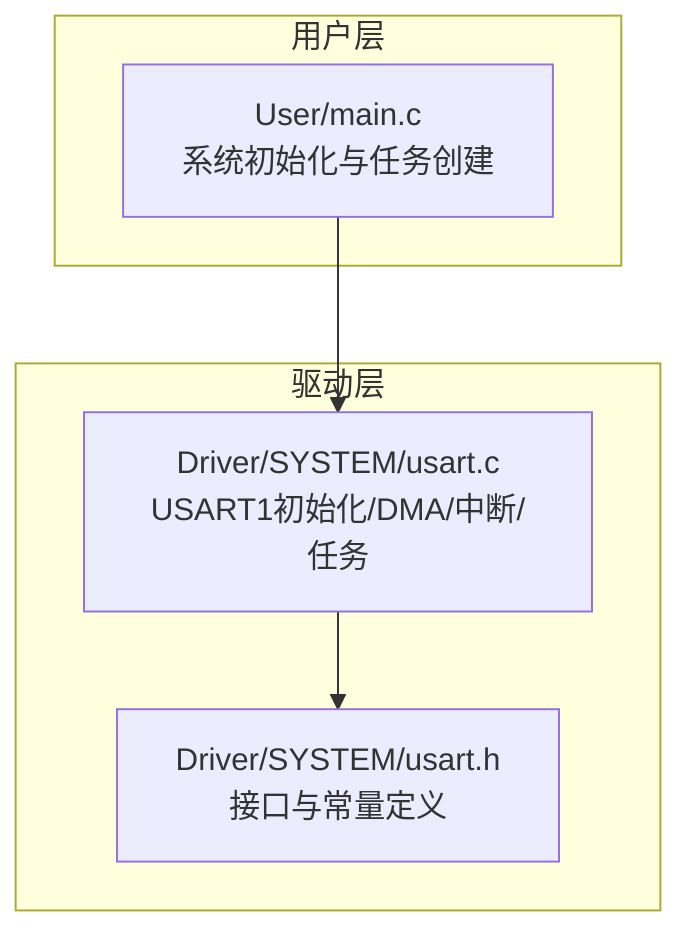
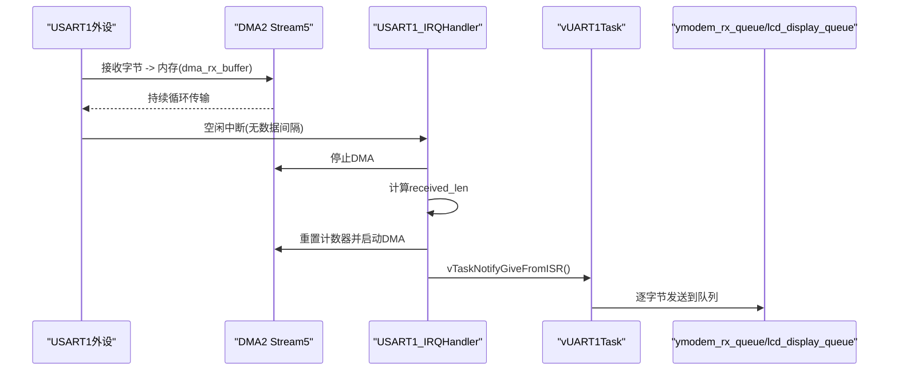
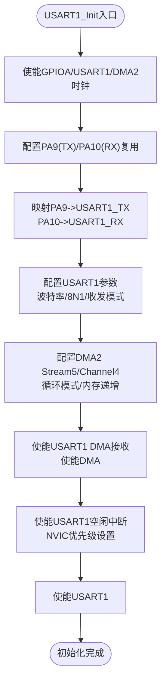
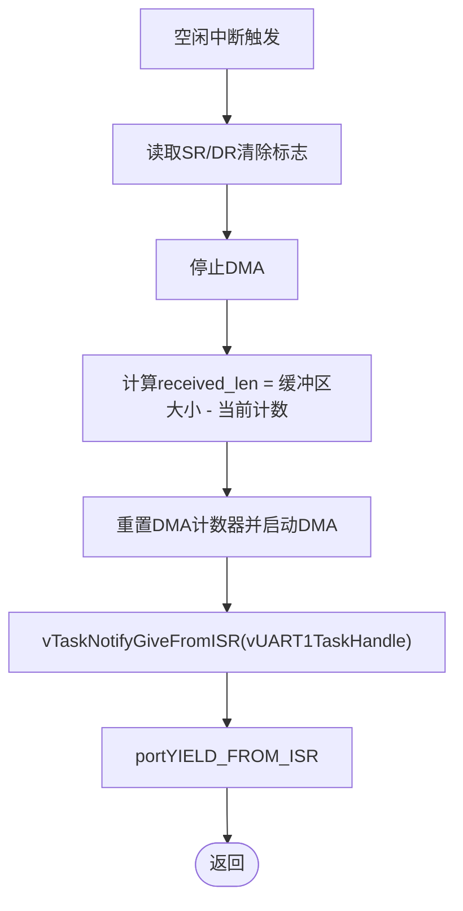
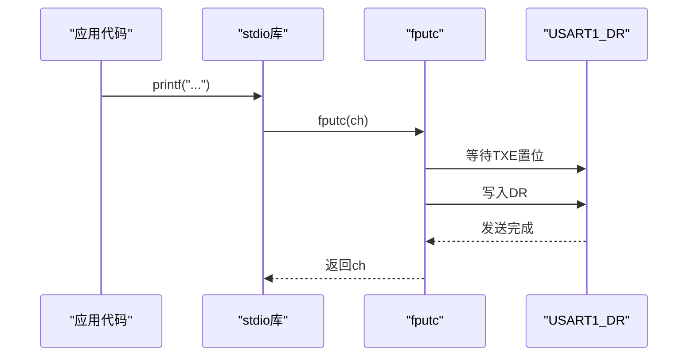
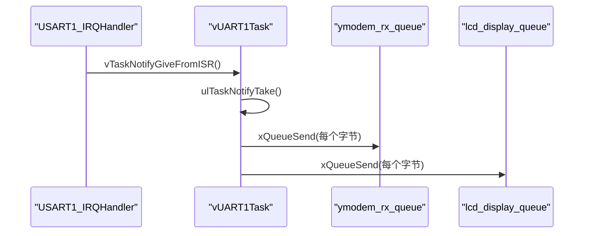
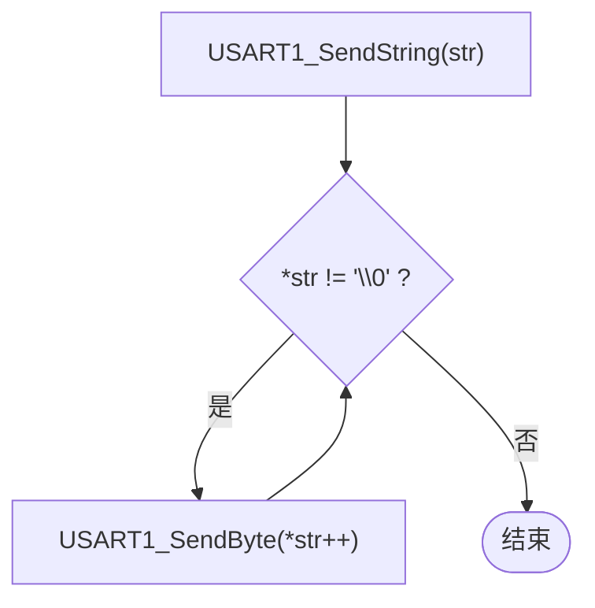
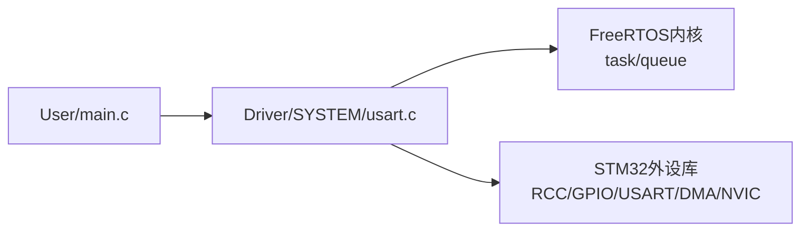

# UART串口通信

<cite>
**本文引用的文件**   
- [usart.c](file://_gbk_backup/Driver/SYSTEM/usart.c)
- [usart.h](file://_gbk_backup/Driver/SYSTEM/usart.h)
- [main.c](file://_gbk_backup/User/main.c)
</cite>

## 目录
1. [简介](#简介)
2. [项目结构](#项目结构)
3. [核心组件](#核心组件)
4. [架构总览](#架构总览)
5. [详细组件分析](#详细组件分析)
6. [依赖关系分析](#依赖关系分析)
7. [性能考虑](#性能考虑)
8. [故障排除指南](#故障排除指南)
9. [结论](#结论)
10. [附录：API与配置参考](#附录api与配置参考)

## 简介
本技术文档围绕STM32F407的USART1串口通信实现，重点说明以下方面：
- USART1初始化配置：波特率、GPIO引脚映射、DMA通道配置、中断优先级
- DMA接收机制：循环缓冲区模式、空闲中断处理、数据长度计算
- printf重定向：支持调试输出
- 串口任务处理流程：中断服务函数、FreeRTOS任务通知、数据队列管理
- API使用：发送单字节与字符串
- 性能优化建议与常见故障排除方法

## 项目结构
本项目中与UART串口通信直接相关的代码位于驱动层与用户层：
- 驱动层：SYSTEM/usart.c、SYSTEM/usart.h
- 用户层：User/main.c（系统初始化与任务创建）

图表来源
- [main.c:34-59](file://_gbk_backup/User/main.c#L34-L59)
- [usart.c:101-166](file://_gbk_backup/Driver/SYSTEM/usart.c#L101-L166)
- [usart.h:13-27](file://_gbk_backup/Driver/SYSTEM/usart.h#L13-L27)

章节来源
- [main.c:34-59](file://_gbk_backup/User/main.c#L34-L59)
- [usart.c:101-166](file://_gbk_backup/Driver/SYSTEM/usart.c#L101-L166)
- [usart.h:13-27](file://_gbk_backup/Driver/SYSTEM/usart.h#L13-L27)

## 核心组件
- USART1初始化：时钟使能、GPIO复用、USART参数、DMA接收、空闲中断、NVIC优先级、USART使能
- DMA接收：DMA2 Stream5 Channel4，循环模式，内存递增，外设地址固定
- 空闲中断处理：清除标志、停止DMA、计算接收长度、重启DMA、任务通知
- FreeRTOS任务：vUART1Task通过任务通知获取数据并转发到队列
- printf重定向：fputc重写，输出到USART1
- 发送API：USART1_SendByte、USART1_SendString

章节来源
- [usart.c:101-166](file://_gbk_backup/Driver/SYSTEM/usart.c#L101-L166)
- [usart.c:184-205](file://_gbk_backup/Driver/SYSTEM/usart.c#L184-L205)
- [usart.c:268-283](file://_gbk_backup/Driver/SYSTEM/usart.c#L268-L283)
- [usart.c:83-90](file://_gbk_backup/Driver/SYSTEM/usart.c#L83-L90)
- [usart.c:285-301](file://_gbk_backup/Driver/SYSTEM/usart.c#L285-L301)
- [usart.h:13-27](file://_gbk_backup/Driver/SYSTEM/usart.h#L13-L27)

## 架构总览
下图展示从硬件到软件的整体数据流：外设通过DMA将数据写入环形缓冲区，空闲中断触发后计算长度并通知任务，任务将数据分发到队列或上层协议。

图表来源
- [usart.c:133-154](file://_gbk_backup/Driver/SYSTEM/usart.c#L133-L154)
- [usart.c:184-205](file://_gbk_backup/Driver/SYSTEM/usart.c#L184-L205)
- [usart.c:251-266](file://_gbk_backup/Driver/SYSTEM/usart.c#L251-L266)
- [usart.c:268-283](file://_gbk_backup/Driver/SYSTEM/usart.c#L268-L283)

## 详细组件分析

### USART1初始化配置
- 时钟与GPIO
  - 使能GPIOA、USART1、DMA2时钟
  - PA9映射为TX，PA10映射为RX，复用功能，推挽输出，上拉
- USART参数
  - 可配置波特率（默认115200），8位数据位，1个停止位，无校验，收发模式
- DMA接收
  - DMA2 Stream5, Channel4
  - 外设地址：USART1_DR；内存地址：dma_rx_buffer
  - 方向：外设到内存；模式：循环；内存地址递增；数据宽度：字节
  - 使能USART1 DMA接收请求
- 中断与优先级
  - 使能USART1空闲中断
  - NVIC抢占优先级6，子优先级0
- 最后使能USART1

图表来源
- [usart.c:107-166](file://_gbk_backup/Driver/SYSTEM/usart.c#L107-L166)

章节来源
- [usart.c:101-166](file://_gbk_backup/Driver/SYSTEM/usart.c#L101-L166)

### DMA接收机制与空闲中断处理
- 循环缓冲区模式
  - DMA以循环模式工作，不断将USART1_DR的数据搬运至dma_rx_buffer
  - 内存地址递增，外设地址固定
- 空闲中断处理
  - 当总线空闲时触发USART_IT_IDLE
  - ISR中先读取SR和DR以清除空闲中断标志
  - 停止DMA，计算received_len = DMA_RX_BUFFER_SIZE - DMA_GetCurrDataCounter(DMA2_Stream5)
  - 重置DMA计数器并重新启动DMA
  - 通过vTaskNotifyGiveFromISR通知vUART1Task
- 数据长度计算
  - 利用DMA剩余计数值反推已接收字节数，避免丢包

图表来源
- [usart.c:184-205](file://_gbk_backup/Driver/SYSTEM/usart.c#L184-L205)

章节来源
- [usart.c:133-154](file://_gbk_backup/Driver/SYSTEM/usart.c#L133-L154)
- [usart.c:184-205](file://_gbk_backup/Driver/SYSTEM/usart.c#L184-L205)

### printf重定向与调试输出
- 通过重写fputc，将标准库printf的输出重定向到USART1_DR
- 在AC5/AC6编译器环境下禁用半主机模式，提供必要的stub函数
- 每次输出前等待发送寄存器空，确保不丢失字符

图表来源
- [usart.c:83-90](file://_gbk_backup/Driver/SYSTEM/usart.c#L83-L90)

章节来源
- [usart.c:40-91](file://_gbk_backup/Driver/SYSTEM/usart.c#L40-L91)

### 串口任务处理流程与队列管理
- 中断服务函数
  - 处理空闲中断，计算长度，重启DMA，通知任务
- 任务vUART1Task
  - 阻塞等待任务通知
  - 收到通知后，将dma_rx_buffer中的数据逐字节发送到ymodem_rx_queue和lcd_display_queue
- 队列
  - ymodem_rx_queue：用于Ymodem协议处理
  - lcd_display_queue：用于LCD显示刷新

图表来源
- [usart.c:184-205](file://_gbk_backup/Driver/SYSTEM/usart.c#L184-L205)
- [usart.c:251-266](file://_gbk_backup/Driver/SYSTEM/usart.c#L251-L266)
- [usart.c:268-283](file://_gbk_backup/Driver/SYSTEM/usart.c#L268-L283)

章节来源
- [usart.c:184-205](file://_gbk_backup/Driver/SYSTEM/usart.c#L184-L205)
- [usart.c:251-283](file://_gbk_backup/Driver/SYSTEM/usart.c#L251-L283)

### 发送API使用方法
- 发送单字节
  - 函数：USART1_SendByte(data)
  - 行为：等待发送寄存器空，然后写入DR
- 发送字符串
  - 函数：USART1_SendString(str)
  - 行为：循环调用USART1_SendByte逐个字符发送

图表来源
- [usart.c:285-301](file://_gbk_backup/Driver/SYSTEM/usart.c#L285-L301)

章节来源
- [usart.c:285-301](file://_gbk_backup/Driver/SYSTEM/usart.c#L285-L301)

## 依赖关系分析
- main.c负责系统初始化，包括NVIC分组、延时、USART1初始化、外设初始化、队列创建、任务创建与调度启动
- usart.c依赖FreeRTOS的任务与队列API进行异步数据处理
- usart.h提供对外接口与全局缓冲区、变量声明

图表来源
- [main.c:34-59](file://_gbk_backup/User/main.c#L34-L59)
- [usart.c:19-25](file://_gbk_backup/Driver/SYSTEM/usart.c#L19-L25)

章节来源
- [main.c:34-59](file://_gbk_backup/User/main.c#L34-L59)
- [usart.c:19-25](file://_gbk_backup/Driver/SYSTEM/usart.c#L19-L25)

## 性能考虑
- DMA优先级别
  - DMA优先级设置为高，减少CPU干预，提高吞吐
- 循环缓冲区
  - 使用循环模式避免频繁重新配置DMA，降低中断开销
- 空闲中断
  - 仅在空闲时触发，减少中断频率
- 任务通知
  - 使用vTaskNotifyGiveFromISR替代队列发送，降低上下文切换成本
- 发送策略
  - 短消息可使用阻塞式发送；大数据量建议使用DMA发送以避免阻塞
- 缓冲区大小
  - DMA_RX_BUFFER_SIZE=512，需根据实际最大帧长调整，避免溢出

[本节为通用指导，无需具体文件引用]

## 故障排除指南
- 无法打印或printf无效
  - 检查fputc是否被正确重写，确认编译器半主机模式已禁用
  - 确认USART1已使能且TX引脚映射正确
- 接收不到数据或长度异常
  - 确认DMA2 Stream5/Channel4配置正确，循环模式启用
  - 确认USART1_DMAReq_Rx已使能
  - 检查空闲中断是否使能，ISR是否正确清除标志
- 数据丢失或覆盖
  - 检查任务是否及时响应通知，队列深度是否足够
  - 若存在多生产者，注意临界区保护与队列满处理
- 中断优先级冲突
  - 确认NVIC分组与USART1_IRQn优先级设置合理，避免与其他高优先级中断竞争

章节来源
- [usart.c:83-90](file://_gbk_backup/Driver/SYSTEM/usart.c#L83-L90)
- [usart.c:133-166](file://_gbk_backup/Driver/SYSTEM/usart.c#L133-L166)
- [usart.c:184-205](file://_gbk_backup/Driver/SYSTEM/usart.c#L184-L205)

## 结论
该实现基于STM32F407的USART1，结合DMA循环缓冲与空闲中断，实现了高效可靠的串口接收；通过FreeRTOS任务通知与队列机制，将数据异步分发给上层协议与显示模块；同时提供printf重定向与简洁的发送API，便于调试与扩展。在实际应用中，可根据业务需求调整缓冲区大小、中断优先级与任务处理逻辑，以获得更优的性能与稳定性。

[本节为总结性内容，无需具体文件引用]

## 附录：API与配置参考
- 初始化
  - USART1_Init(baudrate)：配置USART1、DMA、中断与NVIC
- 发送
  - USART1_SendByte(data)：发送单字节
  - USART1_SendString(str)：发送字符串
- 任务
  - vUART1Task(pvParameters)：接收任务，处理DMA数据并分发到队列
- 常量与变量
  - DMA_RX_BUFFER_SIZE：DMA接收缓冲区大小
  - dma_rx_buffer：DMA接收缓冲区
  - received_len：空闲中断计算的接收长度
  - idle_flag：空闲中断标志（声明于头文件）

章节来源
- [usart.h:13-27](file://_gbk_backup/Driver/SYSTEM/usart.h#L13-L27)
- [usart.c:101-166](file://_gbk_backup/Driver/SYSTEM/usart.c#L101-L166)
- [usart.c:285-301](file://_gbk_backup/Driver/SYSTEM/usart.c#L285-L301)
- [usart.c:268-283](file://_gbk_backup/Driver/SYSTEM/usart.c#L268-L283)