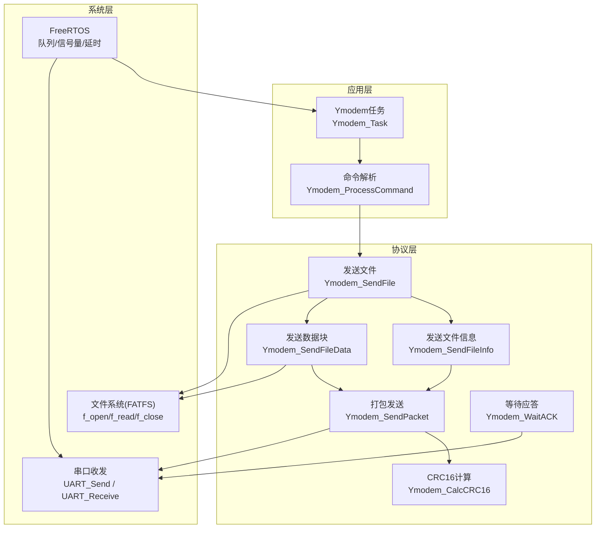
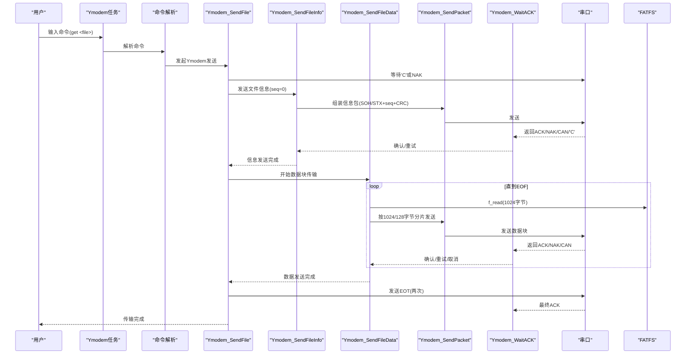
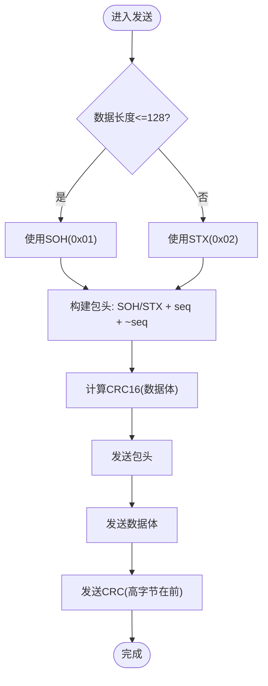
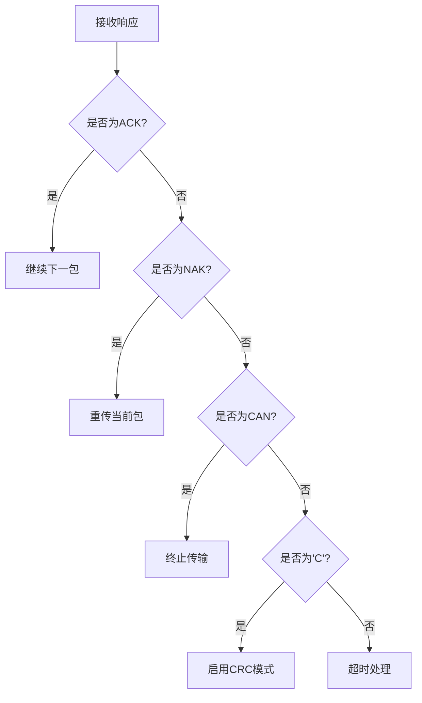
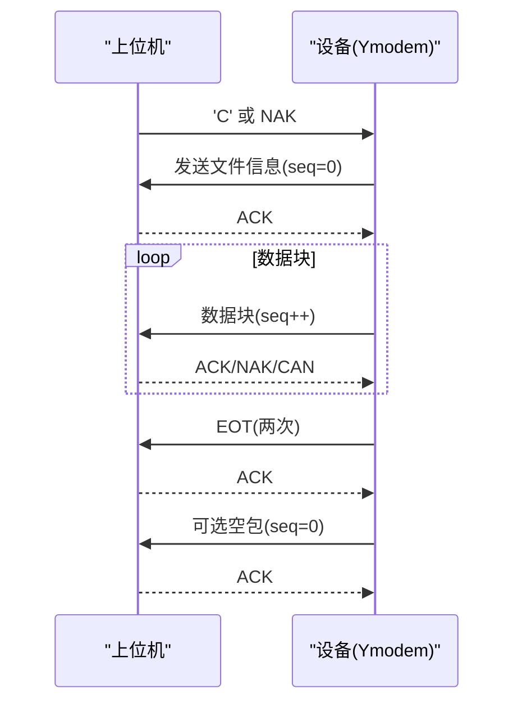
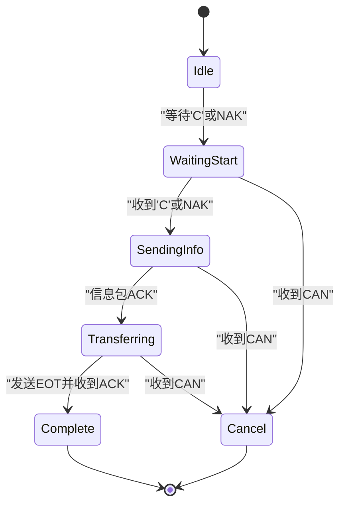
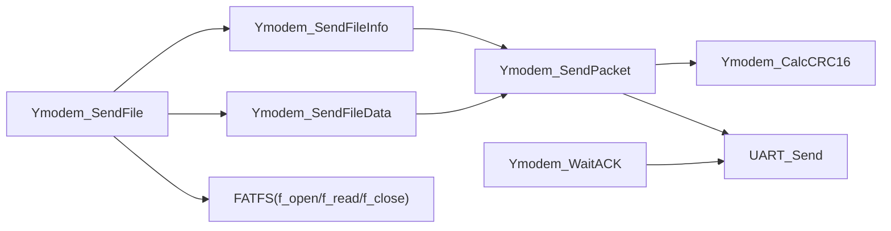

# Ymodem协议规范

<cite>
**本文引用的文件**   
- [ymodem_protocol.c](file://_gbk_backup/User/ymodem_protocol.c)
- [ymodem_protocol.h](file://_gbk_backup/User/ymodem_protocol.h)
- [usart.h](file://_gbk_backup/Driver/SYSTEM/usart.h)
</cite>

## 目录
1. [简介](#简介)
2. [项目结构](#项目结构)
3. [核心组件](#核心组件)
4. [架构总览](#架构总览)
5. [详细组件分析](#详细组件分析)
6. [依赖关系分析](#依赖关系分析)
7. [性能考虑](#性能考虑)
8. [故障排查指南](#故障排查指南)
9. [结论](#结论)
10. [附录](#附录)

## 简介
本技术文档基于仓库中的Ymodem实现，系统性说明Ymodem协议的帧格式、控制字符、握手流程、状态机与错误处理机制，并结合代码给出可追溯的实现细节。重点覆盖：
- SOH/STX包头结构与序列号机制
- CRC校验算法与数据块长度（128字节与1024字节）差异
- ACK/NAK/CAN等控制字符的处理逻辑
- 以'C'启动的文件传输握手流程（文件名、数据块、EOT结束）
- 超时重传、CRC失败处理与中断恢复策略
- 协议状态机与时序图

## 项目结构
本项目在嵌入式FreeRTOS环境下实现Ymodem发送端能力，通过USART1与上位机（如Xshell）进行文件传输，底层使用FATFS访问SD卡文件系统。关键文件职责如下：
- ymodem_protocol.h：定义协议常量、数据结构、函数接口
- ymodem_protocol.c：实现Ymodem协议栈、串口收发封装、CRC计算、文件读取与发送、命令解析与任务调度
- usart.h：提供串口发送接口及Ymodem模式识别接口声明

图表来源
- [ymodem_protocol.c:125-158](file://_gbk_backup/User/ymodem_protocol.c#L125-L158)
- [ymodem_protocol.c:163-191](file://_gbk_backup/User/ymodem_protocol.c#L163-L191)
- [ymodem_protocol.c:196-227](file://_gbk_backup/User/ymodem_protocol.c#L196-L227)
- [ymodem_protocol.c:232-298](file://_gbk_backup/User/ymodem_protocol.c#L232-L298)
- [ymodem_protocol.c:303-428](file://_gbk_backup/User/ymodem_protocol.c#L303-L428)
- [ymodem_protocol.c:711-748](file://_gbk_backup/User/ymodem_protocol.c#L711-L748)

章节来源
- [ymodem_protocol.c:1-749](file://_gbk_backup/User/ymodem_protocol.c#L1-L749)
- [ymodem_protocol.h:1-127](file://_gbk_backup/User/ymodem_protocol.h#L1-L127)
- [usart.h:1-44](file://_gbk_backup/Driver/SYSTEM/usart.h#L1-L44)

## 核心组件
- 协议常量与数据包大小
  - SOH(0x01)/STX(0x02)：分别表示128字节和1024字节数据包的包头
  - EOT(0x04)：传输结束
  - ACK(0x06)/NAK(0x15)/CAN(0x18)：应答、请求重传、取消传输
  - 'C'：CRC模式启动字符
  - 包大小：128字节与1024字节；序列号范围0xFF
- 上下文与状态
  - YmodemContext：包含当前状态、序列号、包大小、文件大小、已发送字节数、重试计数、是否启用CRC
  - YmodemState：空闲、等待应答、传输中、完成、取消
- 关键函数
  - Ymodem_SendFile：主流程，等待'C'或NAK启动，发送文件信息与数据块，最后发送EOT并收尾
  - Ymodem_SendFileInfo：发送文件名与大小的初始包（seq=0）
  - Ymodem_SendFileData：循环读取文件并按1024/128字节分片发送，维护序列号与重试
  - Ymodem_SendPacket：组装包头（SOH/STX + seq + ~seq）、数据体与CRC
  - Ymodem_WaitACK：接收ACK/NAK/CAN/'C'，支持超时
  - Ymodem_CalcCRC16：查表法CRC16计算

章节来源
- [ymodem_protocol.h:15-26](file://_gbk_backup/User/ymodem_protocol.h#L15-L26)
- [ymodem_protocol.h:42-60](file://_gbk_backup/User/ymodem_protocol.h#L42-L60)
- [ymodem_protocol.c:75-82](file://_gbk_backup/User/ymodem_protocol.c#L75-L82)
- [ymodem_protocol.c:125-158](file://_gbk_backup/User/ymodem_protocol.c#L125-L158)
- [ymodem_protocol.c:163-191](file://_gbk_backup/User/ymodem_protocol.c#L163-L191)
- [ymodem_protocol.c:196-227](file://_gbk_backup/User/ymodem_protocol.c#L196-L227)
- [ymodem_protocol.c:232-298](file://_gbk_backup/User/ymodem_protocol.c#L232-L298)
- [ymodem_protocol.c:303-428](file://_gbk_backup/User/ymodem_protocol.c#L303-L428)

## 架构总览
下图展示从命令触发到文件传输完成的整体调用链与模块交互。

图表来源
- [ymodem_protocol.c:303-428](file://_gbk_backup/User/ymodem_protocol.c#L303-L428)
- [ymodem_protocol.c:196-227](file://_gbk_backup/User/ymodem_protocol.c#L196-L227)
- [ymodem_protocol.c:232-298](file://_gbk_backup/User/ymodem_protocol.c#L232-L298)
- [ymodem_protocol.c:125-158](file://_gbk_backup/User/ymodem_protocol.c#L125-L158)
- [ymodem_protocol.c:163-191](file://_gbk_backup/User/ymodem_protocol.c#L163-L191)

## 详细组件分析

### 帧格式与包头结构
- 包头选择
  - 若数据长度≤128字节：使用SOH(0x01)作为包头
  - 否则：使用STX(0x02)作为包头
- 包头字段
  - 第1字节：SOH或STX
  - 第2字节：序列号seq（递增，模256）
  - 第3字节：~seq（序列号的反码）
- 数据体
  - 128字节包：固定128字节，不足补0
  - 1024字节包：最多1024字节，最后一包可能小于1024字节，剩余补0
- 校验
  - 采用CRC16，对数据体计算后附加两字节CRC（高字节在前）

图表来源
- [ymodem_protocol.c:125-158](file://_gbk_backup/User/ymodem_protocol.c#L125-L158)
- [ymodem_protocol.c:75-82](file://_gbk_backup/User/ymodem_protocol.c#L75-L82)

章节来源
- [ymodem_protocol.c:125-158](file://_gbk_backup/User/ymodem_protocol.c#L125-L158)
- [ymodem_protocol.c:75-82](file://_gbk_backup/User/ymodem_protocol.c#L75-L82)

### 序列号机制
- 初始包（文件信息）使用seq=0
- 数据块从seq=1开始递增
- 每发送一次数据块，seq自增；超过0xFF后回绕（由uint8_t自然溢出）
- 接收方通过比较seq与~seq验证包头完整性

章节来源
- [ymodem_protocol.c:196-227](file://_gbk_backup/User/ymodem_protocol.c#L196-L227)
- [ymodem_protocol.c:232-298](file://_gbk_backup/User/ymodem_protocol.c#L232-L298)

### CRC校验算法
- 使用预计算的CRC16表进行快速计算
- 对每个数据体独立计算CRC16，并以大端序（高字节在前）附加在数据体之后
- 当收到'C'时启用CRC模式；收到NAK时禁用CRC模式（仅用于启动协商）

章节来源
- [ymodem_protocol.c:37-70](file://_gbk_backup/User/ymodem_protocol.c#L37-L70)
- [ymodem_protocol.c:125-158](file://_gbk_backup/User/ymodem_protocol.c#L125-L158)
- [ymodem_protocol.c:163-191](file://_gbk_backup/User/ymodem_protocol.c#L163-L191)
- [ymodem_protocol.c:335-361](file://_gbk_backup/User/ymodem_protocol.c#L335-L361)

### 控制字符处理逻辑
- ACK(0x06)：确认成功，继续下一包
- NAK(0x15)：请求重传当前包
- CAN(0x18)：对方取消传输，立即终止
- 'C'：CRC模式启动，发送端据此决定是否使用CRC校验

图表来源
- [ymodem_protocol.c:163-191](file://_gbk_backup/User/ymodem_protocol.c#L163-L191)
- [ymodem_protocol.c:335-361](file://_gbk_backup/User/ymodem_protocol.c#L335-L361)

章节来源
- [ymodem_protocol.c:163-191](file://_gbk_backup/User/ymodem_protocol.c#L163-L191)
- [ymodem_protocol.c:335-361](file://_gbk_backup/User/ymodem_protocol.c#L335-L361)

### 文件传输握手流程
- 启动阶段
  - 发送端等待上位机发送'C'或NAK
  - 收到'C'：启用CRC模式
  - 收到NAK：禁用CRC模式
- 文件信息阶段
  - 发送seq=0的信息包，包含文件名与文件大小（以'\0'分隔）
  - 等待ACK；若NAK则重试，最多10次
- 数据块阶段
  - 循环读取文件，每次最多1024字节
  - 根据实际读取长度决定使用1024或128字节包
  - 发送数据块并等待ACK；NAK重试，CAN取消
- 结束阶段
  - 发送EOT两次，等待ACK
  - 可选发送空包（seq=0）以清理某些终端的残留字符

图表来源
- [ymodem_protocol.c:303-428](file://_gbk_backup/User/ymodem_protocol.c#L303-L428)
- [ymodem_protocol.c:196-227](file://_gbk_backup/User/ymodem_protocol.c#L196-L227)
- [ymodem_protocol.c:232-298](file://_gbk_backup/User/ymodem_protocol.c#L232-L298)

章节来源
- [ymodem_protocol.c:303-428](file://_gbk_backup/User/ymodem_protocol.c#L303-L428)

### 128字节与1024字节数据包的区别与使用场景
- 128字节包
  - 适用于小文件或兼容性要求高的场景
  - 开销相对较大（包头与CRC占比更高）
- 1024字节包
  - 适用于大文件传输，提升吞吐效率
  - 减少包头与CRC次数，降低协议开销
- 实现策略
  - 数据块读取最大为1024字节
  - 若实际读取长度≤128字节，则使用128字节包；否则使用1024字节包
  - 最后一包可能小于1024字节，剩余空间补0

章节来源
- [ymodem_protocol.c:232-298](file://_gbk_backup/User/ymodem_protocol.c#L232-L298)
- [ymodem_protocol.c:125-158](file://_gbk_backup/User/ymodem_protocol.c#L125-L158)

### 协议状态机

图表来源
- [ymodem_protocol.h:42-49](file://_gbk_backup/User/ymodem_protocol.h#L42-L49)
- [ymodem_protocol.c:303-428](file://_gbk_backup/User/ymodem_protocol.c#L303-L428)

章节来源
- [ymodem_protocol.h:42-49](file://_gbk_backup/User/ymodem_protocol.h#L42-L49)
- [ymodem_protocol.c:303-428](file://_gbk_backup/User/ymodem_protocol.c#L303-L428)

## 依赖关系分析
- 外部依赖
  - FreeRTOS：队列、信号量、任务延时
  - FATFS：文件打开、读取、关闭
  - USART1：字节发送、字符串发送
- 内部耦合
  - Ymodem_SendFile协调信息发送与数据发送
  - Ymodem_SendPacket统一封装包头、数据与CRC
  - Ymodem_WaitACK集中处理ACK/NAK/CAN/'C'
  - UART_Send/UART_Receive封装串口I/O

图表来源
- [ymodem_protocol.c:125-158](file://_gbk_backup/User/ymodem_protocol.c#L125-L158)
- [ymodem_protocol.c:163-191](file://_gbk_backup/User/ymodem_protocol.c#L163-L191)
- [ymodem_protocol.c:196-227](file://_gbk_backup/User/ymodem_protocol.c#L196-L227)
- [ymodem_protocol.c:232-298](file://_gbk_backup/User/ymodem_protocol.c#L232-L298)
- [ymodem_protocol.c:303-428](file://_gbk_backup/User/ymodem_protocol.c#L303-L428)

章节来源
- [ymodem_protocol.c:125-158](file://_gbk_backup/User/ymodem_protocol.c#L125-L158)
- [ymodem_protocol.c:163-191](file://_gbk_backup/User/ymodem_protocol.c#L163-L191)
- [ymodem_protocol.c:196-227](file://_gbk_backup/User/ymodem_protocol.c#L196-L227)
- [ymodem_protocol.c:232-298](file://_gbk_backup/User/ymodem_protocol.c#L232-L298)
- [ymodem_protocol.c:303-428](file://_gbk_backup/User/ymodem_protocol.c#L303-L428)

## 性能考虑
- CRC计算
  - 使用查表法，时间复杂度O(n)，n为数据体长度
  - 1024字节包比128字节包CRC次数更少，整体吞吐更高
- 串口I/O
  - 批量发送减少系统调用次数
  - 接收通过队列缓冲，避免阻塞
- 内存管理
  - 动态分配1024字节缓冲区，注意释放以避免泄漏
- 重试策略
  - 信息包与数据块均设置最大重试次数（10次），防止死循环
- 建议优化
  - 将CRC表置于Flash以减少RAM占用
  - 调整超时参数以适应不同波特率与链路质量

[本节为通用指导，不直接分析具体文件]

## 故障排查指南
- 常见问题
  - 无法启动传输：检查是否收到'C'或NAK；确认上位机正确发起Ymodem接收
  - 频繁NAK：检查CRC模式是否匹配；确认串口波特率与配置一致
  - 传输中断：检查CAN字符是否被误收；确认链路稳定性
  - 超时：适当增大等待超时时间；检查队列与任务优先级
- 定位方法
  - 观察Ymodem_WaitACK返回值：ACK(0)、NAK(-1)、CAN(-2)、超时(-3)
  - 检查重试计数与序列号是否正确递增
  - 验证CRC值是否与数据体一致

章节来源
- [ymodem_protocol.c:163-191](file://_gbk_backup/User/ymodem_protocol.c#L163-L191)
- [ymodem_protocol.c:232-298](file://_gbk_backup/User/ymodem_protocol.c#L232-L298)
- [ymodem_protocol.c:303-428](file://_gbk_backup/User/ymodem_protocol.c#L303-L428)

## 结论
本实现完整覆盖了Ymodem协议的关键要素：帧格式、序列号、CRC校验、控制字符处理与握手流程。通过清晰的模块化设计与合理的错误处理机制，能够在嵌入式环境中稳定地进行文件传输。针对128字节与1024字节包的选择，兼顾了兼容性与性能。建议在部署时根据链路质量与目标设备特性调优超时与重试参数，以获得最佳传输体验。

[本节为总结性内容，不直接分析具体文件]

## 附录
- 协议常量参考
  - SOH(0x01)、STX(0x02)、EOT(0x04)、ACK(0x06)、NAK(0x15)、CAN(0x18)、'C'
- 数据结构参考
  - YmodemContext：状态、序列号、包大小、文件大小、已发送字节数、重试计数、CRC标志
  - FileInfo：文件名、大小、目录标志、日期、时间

章节来源
- [ymodem_protocol.h:15-26](file://_gbk_backup/User/ymodem_protocol.h#L15-L26)
- [ymodem_protocol.h:42-69](file://_gbk_backup/User/ymodem_protocol.h#L42-L69)