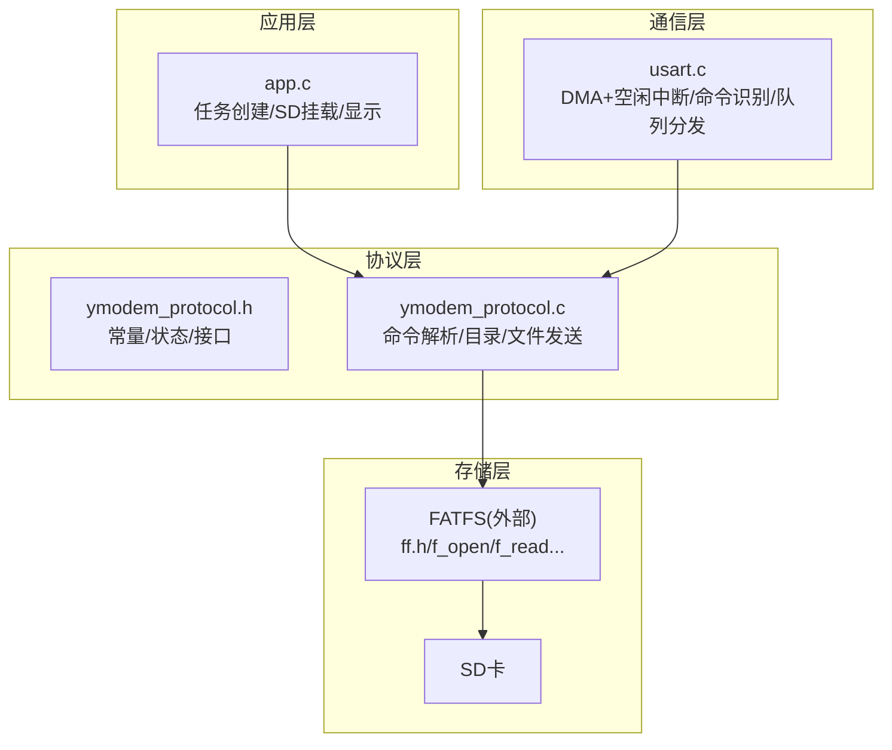
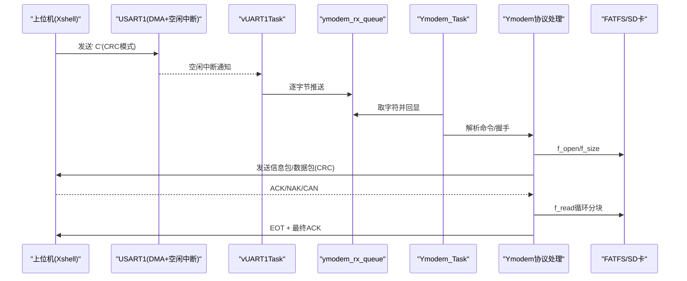
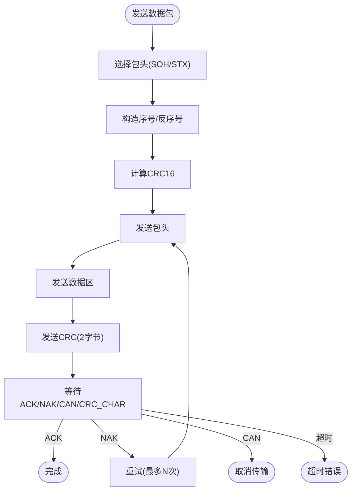
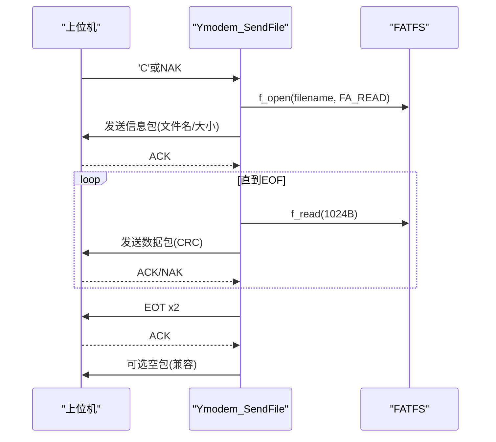
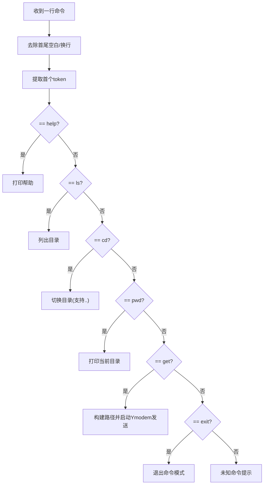
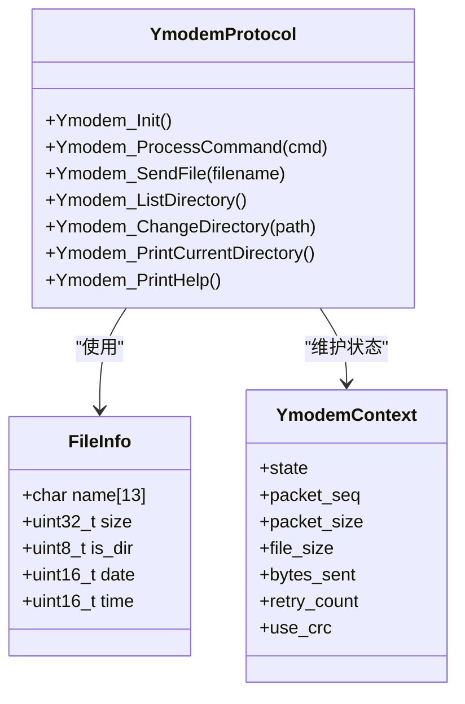
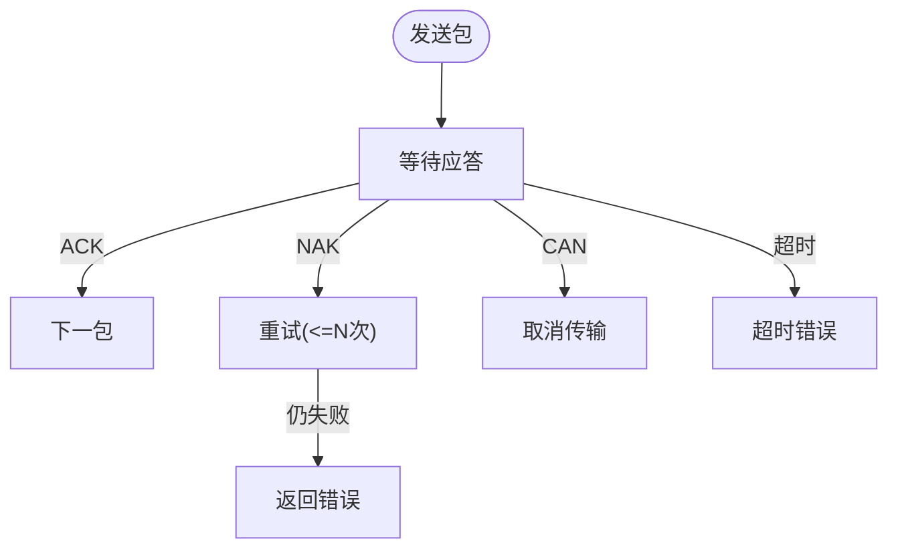
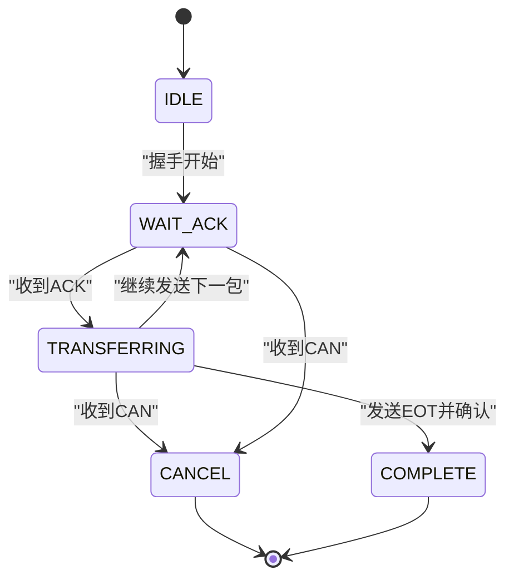
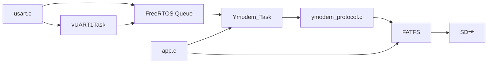

# Ymodem文件传输协议

<cite>
**本文引用的文件**   
- [ymodem_protocol.c](file://_gbk_backup/User/ymodem_protocol.c)
- [ymodem_protocol.h](file://_gbk_backup/User/ymodem_protocol.h)
- [usart.c](file://_gbk_backup/Driver/SYSTEM/usart.c)
- [app.c](file://_gbk_backup/User/app.c)
- [app.h](file://_gbk_backup/User/app.h)
</cite>

## 目录
1. [简介](#简介)
2. [项目结构](#项目结构)
3. [核心组件](#核心组件)
4. [架构总览](#架构总览)
5. [详细组件分析](#详细组件分析)
6. [依赖关系分析](#依赖关系分析)
7. [性能与优化](#性能与优化)
8. [故障排查指南](#故障排查指南)
9. [结论](#结论)
10. [附录：上位机集成与调试要点](#附录上位机集成与调试要点)

## 简介
本技术文档围绕STM32F407 FreeRTOS工程中的Ymodem文件传输实现，系统阐述协议实现原理、命令检测机制、文件系统接口、数据传输流程、错误检测与重传机制、状态机设计，以及上位机集成与调试方法。该实现以串口为通道，通过FreeRTOS任务与队列解耦数据接收与协议处理，结合FATFS访问SD卡进行文件读取与目录操作，支持帮助、目录浏览、路径切换、当前路径打印、文件下载（从设备侧发送到上位机）等常用功能。

## 项目结构
- 协议层
  - ymodem_protocol.h/.c：定义Ymodem常量、状态、上下文、命令集及核心收发逻辑；提供命令解析、目录操作、文件发送入口。
- 通信层
  - usart.c：USART1初始化、DMA+空闲中断接收、命令识别、将字符推入Ymodem队列，并提供字节/字符串发送接口。
- 应用层
  - app.c/.h：创建各FreeRTOS任务（含Ymodem任务）、SD卡挂载与互斥量管理、LCD显示、按键与LED等。

**图表来源** 
- [app.c:529-541](file://_gbk_backup/User/app.c#L529-L541)
- [ymodem_protocol.h:15-40](file://_gbk_backup/User/ymodem_protocol.h#L15-L40)
- [ymodem_protocol.c:9-28](file://_gbk_backup/User/ymodem_protocol.c#L9-L28)
- [usart.c:101-166](file://_gbk_backup/Driver/SYSTEM/usart.c#L101-L166)

**章节来源**
- [app.c:529-541](file://_gbk_backup/User/app.c#L529-L541)
- [ymodem_protocol.h:15-40](file://_gbk_backup/User/ymodem_protocol.h#L15-L40)
- [ymodem_protocol.c:9-28](file://_gbk_backup/User/ymodem_protocol.c#L9-L28)
- [usart.c:101-166](file://_gbk_backup/Driver/SYSTEM/usart.c#L101-L166)

## 核心组件
- Ymodem协议常量与状态
  - 包头：SOH(128字节)、STX(1024字节)
  - 控制符：EOT、ACK、NAK、CAN、CRC_CHAR('C')
  - 状态枚举：IDLE、WAIT_ACK、TRANSFERRING、COMPLETE、CANCEL
  - 上下文：包含序列号、包大小、文件大小、已发送字节、重试计数、是否使用CRC等
- 命令子系统
  - 支持CMD_HELP、CMD_LS、CMD_CD、CMD_PWD、CMD_GET、CMD_EXIT（另含CMD_SETTIME用于RTC设置）
- 文件系统接口
  - 基于FATFS的f_open/f_read/f_opendir/f_readdir/f_closedir/f_close
  - 通过互斥量xSDCardMutex保护并发访问
- 通信子系统
  - USART1 DMA+空闲中断接收，vUART1Task将数据逐字节推入ymodem_rx_queue
  - Ymodem_Task消费队列，回显并解析命令，触发Ymodem_SendFile等

**章节来源**
- [ymodem_protocol.h:15-60](file://_gbk_backup/User/ymodem_protocol.h#L15-L60)
- [ymodem_protocol.c:36-82](file://_gbk_backup/User/ymodem_protocol.c#L36-L82)
- [ymodem_protocol.c:589-685](file://_gbk_backup/User/ymodem_protocol.c#L589-L685)
- [ymodem_protocol.c:433-502](file://_gbk_backup/User/ymodem_protocol.c#L433-L502)
- [ymodem_protocol.c:507-555](file://_gbk_backup/User/ymodem_protocol.c#L507-L555)
- [usart.c:184-205](file://_gbk_backup/Driver/SYSTEM/usart.c#L184-L205)
- [usart.c:251-283](file://_gbk_backup/Driver/SYSTEM/usart.c#L251-L283)

## 架构总览
Ymodem在设备端作为“发送方”，由上位机软件（如Xshell）发起Ymodem接收，设备侧根据命令或自动握手启动传输。整体数据流如下：

**图表来源** 
- [usart.c:184-205](file://_gbk_backup/Driver/SYSTEM/usart.c#L184-L205)
- [usart.c:251-283](file://_gbk_backup/Driver/SYSTEM/usart.c#L251-L283)
- [ymodem_protocol.c:303-428](file://_gbk_backup/User/ymodem_protocol.c#L303-L428)
- [ymodem_protocol.c:711-748](file://_gbk_backup/User/ymodem_protocol.c#L711-L748)

## 详细组件分析

### 1) Ymodem协议实现与数据包格式
- 包头选择
  - 若数据长度≤128字节，使用SOH；否则使用STX。
- 包体与校验
  - 包体包含序号(seq)和反序号(~seq)，随后是数据区，最后以CRC16两字节结束。
- CRC计算
  - 查表法实现CRC16，对整包数据计算后附加到帧尾。
- 应答等待
  - 发送后调用Ymodem_WaitACK，支持ACK成功、NAK重传、CAN取消、CRC_CHAR协商模式，超时返回错误码。

**图表来源** 
- [ymodem_protocol.c:125-158](file://_gbk_backup/User/ymodem_protocol.c#L125-L158)
- [ymodem_protocol.c:163-191](file://_gbk_backup/User/ymodem_protocol.c#L163-L191)

**章节来源**
- [ymodem_protocol.c:36-82](file://_gbk_backup/User/ymodem_protocol.c#L36-L82)
- [ymodem_protocol.c:125-191](file://_gbk_backup/User/ymodem_protocol.c#L125-L191)
- [ymodem_protocol.h:15-26](file://_gbk_backup/User/ymodem_protocol.h#L15-L26)

### 2) 文件上传/下载流程（设备侧发送文件给上位机）
- 握手阶段
  - 等待上位机发送'C'(CRC模式)或NAK，据此决定use_crc标志。
- 信息包发送
  - 发送文件名与大小的信息包（128字节），等待ACK。
- 数据块发送
  - 循环读取文件，按1024字节分块发送，不足补零；每包等待ACK，失败则重试。
- 结束阶段
  - 发送两次EOT，等待ACK；必要时再发一个空包并丢弃后续无用字符。

**图表来源** 
- [ymodem_protocol.c:303-428](file://_gbk_backup/User/ymodem_protocol.c#L303-L428)

**章节来源**
- [ymodem_protocol.c:196-227](file://_gbk_backup/User/ymodem_protocol.c#L196-L227)
- [ymodem_protocol.c:232-298](file://_gbk_backup/User/ymodem_protocol.c#L232-L298)
- [ymodem_protocol.c:303-428](file://_gbk_backup/User/ymodem_protocol.c#L303-L428)

### 3) 命令检测机制
- 命令常量
  - CMD_HELP、CMD_LS、CMD_CD、CMD_PWD、CMD_GET、CMD_EXIT（另有CMD_SETTIME）
- 识别位置
  - usart.c中USART1_IsYmodemCommand对首词进行小写匹配，判断是否为Ymodem命令。
  - ymodem_protocol.c中Ymodem_ProcessCommand负责具体分支处理。
- 典型行为
  - help：打印可用命令
  - ls：列出当前目录内容
  - cd <dir>：切换工作目录（支持..）
  - pwd：打印当前目录
  - get <file>：启动Ymodem发送指定文件
  - exit：退出命令模式（提示重新help进入）

**图表来源** 
- [usart.c:213-244](file://_gbk_backup/Driver/SYSTEM/usart.c#L213-L244)
- [ymodem_protocol.c:589-685](file://_gbk_backup/User/ymodem_protocol.c#L589-L685)

**章节来源**
- [ymodem_protocol.h:28-35](file://_gbk_backup/User/ymodem_protocol.h#L28-L35)
- [usart.c:213-244](file://_gbk_backup/Driver/SYSTEM/usart.c#L213-L244)
- [ymodem_protocol.c:589-685](file://_gbk_backup/User/ymodem_protocol.c#L589-L685)

### 4) 文件系统接口与目录操作
- 目录遍历
  - 使用f_opendir/f_readdir遍历当前目录，过滤隐藏项，统计文件数/目录数/总大小。
- 路径切换
  - 支持绝对路径与相对路径拼接，末尾补齐'/'，存在性检查通过后更新current_path。
- 文件读写
  - 打开文件获取大小，循环f_read分块发送；关闭文件并释放互斥量。

**图表来源** 
- [ymodem_protocol.h:51-69](file://_gbk_backup/User/ymodem_protocol.h#L51-L69)
- [ymodem_protocol.c:433-502](file://_gbk_backup/User/ymodem_protocol.c#L433-L502)
- [ymodem_protocol.c:507-555](file://_gbk_backup/User/ymodem_protocol.c#L507-L555)
- [ymodem_protocol.c:303-428](file://_gbk_backup/User/ymodem_protocol.c#L303-L428)

**章节来源**
- [ymodem_protocol.c:433-502](file://_gbk_backup/User/ymodem_protocol.c#L433-L502)
- [ymodem_protocol.c:507-555](file://_gbk_backup/User/ymodem_protocol.c#L507-L555)
- [ymodem_protocol.c:303-428](file://_gbk_backup/User/ymodem_protocol.c#L303-L428)

### 5) 错误检测与重传机制
- CRC校验
  - 所有数据包均附带CRC16，接收方可校验完整性。
- NAK与重试
  - 若收到NAK，上层函数会重试发送当前包，最多重试次数受retry_count限制。
- CAN取消
  - 收到CAN立即终止传输并返回取消状态。
- 超时处理
  - 等待ACK/NAK/CAN/CRC_CHAR时采用超时计时，超时返回错误码。
- 内存与资源安全
  - 动态分配缓冲区需判空；文件操作前后正确关闭文件与释放互斥量。

**图表来源** 
- [ymodem_protocol.c:163-191](file://_gbk_backup/User/ymodem_protocol.c#L163-L191)
- [ymodem_protocol.c:232-298](file://_gbk_backup/User/ymodem_protocol.c#L232-L298)

**章节来源**
- [ymodem_protocol.c:163-191](file://_gbk_backup/User/ymodem_protocol.c#L163-L191)
- [ymodem_protocol.c:232-298](file://_gbk_backup/User/ymodem_protocol.c#L232-L298)

### 6) 状态机设计
- 状态定义
  - IDLE、WAIT_ACK、TRANSFERRING、COMPLETE、CANCEL
- 实际流转
  - 初始化后处于IDLE；等待握手后进入WAIT_ACK；发送信息包/数据块期间处于TRANSFERRING；完成后置COMPLETE；遇CAN置CANCEL。
- 注意
  - 代码中未显式调用状态转换API，但上下文字段state可用于扩展更严谨的状态机。

**图表来源** 
- [ymodem_protocol.h:42-49](file://_gbk_backup/User/ymodem_protocol.h#L42-L49)
- [ymodem_protocol.c:303-428](file://_gbk_backup/User/ymodem_protocol.c#L303-L428)

**章节来源**
- [ymodem_protocol.h:42-49](file://_gbk_backup/User/ymodem_protocol.h#L42-L49)
- [ymodem_protocol.c:303-428](file://_gbk_backup/User/ymodem_protocol.c#L303-L428)

## 依赖关系分析
- 模块耦合
  - Ymodem协议层依赖usart.c提供的串口发送接口与队列；依赖FATFS进行文件IO；依赖FreeRTOS任务/队列/信号量。
  - 应用层负责创建Ymodem任务、挂载SD卡、创建互斥量。
- 关键外部依赖
  - FreeRTOS：task/queue/semphr/timers
  - FATFS：ff.h及相关API
  - HAL/LL：USART/DMA/NVIC配置

**图表来源** 
- [usart.c:251-283](file://_gbk_backup/Driver/SYSTEM/usart.c#L251-L283)
- [ymodem_protocol.c:711-748](file://_gbk_backup/User/ymodem_protocol.c#L711-L748)
- [app.c:529-541](file://_gbk_backup/User/app.c#L529-L541)

**章节来源**
- [usart.c:251-283](file://_gbk_backup/Driver/SYSTEM/usart.c#L251-L283)
- [ymodem_protocol.c:711-748](file://_gbk_backup/User/ymodem_protocol.c#L711-L748)
- [app.c:529-541](file://_gbk_backup/User/app.c#L529-L541)

## 性能与优化
- 传输效率
  - 优先使用STX(1024字节)包体以减少开销；合理设置重试次数与超时时间，避免长时间阻塞。
- I/O吞吐
  - 使用DMA+空闲中断降低CPU占用；FATFS读操作尽量顺序化，减少碎片影响。
- 内存管理
  - 动态分配缓冲区需判空并及时释放；避免在临界区执行耗时操作。
- 并发安全
  - 所有SD卡访问通过xSDCardMutex互斥保护；确保异常路径也释放锁。
- 可观测性
  - 可通过按键任务打印任务栈高水位，评估Ymodem任务栈是否足够。

[本节为通用指导，不直接分析具体文件]

## 故障排查指南
- 常见问题
  - 无法进入Ymodem模式：检查上位机是否发送'C'或NAK；确认串口参数一致。
  - 传输中途失败：观察是否频繁NAK或超时；检查线缆质量与波特率稳定性。
  - 目录为空或权限问题：确认SD卡已正确挂载且路径有效。
  - 内存不足：检查mymalloc分配结果；适当减小包大小或增加堆空间。
- 定位手段
  - 通过按键任务打印任务列表与最小栈空间，评估栈溢出风险。
  - 在Ymodem关键路径添加日志（如握手、发送包、ACK等待）。
  - 使用串口抓包工具验证帧结构与CRC。

**章节来源**
- [app.c:368-412](file://_gbk_backup/User/app.c#L368-L412)
- [ymodem_protocol.c:303-428](file://_gbk_backup/User/ymodem_protocol.c#L303-L428)

## 结论
该Ymodem实现以FreeRTOS任务与队列为核心，结合DMA与空闲中断高效采集串口数据，通过FATFS访问SD卡完成文件传输。协议层实现了标准的数据包格式、CRC校验、NAK重试与超时处理，命令子系统提供了常用的目录与文件操作能力。整体架构清晰、职责分离，便于扩展与维护。

[本节为总结性内容，不直接分析具体文件]

## 附录：上位机集成与调试要点
- 通信参数
  - 波特率、数据位、停止位、校验位需与设备端一致（参考USART1初始化配置）。
- 交互流程
  - 在上位机软件（如Xshell）中选择Ymodem接收模式，设备端等待'C'或NAK后开始传输。
- 数据格式
  - 设备端发送的信息包包含文件名与大小；数据块为128或1024字节，尾部附CRC16。
- 调试建议
  - 先测试help/ls/pwd命令，确认命令通道正常。
  - 使用小文件验证握手与ACK流程，再逐步增大文件体积。
  - 关注NAK与超时频率，必要时调整重试次数与超时阈值。

**章节来源**
- [usart.c:101-166](file://_gbk_backup/Driver/SYSTEM/usart.c#L101-L166)
- [ymodem_protocol.c:568-584](file://_gbk_backup/User/ymodem_protocol.c#L568-L584)