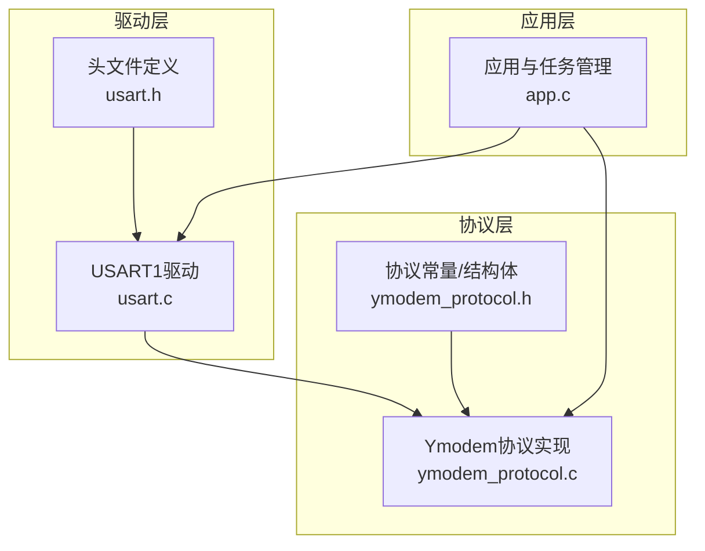
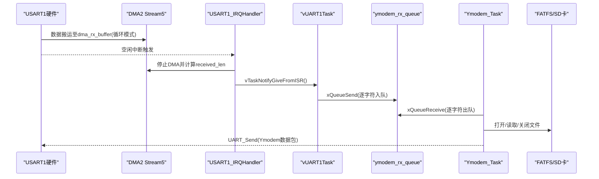
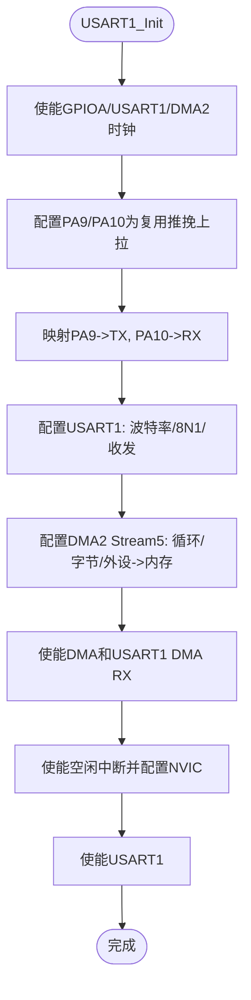
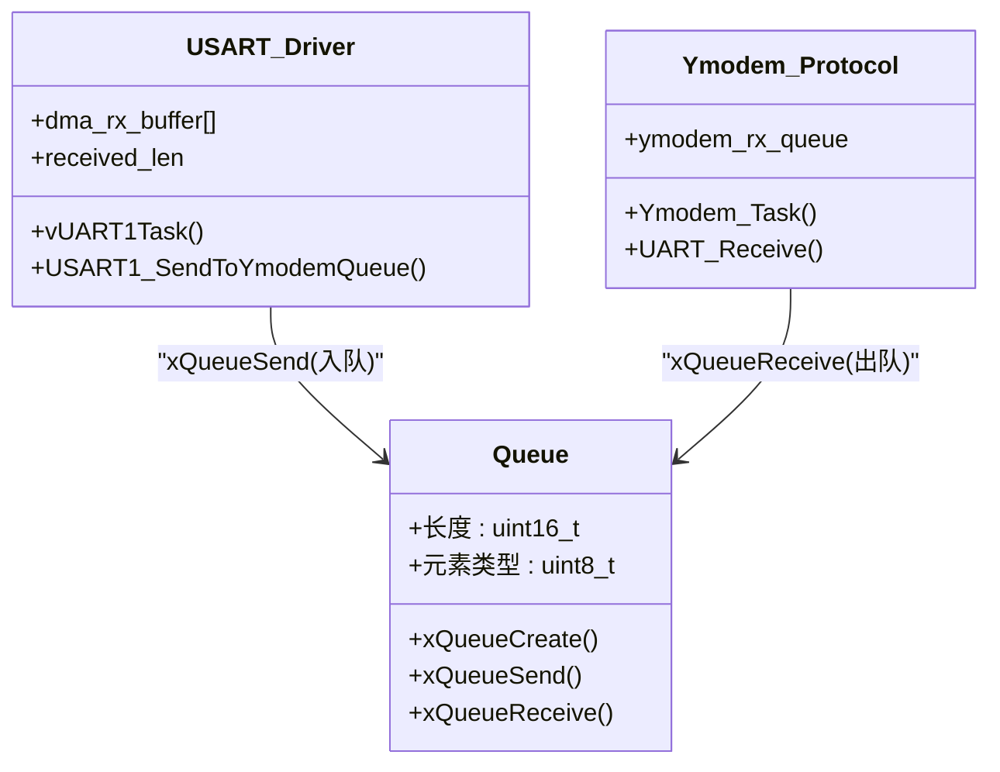
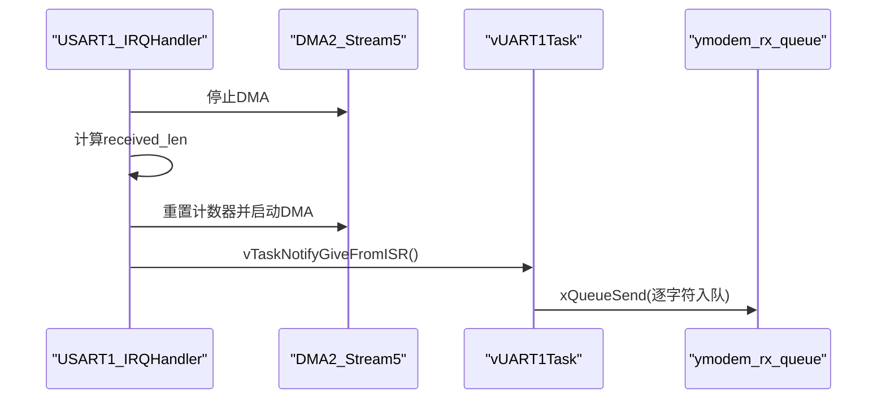
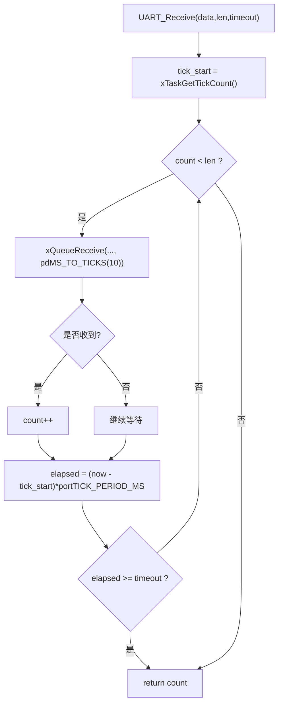
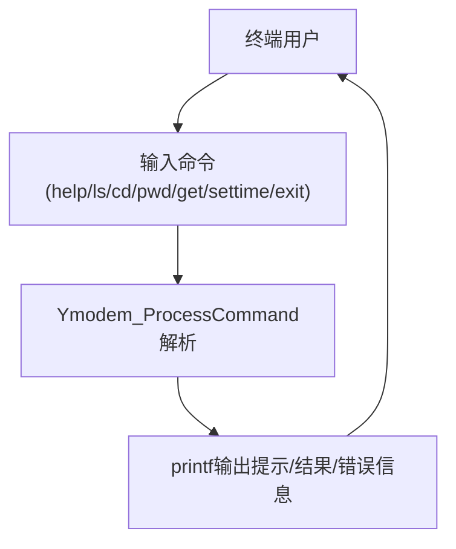
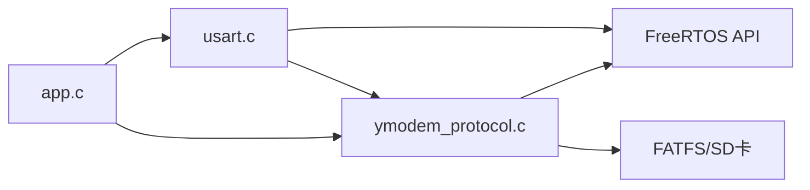

# 串口通信接口

<cite>
**本文引用的文件**   
- [usart.c](file://_gbk_backup/Driver/SYSTEM/usart.c)
- [usart.h](file://_gbk_backup/Driver/SYSTEM/usart.h)
- [ymodem_protocol.c](file://_gbk_backup/User/ymodem_protocol.c)
- [ymodem_protocol.h](file://_gbk_backup/User/ymodem_protocol.h)
- [app.c](file://_gbk_backup/User/app.c)
</cite>

## 目录
1. [简介](#简介)
2. [项目结构](#项目结构)
3. [核心组件](#核心组件)
4. [架构总览](#架构总览)
5. [详细组件分析](#详细组件分析)
6. [依赖关系分析](#依赖关系分析)
7. [性能考虑](#性能考虑)
8. [故障排查指南](#故障排查指南)
9. [结论](#结论)
10. [附录](#附录)

## 简介
本文件面向STM32F407 FreeRTOS工程中的串口通信子系统，重点说明：
- USART1的硬件配置与初始化流程（时钟、GPIO复用、波特率、数据帧格式）
- DMA+空闲中断的异步接收机制
- 基于FreeRTOS队列的字符级数据传输（ymodem_rx_queue）
- Ymodem协议层的超时处理与重试逻辑
- 串口调试输出与错误诊断信息
- 性能优化建议（缓冲区大小、DMA参数、任务调度）

## 项目结构
本项目中与串口通信相关的代码主要分布在以下模块：
- Driver/SYSTEM: 底层串口驱动（USART1初始化、DMA、空闲中断、任务通知）
- User: Ymodem协议实现（命令解析、文件传输、队列消费、日志输出）
- User/app.c: 系统应用层（任务创建、队列管理、外设互斥量）

**图示来源**
- [usart.c:101-166](file://_gbk_backup/Driver/SYSTEM/usart.c#L101-L166)
- [usart.h:13-27](file://_gbk_backup/Driver/SYSTEM/usart.h#L13-L27)
- [ymodem_protocol.c:9-28](file://_gbk_backup/User/ymodem_protocol.c#L9-L28)
- [ymodem_protocol.h:15-60](file://_gbk_backup/User/ymodem_protocol.h#L15-L60)
- [app.c:1-21](file://_gbk_backup/User/app.c#L1-L21)

**章节来源**
- [usart.c:1-30](file://_gbk_backup/Driver/SYSTEM/usart.c#L1-L30)
- [ymodem_protocol.c:1-20](file://_gbk_backup/User/ymodem_protocol.c#L1-L20)
- [app.c:1-21](file://_gbk_backup/User/app.c#L1-L21)

## 核心组件
- USART1驱动
  - 负责USART1时钟/GPIO/DMA/NVIC初始化
  - 使用DMA循环接收至dma_rx_buffer
  - 空闲中断触发后计算received_len并通知vUART1Task
  - 提供printf重定向、单字节/字符串发送
- Ymodem协议层
  - 创建并维护ymodem_rx_queue（字符队列）
  - 实现UART_Receive带超时读取
  - 实现Ymodem文件发送流程（含ACK/NAK/CRC模式协商、重试）
  - 提供命令行交互（help/ls/cd/pwd/get/settime/exit）
- 应用层
  - 创建各任务与队列（包括lcd_display_queue等）
  - 协调SD卡互斥量与文件系统访问

**章节来源**
- [usart.c:101-166](file://_gbk_backup/Driver/SYSTEM/usart.c#L101-L166)
- [usart.c:184-205](file://_gbk_backup/Driver/SYSTEM/usart.c#L184-L205)
- [usart.c:268-283](file://_gbk_backup/Driver/SYSTEM/usart.c#L268-L283)
- [ymodem_protocol.c:690-706](file://_gbk_backup/User/ymodem_protocol.c#L690-L706)
- [ymodem_protocol.c:711-748](file://_gbk_backup/User/ymodem_protocol.c#L711-L748)
- [app.c:25-32](file://_gbk_backup/User/app.c#L25-L32)

## 架构总览
下图展示从硬件到协议再到应用的完整数据流与控制流。

**图示来源**
- [usart.c:133-166](file://_gbk_backup/Driver/SYSTEM/usart.c#L133-L166)
- [usart.c:184-205](file://_gbk_backup/Driver/SYSTEM/usart.c#L184-L205)
- [usart.c:251-283](file://_gbk_backup/Driver/SYSTEM/usart.c#L251-L283)
- [ymodem_protocol.c:101-120](file://_gbk_backup/User/ymodem_protocol.c#L101-L120)
- [ymodem_protocol.c:303-428](file://_gbk_backup/User/ymodem_protocol.c#L303-L428)

## 详细组件分析

### USART1配置与初始化
- 时钟与GPIO
  - 使能GPIOA、USART1、DMA2时钟
  - PA9映射为TX，PA10映射为RX，复用功能AF7
- USART参数
  - 波特率由调用方传入
  - 数据位8，停止位1，无校验，无硬件流控，收发同时启用
- DMA接收
  - DMA2 Stream5 Channel4，外设地址USART1_DR，内存地址dma_rx_buffer
  - 方向外设到内存，循环模式，字节宽度
  - 使能USART1 DMA RX请求
- 空闲中断
  - 使能USART_IT_IDLE，NVIC优先级设置
  - 中断服务程序清除SR/DR标志，停止DMA，计算received_len，重启DMA，并通过任务通知唤醒vUART1Task

**图示来源**
- [usart.c:101-166](file://_gbk_backup/Driver/SYSTEM/usart.c#L101-L166)

**章节来源**
- [usart.c:101-166](file://_gbk_backup/Driver/SYSTEM/usart.c#L101-L166)
- [usart.h:13-27](file://_gbk_backup/Driver/SYSTEM/usart.h#L13-L27)

### 队列式数据传输机制（ymodem_rx_queue）
- 队列创建
  - Ymodem_Init中创建长度为256的uint8_t队列ymodem_rx_queue
- 数据入队
  - vUART1Task收到任务通知后，将dma_rx_buffer中received_len个字符逐个xQueueSend入队
  - 同时可转发到lcd_display_queue用于显示
- 数据出队
  - Ymodem_Task以阻塞方式从ymodem_rx_queue取字符，进行回显与命令解析
  - UART_Receive在协议层通过xQueueReceive获取字符，支持超时控制

**图示来源**
- [ymodem_protocol.c:690-706](file://_gbk_backup/User/ymodem_protocol.c#L690-L706)
- [usart.c:251-283](file://_gbk_backup/Driver/SYSTEM/usart.c#L251-L283)
- [ymodem_protocol.c:711-748](file://_gbk_backup/User/ymodem_protocol.c#L711-L748)

**章节来源**
- [ymodem_protocol.c:690-706](file://_gbk_backup/User/ymodem_protocol.c#L690-L706)
- [usart.c:251-283](file://_gbk_backup/Driver/SYSTEM/usart.c#L251-L283)
- [ymodem_protocol.c:711-748](file://_gbk_backup/User/ymodem_protocol.c#L711-L748)

### 异步接收处理（中断与任务间通信）
- 中断服务程序
  - 检测USART_IT_IDLE，读取SR/DR以清标志
  - 暂停DMA，计算received_len，恢复DMA计数并启动DMA
  - 通过vTaskNotifyGiveFromISR唤醒vUART1Task
- 任务处理
  - vUART1Task等待任务通知，收到后将dma_rx_buffer中的数据按字符入队
  - 同时将字符发送到LCD显示队列（若存在）

**图示来源**
- [usart.c:184-205](file://_gbk_backup/Driver/SYSTEM/usart.c#L184-L205)
- [usart.c:251-283](file://_gbk_backup/Driver/SYSTEM/usart.c#L251-L283)

**章节来源**
- [usart.c:184-205](file://_gbk_backup/Driver/SYSTEM/usart.c#L184-L205)
- [usart.c:251-283](file://_gbk_backup/Driver/SYSTEM/usart.c#L251-L283)

### 超时处理机制（UART_Receive与重试逻辑）
- UART_Receive
  - 从ymodem_rx_queue以pdMS_TO_TICKS(10)阻塞读取，累计count
  - 使用xTaskGetTickCount计算elapsed，超过timeout则返回已读数量
- Ymodem_WaitACK
  - 循环调用UART_Receive等待ACK/NAK/CAN/CRC_CHAR
  - 超时返回-3；CAN返回-2；NAK返回-1；ACK或CRC_CHAR成功
- 文件发送重试
  - 每个数据包发送后等待ACK，最多重试10次，每次间隔vTaskDelay(50)
  - 文件信息包和数据包均遵循相同重试策略

**图示来源**
- [ymodem_protocol.c:101-120](file://_gbk_backup/User/ymodem_protocol.c#L101-L120)
- [ymodem_protocol.c:163-191](file://_gbk_backup/User/ymodem_protocol.c#L163-L191)
- [ymodem_protocol.c:232-298](file://_gbk_backup/User/ymodem_protocol.c#L232-L298)

**章节来源**
- [ymodem_protocol.c:101-120](file://_gbk_backup/User/ymodem_protocol.c#L101-L120)
- [ymodem_protocol.c:163-191](file://_gbk_backup/User/ymodem_protocol.c#L163-L191)
- [ymodem_protocol.c:232-298](file://_gbk_backup/User/ymodem_protocol.c#L232-L298)

### 串口调试工具使用方法
- 日志输出
  - 通过printf重定向到USART1，输出帮助信息、目录列表、错误信息等
  - Ymodem任务对输入字符进行回显，便于终端交互
- 常见错误信息
  - 无法获取SD卡互斥量、打开文件失败、路径不存在、传输超时、传输被取消等
- 终端操作
  - 在Xshell等终端中使用Ymodem接收功能，选择目标文件开始接收
  - 输入help查看可用命令，get <filename>发起下载

**图示来源**
- [ymodem_protocol.c:568-685](file://_gbk_backup/User/ymodem_protocol.c#L568-L685)
- [ymodem_protocol.c:303-428](file://_gbk_backup/User/ymodem_protocol.c#L303-L428)

**章节来源**
- [ymodem_protocol.c:568-685](file://_gbk_backup/User/ymodem_protocol.c#L568-L685)
- [ymodem_protocol.c:303-428](file://_gbk_backup/User/ymodem_protocol.c#L303-L428)

## 依赖关系分析
- 模块耦合
  - usart.c依赖FreeRTOS任务与队列API，以及外部ymodem_rx_queue
  - ymodem_protocol.c依赖usart.c的发送函数与ymodem_rx_queue，同时依赖FATFS与SD卡互斥量
  - app.c协调任务创建、队列与互斥量的生命周期
- 外部依赖
  - FreeRTOS：任务、队列、信号量、时间片
  - FATFS：文件读写
  - STM32 HAL/标准库：USART、DMA、NVIC、RCC、GPIO

**图示来源**
- [usart.c:19-25](file://_gbk_backup/Driver/SYSTEM/usart.c#L19-L25)
- [ymodem_protocol.c:9-19](file://_gbk_backup/User/ymodem_protocol.c#L9-L19)
- [app.c:1-21](file://_gbk_backup/User/app.c#L1-L21)

**章节来源**
- [usart.c:19-25](file://_gbk_backup/Driver/SYSTEM/usart.c#L19-L25)
- [ymodem_protocol.c:9-19](file://_gbk_backup/User/ymodem_protocol.c#L9-L19)
- [app.c:1-21](file://_gbk_backup/User/app.c#L1-L21)

## 性能考虑
- 缓冲区大小调优
  - DMA_RX_BUFFER_SIZE默认512字节，可根据典型报文长度调整，避免频繁空闲中断与DMA重启
  - ymodem_rx_queue深度256，适合字符流缓冲；若终端回显压力大，可适当增大
- DMA传输配置
  - 当前采用循环模式，配合空闲中断计算实际接收长度，减少CPU参与
  - 可评估开启DMA FIFO半满阈值以降低中断频率（已配置HalfFull）
- 任务调度与延时
  - vUART1Task使用ulTaskNotifyTake阻塞等待，降低CPU占用
  - Ymodem_WaitACK与数据包重试使用vTaskDelay(50)避免忙等
- 文件系统访问
  - 使用互斥量保护SD卡访问，避免并发冲突；合理设置超时防止死锁
- 打印开销
  - printf重定向为轮询发送，高频日志可能影响实时性；建议在关键路径减少printf或使用环形缓冲+后台发送

[本节为通用指导，不直接分析具体文件]

## 故障排查指南
- 常见问题定位
  - 无法进入Ymodem模式：检查终端是否正确发送“C”或NAK协商
  - 传输超时：确认UART_Receive超时参数与对方响应速度匹配
  - 文件打开失败：检查路径与文件名，确认SD卡挂载与互斥量状态
  - 队列溢出：观察ymodem_rx_queue是否堆积，必要时增大队列深度或提升消费速率
- 错误信息示例
  - “Error: Cannot take SD card mutex”
  - “Error: Cannot open file ...”
  - “Error: Timeout waiting for receiver”
  - “Transfer failed / Transfer cancelled by receiver”
- 调试建议
  - 使用终端回显验证字符流是否正常
  - 在Ymodem_Task中增加日志打印，跟踪命令解析与文件传输阶段
  - 监控DMA计数器与received_len变化，确认空闲中断触发正常

**章节来源**
- [ymodem_protocol.c:303-428](file://_gbk_backup/User/ymodem_protocol.c#L303-L428)
- [ymodem_protocol.c:433-502](file://_gbk_backup/User/ymodem_protocol.c#L433-L502)
- [ymodem_protocol.c:507-555](file://_gbk_backup/User/ymodem_protocol.c#L507-L555)

## 结论
该串口通信子系统通过USART1+DMA+空闲中断实现了高效的异步接收，结合FreeRTOS队列与任务通知机制，将字符流可靠地传递给Ymodem协议层进行处理与文件传输。协议层具备完善的超时与重试机制，并提供丰富的命令行交互与错误诊断输出。通过合理调优缓冲区大小、DMA参数与任务调度策略，可在保证稳定性的前提下提升吞吐与实时性。

[本节为总结性内容，不直接分析具体文件]

## 附录
- 关键数据结构与常量
  - YMODEM协议常量：SOH/STX/EOT/ACK/NAK/CAN/CRC_CHAR
  - 数据包大小：128字节与1024字节两种
  - YmodemContext：包含状态、序列号、文件大小、重试次数、CRC模式等
- 常用函数入口
  - USART1_Init(baudrate)
  - Ymodem_Init()
  - Ymodem_SendFile(filename)
  - Ymodem_ProcessCommand(cmd)
  - Ymodem_Task(pvParameters)

**章节来源**
- [ymodem_protocol.h:15-60](file://_gbk_backup/User/ymodem_protocol.h#L15-L60)
- [ymodem_protocol.c:690-748](file://_gbk_backup/User/ymodem_protocol.c#L690-L748)
- [usart.c:101-166](file://_gbk_backup/Driver/SYSTEM/usart.c#L101-L166)