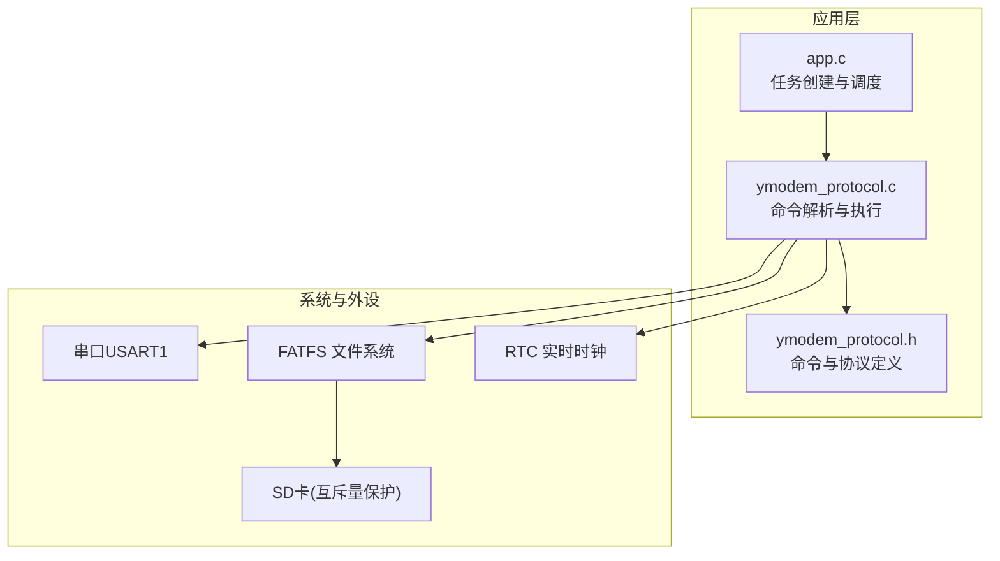
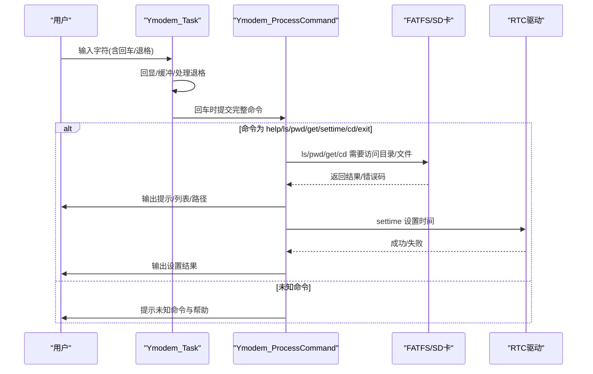
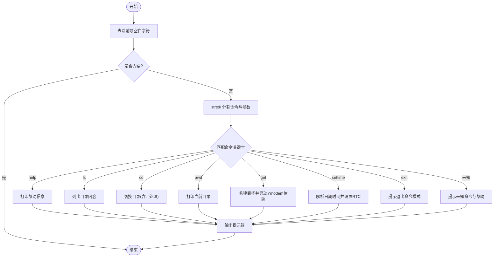
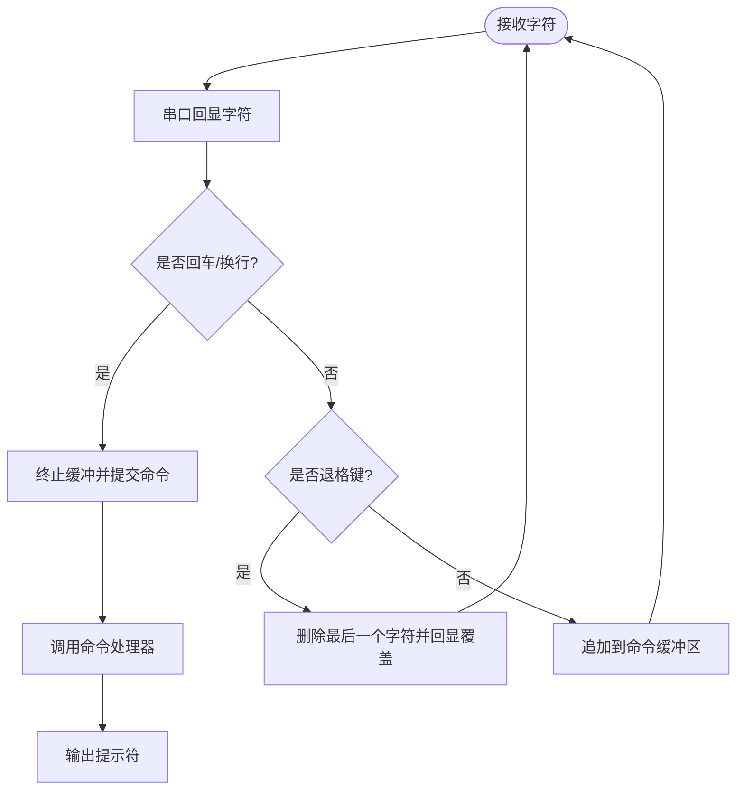
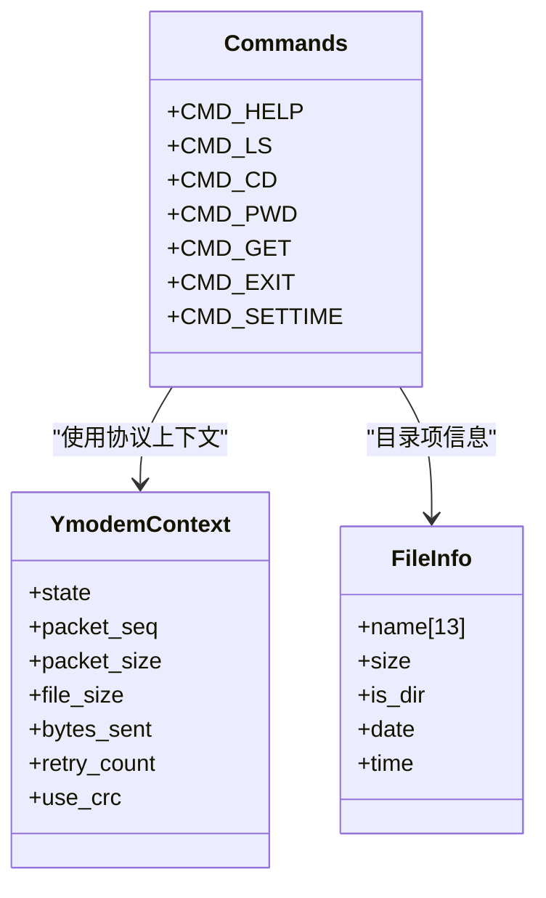
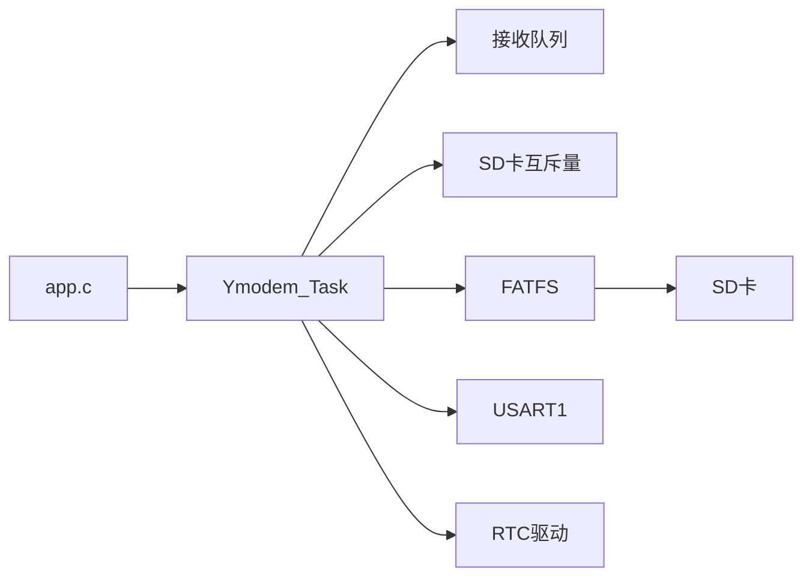

# 命令处理系统

<cite>
**本文引用的文件**   
- [ymodem_protocol.c](file://_gbk_backup/User/ymodem_protocol.c)
- [ymodem_protocol.h](file://_gbk_backup/User/ymodem_protocol.h)
- [app.c](file://_gbk_backup/User/app.c)
</cite>

## 目录
1. [简介](#简介)
2. [项目结构](#项目结构)
3. [核心组件](#核心组件)
4. [架构总览](#架构总览)
5. [详细组件分析](#详细组件分析)
6. [依赖关系分析](#依赖关系分析)
7. [性能与资源特性](#性能与资源特性)
8. [故障排查指南](#故障排查指南)
9. [结论](#结论)
10. [附录：扩展自定义命令](#附录扩展自定义命令)

## 简介
本技术文档聚焦于嵌入式系统中的“命令处理系统”，该系统提供交互式命令行界面，支持帮助、目录浏览、切换目录、显示当前路径、通过 Ymodem 协议下载文件、设置 RTC 时间以及退出命令模式等命令。文档将详细说明支持的命令集、命令解析器工作原理（字符串分割、参数提取、命令路由）、交互界面（命令缓冲区、输入回显、退格键处理）、执行上下文（当前工作目录、文件系统访问权限），并提供扩展自定义命令的步骤与参数校验方法。

## 项目结构
该命令处理系统位于用户层模块中，主要实现集中在以下文件：
- ymodem_protocol.h：定义命令常量、协议常量、数据结构与函数接口
- ymodem_protocol.c：实现命令解析、Ymodem 传输、目录操作、RTC 设置调用、任务入口与交互循环
- app.c：创建 FreeRTOS 任务，启动 Ymodem 交互任务，并管理其他系统任务



图表来源
- [app.c:529-541](file://_gbk_backup/User/app.c#L529-L541)
- [ymodem_protocol.c:589-685](file://_gbk_backup/User/ymodem_protocol.c#L589-L685)
- [ymodem_protocol.h:28-35](file://_gbk_backup/User/ymodem_protocol.h#L28-L35)

章节来源
- [app.c:529-541](file://_gbk_backup/User/app.c#L529-L541)
- [ymodem_protocol.c:589-685](file://_gbk_backup/User/ymodem_protocol.c#L589-L685)
- [ymodem_protocol.h:28-35](file://_gbk_backup/User/ymodem_protocol.h#L28-L35)

## 核心组件
- 命令常量与协议常量：在头文件中集中定义，便于统一管理与扩展
- 命令解析器：基于 strtok 的字符串分割，按关键字路由到具体处理函数
- 交互任务：接收字符、回显、处理回车与退格，维护命令缓冲区
- 文件系统访问：通过 FATFS 列出目录、切换目录、打开文件
- Ymodem 传输：发送文件信息包与数据块，等待 ACK/CRC 响应
- RTC 设置：解析日期时间字符串并调用底层设置函数

章节来源
- [ymodem_protocol.h:15-35](file://_gbk_backup/User/ymodem_protocol.h#L15-L35)
- [ymodem_protocol.c:589-685](file://_gbk_backup/User/ymodem_protocol.c#L589-L685)
- [ymodem_protocol.c:433-502](file://_gbk_backup/User/ymodem_protocol.c#L433-L502)
- [ymodem_protocol.c:507-555](file://_gbk_backup/User/ymodem_protocol.c#L507-L555)
- [ymodem_protocol.c:303-428](file://_gbk_backup/User/ymodem_protocol.c#L303-L428)

## 架构总览
命令处理系统的整体流程如下：
- 应用层创建 Ymodem 任务
- 任务从队列读取字符，进行回显与缓冲
- 回车触发命令解析；退格键删除最后一个字符
- 解析器根据命令关键字分发到对应处理函数
- 处理函数访问文件系统或调用 RTC 设置
- 所有涉及 SD 卡的访问均通过互斥量保护



图表来源
- [app.c:539-539](file://_gbk_backup/User/app.c#L539-L539)
- [ymodem_protocol.c:711-748](file://_gbk_backup/User/ymodem_protocol.c#L711-L748)
- [ymodem_protocol.c:589-685](file://_gbk_backup/User/ymodem_protocol.c#L589-L685)
- [ymodem_protocol.c:433-502](file://_gbk_backup/User/ymodem_protocol.c#L433-L502)
- [ymodem_protocol.c:507-555](file://_gbk_backup/User/ymodem_protocol.c#L507-L555)
- [ymodem_protocol.c:303-428](file://_gbk_backup/User/ymodem_protocol.c#L303-L428)

## 详细组件分析

### 支持的命令集与语法
- CMD_HELP (“help”)：打印可用命令与使用说明
- CMD_LS (“ls”)：列出当前目录的文件与子目录
- CMD_CD (“cd <dir>”)：切换当前工作目录，支持相对路径与“..”返回上级
- CMD_PWD (“pwd”)：打印当前工作目录
- CMD_GET (“get <file>”)：通过 Ymodem 协议下载指定文件
- CMD_SETTIME (“settime YYYY-MM-DD HH:MM:SS”)：设置 RTC 时间
- CMD_EXIT (“exit”)：退出命令模式（提示重新进入方式）

章节来源
- [ymodem_protocol.h:28-35](file://_gbk_backup/User/ymodem_protocol.h#L28-L35)
- [ymodem_protocol.c:568-584](file://_gbk_backup/User/ymodem_protocol.c#L568-L584)
- [ymodem_protocol.c:589-685](file://_gbk_backup/User/ymodem_protocol.c#L589-L685)

### 命令解析器工作原理
- 字符串清理：去除前导空格、制表符、回车、换行
- 参数提取：使用 strtok 以空格和换行为分隔符提取命令关键字与后续参数
- 命令路由：按关键字分支调用对应处理函数
- 错误处理：对缺失参数、未知命令给出友好提示



图表来源
- [ymodem_protocol.c:589-685](file://_gbk_backup/User/ymodem_protocol.c#L589-L685)

章节来源
- [ymodem_protocol.c:589-685](file://_gbk_backup/User/ymodem_protocol.c#L589-L685)

### 交互式命令行界面
- 命令缓冲区：固定大小数组，逐字符累积，回车时终止并处理
- 输入回显：每个字符立即通过串口回显
- 退格键处理：识别退格键（ASCII 0x08 或 0x7F），删除最后一个字符并在终端回显“空格+退格”以覆盖原字符
- 提示符：命令处理后输出“STM32> ”提示符



图表来源
- [ymodem_protocol.c:711-748](file://_gbk_backup/User/ymodem_protocol.c#L711-L748)

章节来源
- [ymodem_protocol.c:711-748](file://_gbk_backup/User/ymodem_protocol.c#L711-L748)

### 命令执行上下文
- 当前工作目录状态：静态变量保存当前路径，初始值为根目录
- 文件系统访问权限：所有 SD 卡访问通过互斥量保护，避免并发冲突
- 路径处理：支持绝对路径与相对路径拼接，自动补全尾部斜杠
- 目录有效性检查：切换目录前先验证目标是否存在



图表来源
- [ymodem_protocol.h:42-69](file://_gbk_backup/User/ymodem_protocol.h#L42-L69)
- [ymodem_protocol.h:28-35](file://_gbk_backup/User/ymodem_protocol.h#L28-L35)

章节来源
- [ymodem_protocol.c:30-34](file://_gbk_backup/User/ymodem_protocol.c#L30-L34)
- [ymodem_protocol.c:507-555](file://_gbk_backup/User/ymodem_protocol.c#L507-L555)
- [ymodem_protocol.h:42-69](file://_gbk_backup/User/ymodem_protocol.h#L42-L69)

### Ymodem 文件传输流程
- 初始化：创建接收队列，初始化上下文，打印就绪信息
- 握手：等待接收端发送 CRC 模式请求或 NAK
- 文件信息包：发送文件名与文件大小
- 数据块传输：分块发送数据，等待 ACK，必要时重试
- 结束：发送 EOT，最终确认并清理

```mermaid
sequenceDiagram
participant Host as "上位机"
participant STM as "STM32(Ymodem)"
participant FS as "FATFS/SD卡"
STM->>Host : 等待 'C' 或 NAK
Host-->>STM : 发送 'C'(CRC模式) 或 NAK
STM->>FS : 打开文件并获取大小
STM->>Host : 发送文件信息包(文件名,大小)
loop 数据块
STM->>Host : 发送数据包(seq,CRC)
Host-->>STM : ACK/NAK/CAN
alt ACK
continue
else CAN
abort
else NAK
retry
end
end
STM->>Host : 发送EOT(两次)
Host-->>STM : ACK
STM->>FS : 关闭文件
```

图表来源
- [ymodem_protocol.c:303-428](file://_gbk_backup/User/ymodem_protocol.c#L303-L428)

章节来源
- [ymodem_protocol.c:303-428](file://_gbk_backup/User/ymodem_protocol.c#L303-L428)

### RTC 时间设置
- 参数格式：YYYY-MM-DD HH:MM:SS
- 长度校验：至少包含完整日期时间字符串
- 调用底层函数：成功后输出成功提示，否则输出失败提示

章节来源
- [ymodem_protocol.c:651-675](file://_gbk_backup/User/ymodem_protocol.c#L651-L675)

## 依赖关系分析
- 任务创建：应用层创建 Ymodem 任务，优先级与其他任务协调
- 队列与互斥量：串口接收通过队列传递字符；SD 卡访问通过互斥量保护
- 文件系统：FATFS 提供目录遍历、文件打开/关闭、路径操作
- 协议常量：Ymodem 协议常量与命令常量集中定义，便于维护



图表来源
- [app.c:529-541](file://_gbk_backup/User/app.c#L529-L541)
- [ymodem_protocol.c:711-748](file://_gbk_backup/User/ymodem_protocol.c#L711-L748)
- [ymodem_protocol.c:433-502](file://_gbk_backup/User/ymodem_protocol.c#L433-L502)

章节来源
- [app.c:529-541](file://_gbk_backup/User/app.c#L529-L541)
- [ymodem_protocol.c:711-748](file://_gbk_backup/User/ymodem_protocol.c#L711-L748)

## 性能与资源特性
- 内存使用：命令缓冲区固定大小，Ymodem 数据块动态分配与释放
- 并发控制：互斥量保护 SD 卡访问，避免多任务竞争
- 超时机制：Ymodem 传输与接收具备超时判断，防止阻塞
- 任务调度：FreeRTOS 任务间通过队列通信，降低耦合度

章节来源
- [ymodem_protocol.c:232-298](file://_gbk_backup/User/ymodem_protocol.c#L232-L298)
- [ymodem_protocol.c:303-428](file://_gbk_backup/User/ymodem_protocol.c#L303-L428)
- [ymodem_protocol.c:711-748](file://_gbk_backup/User/ymodem_protocol.c#L711-L748)

## 故障排查指南
- 无法访问 SD 卡：检查互斥量获取是否成功，确认挂载与文件系统对象有效
- 目录不存在：切换目录前会检查路径有效性，若失败会输出错误提示
- 文件传输失败：检查接收端是否发送 CRC 模式请求或 NAK，观察 ACK/NAK/CAN 响应
- 未知命令：确保命令拼写正确，参考帮助信息
- RTC 设置失败：检查日期时间字符串格式与长度是否符合要求

章节来源
- [ymodem_protocol.c:507-555](file://_gbk_backup/User/ymodem_protocol.c#L507-L555)
- [ymodem_protocol.c:303-428](file://_gbk_backup/User/ymodem_protocol.c#L303-L428)
- [ymodem_protocol.c:651-675](file://_gbk_backup/User/ymodem_protocol.c#L651-L675)

## 结论
该命令处理系统提供了稳定且易用的交互式命令行界面，支持常用文件操作与 Ymodem 传输，并通过互斥量与队列机制保证并发安全。命令解析器简洁高效，易于扩展新命令。结合 RTC 设置功能，系统具备较强的可维护性与可扩展性。

## 附录：扩展自定义命令
步骤建议：
- 在头文件中新增命令常量（例如 CMD_NEW “newcmd”）
- 在命令处理器中添加分支逻辑，解析参数并调用相应处理函数
- 如需访问文件系统，遵循现有互斥量保护模式
- 添加参数校验与错误提示，保持用户友好的交互体验
- 更新帮助信息，确保用户可见

示例要点（不展示代码内容）：
- 新增命令常量定义位置：头文件命令区段
- 命令路由分支位置：命令处理器主分支
- 参数提取与校验：使用 strtok 与字符串长度/格式检查
- 文件系统访问：先获取互斥量，再调用 FATFS API，最后释放互斥量
- 帮助信息更新：在帮助打印函数中补充新命令说明

章节来源
- [ymodem_protocol.h:28-35](file://_gbk_backup/User/ymodem_protocol.h#L28-L35)
- [ymodem_protocol.c:589-685](file://_gbk_backup/User/ymodem_protocol.c#L589-L685)
- [ymodem_protocol.c:568-584](file://_gbk_backup/User/ymodem_protocol.c#L568-L584)