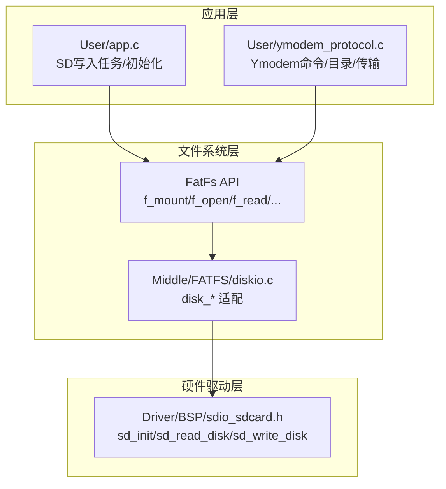
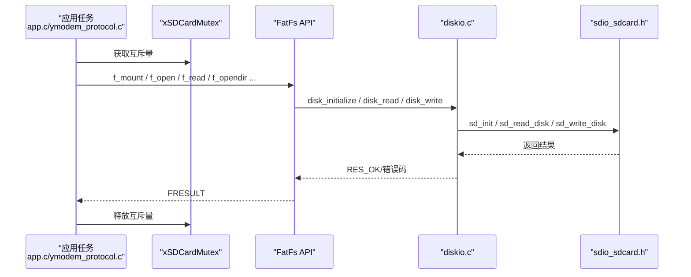
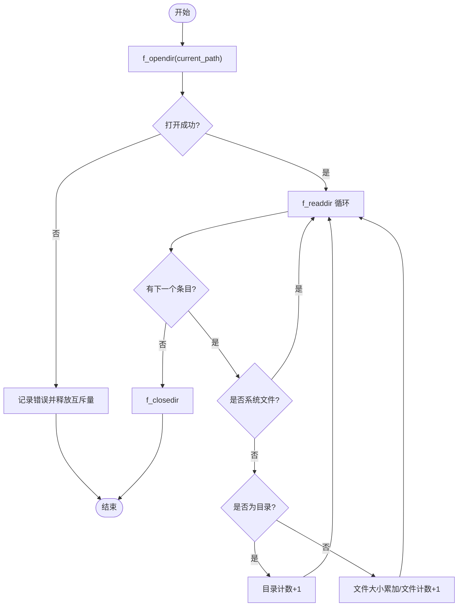
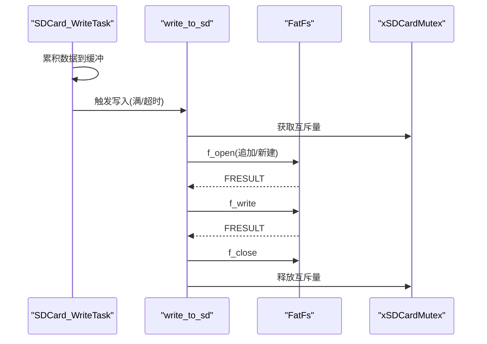
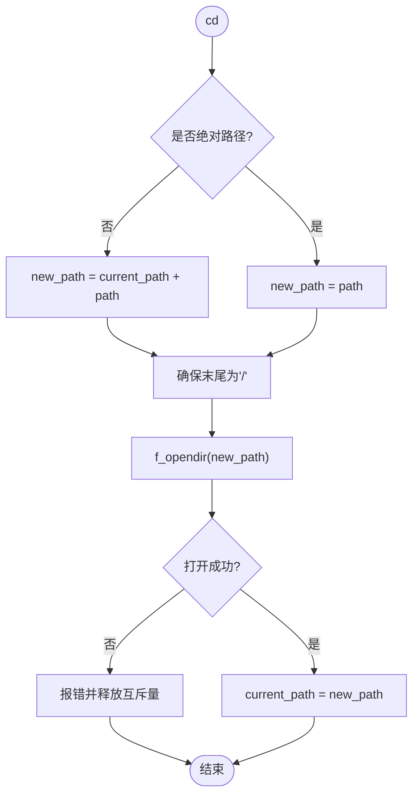
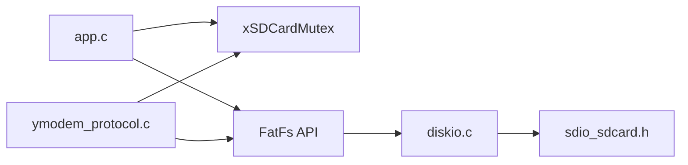

# 文件系统管理

<cite>
**本文引用的文件**   
- [main.c](file://_gbk_backup/User/main.c)
- [app.c](file://_gbk_backup/User/app.c)
- [ymodem_protocol.c](file://_gbk_backup/User/ymodem_protocol.c)
- [ymodem_protocol.h](file://_gbk_backup/User/ymodem_protocol.h)
- [diskio.c](file://_gbk_backup/Middle/FATFS/diskio.c)
- [sdio_sdcard.h](file://_gbk_backup/Driver/BSP/sdio_sdcard.h)
- [malloc.h](file://_gbk_backup/Middle/MALLOC/malloc.h)
</cite>

## 目录
1. [引言](#引言)
2. [项目结构](#项目结构)
3. [核心组件](#核心组件)
4. [架构总览](#架构总览)
5. [详细组件分析](#详细组件分析)
6. [依赖关系分析](#依赖关系分析)
7. [性能与优化](#性能与优化)
8. [故障排查指南](#故障排查指南)
9. [结论](#结论)

## 引言
本文件面向本项目的“文件系统管理模块”，聚焦于 FATFS 在 STM32F4 + FreeRTOS 环境中的集成方式、SD 卡互斥量 xSDCardMutex 的并发保护、全局文件系统对象 g_fs 的使用约定，以及目录操作、文件读写、路径管理与权限属性检查的实现细节。同时给出内存管理策略（动态缓冲区分配与释放）的最佳实践建议，帮助读者在不直接阅读源码的情况下也能正确扩展与维护该模块。

## 项目结构
本项目将文件系统相关代码分布在以下位置：
- 底层磁盘 I/O 适配层：Middle/FATFS/diskio.c
- SD 卡硬件驱动接口：Driver/BSP/sdio_sdcard.h
- 应用层任务与初始化：User/app.c、User/main.c
- Ymodem 协议与文件系统交互：User/ymodem_protocol.c、User/ymodem_protocol.h
- 内存管理抽象：Middle/MALLOC/malloc.h

图表来源
- [app.c:414-450](file://_gbk_backup/User/app.c#L414-L450)
- [ymodem_protocol.c:303-428](file://_gbk_backup/User/ymodem_protocol.c#L303-L428)
- [diskio.c:38-98](file://_gbk_backup/Middle/FATFS/diskio.c#L38-L98)
- [sdio_sdcard.h:332-336](file://_gbk_backup/Driver/BSP/sdio_sdcard.h#L332-L336)

章节来源
- [main.c:30-31](file://_gbk_backup/User/main.c#L30-L31)
- [app.c:414-450](file://_gbk_backup/User/app.c#L414-L450)
- [ymodem_protocol.c:30-31](file://_gbk_backup/User/ymodem_protocol.c#L30-L31)
- [diskio.c:10-17](file://_gbk_backup/Middle/FATFS/diskio.c#L10-L17)

## 核心组件
- 全局文件系统对象指针 g_fs
  - 在 main.c 中声明为全局变量，用于挂载后由上层使用。
  - 注意：当前 app.c 的 SD_Card_Init 实际挂载到局部 fs_obj，未更新 g_fs；若上层直接使用 g_fs，需确保其已被赋值或统一改为使用 g_fs。
- SD 卡互斥量 xSDCardMutex
  - 在 main.c 中声明，在 app.c 的 SD_Card_Init 中创建。
  - 所有涉及 FATFS 调用的关键路径均通过取/放互斥量进行串行化保护，避免多任务并发访问导致文件系统状态不一致。
- 当前工作目录 current_path
  - 在 ymodem_protocol.c 中维护，初始化为根目录 "/"。
  - 提供 cd/pwd/ls/get 等命令对路径进行解析与变更。

章节来源
- [main.c:30-31](file://_gbk_backup/User/main.c#L30-L31)
- [app.c:414-450](file://_gbk_backup/User/app.c#L414-L450)
- [ymodem_protocol.c:30-31](file://_gbk_backup/User/ymodem_protocol.c#L30-L31)

## 架构总览
下图展示了从应用层到硬件驱动的完整调用链，以及互斥量的作用范围。

图表来源
- [app.c:50-70](file://_gbk_backup/User/app.c#L50-L70)
- [ymodem_protocol.c:310-395](file://_gbk_backup/User/ymodem_protocol.c#L310-L395)
- [diskio.c:38-98](file://_gbk_backup/Middle/FATFS/diskio.c#L38-L98)
- [sdio_sdcard.h:332-336](file://_gbk_backup/Driver/BSP/sdio_sdcard.h#L332-L336)

## 详细组件分析

### 1) FATFS 集成与全局对象 g_fs
- 挂载流程
  - 在 app.c 的 SD_Card_Init 中，先创建 xSDCardMutex，再分配 FATFS 对象并调用 f_mount 挂载到驱动器 "0:"。
  - 该函数内使用静态局部变量 fs_obj 保存 FATFS 实例，但并未将其赋值给全局 g_fs。因此，若其他模块直接读取 g_fs，可能得到 NULL。建议在挂载成功后将 fs_obj 赋值给 g_fs，或在所有上层模块统一使用局部 fs_obj。
- 底层适配
  - diskio.c 将物理驱动器号映射到 SD 卡，并在 disk_initialize/disk_read/disk_write/disk_ioctl 中调用 sd_init/sd_read_disk/sd_write_disk 等接口。
  - disk_ioctl 暴露扇区大小、块大小、容量等信息给 FatFs。

章节来源
- [app.c:414-450](file://_gbk_backup/User/app.c#L414-L450)
- [diskio.c:38-98](file://_gbk_backup/Middle/FATFS/diskio.c#L38-L98)
- [diskio.c:107-144](file://_gbk_backup/Middle/FATFS/diskio.c#L107-L144)

### 2) SD 卡互斥量 xSDCardMutex 的管理
- 创建与销毁
  - 在 app.c 的 SD_Card_Init 中创建互斥量，失败则删除自身任务。
- 使用模式
  - 写路径：write_to_sd 在 f_open/f_write/f_close 前后加锁。
  - 读路径：ymodem_protocol.c 的 Ymodem_SendFile/Ymodem_ListDirectory/Ymodem_ChangeDirectory 等在进入 FATFS 调用前加锁，并在退出时释放。
- 注意事项
  - 所有分支均需保证互斥量被释放，避免死锁。
  - 超时取值 pdMS_TO_TICKS(1000) 可防止长时间阻塞。

章节来源
- [app.c:50-70](file://_gbk_backup/User/app.c#L50-L70)
- [app.c:414-450](file://_gbk_backup/User/app.c#L414-L450)
- [ymodem_protocol.c:310-395](file://_gbk_backup/User/ymodem_protocol.c#L310-L395)
- [ymodem_protocol.c:442-496](file://_gbk_backup/User/ymodem_protocol.c#L442-L496)
- [ymodem_protocol.c:507-554](file://_gbk_backup/User/ymodem_protocol.c#L507-L554)

### 3) 目录操作：f_opendir / f_readdir / f_closedir
- 打开目录
  - Ymodem_ListDirectory 使用 f_opendir(&dir, current_path) 打开当前工作目录。
- 遍历目录
  - 循环调用 f_readdir(&dir, &fno)，直到返回错误或文件名首字符为空。
  - 跳过系统文件（以 "." 开头），区分目录与文件，统计数量与总大小。
- 关闭目录
  - 遍历结束后调用 f_closedir(&dir)。
- 错误处理
  - 打开失败时打印错误码并释放互斥量后返回。
  - 遍历过程中遇到非 FR_OK 或结束标志即停止。

图表来源
- [ymodem_protocol.c:454-491](file://_gbk_backup/User/ymodem_protocol.c#L454-L491)

章节来源
- [ymodem_protocol.c:433-502](file://_gbk_backup/User/ymodem_protocol.c#L433-L502)

### 4) 文件读写：f_open / f_read / f_close
- 写路径（日志累积）
  - SDCard_WriteTask 从队列接收数据，累积到 512 字节缓冲或超时（默认 60s）时调用 write_to_sd。
  - write_to_sd 尝试追加打开文件，不存在则新建，然后写入并关闭。
  - 所有 FATFS 调用均在 xSDCardMutex 保护下。
- 读路径（Ymodem 发送）
  - Ymodem_SendFile 打开文件、获取文件大小，等待接收端准备后发送文件信息包和数据包。
  - 数据包读取使用 f_read，按 1024 字节分片发送，不足部分补零。
  - 传输完成后关闭文件并释放互斥量。

图表来源
- [app.c:311-366](file://_gbk_backup/User/app.c#L311-L366)
- [app.c:35-71](file://_gbk_backup/User/app.c#L35-L71)

章节来源
- [app.c:35-71](file://_gbk_backup/User/app.c#L35-L71)
- [app.c:311-366](file://_gbk_backup/User/app.c#L311-L366)
- [ymodem_protocol.c:232-298](file://_gbk_backup/User/ymodem_protocol.c#L232-L298)
- [ymodem_protocol.c:303-428](file://_gbk_backup/User/ymodem_protocol.c#L303-L428)

### 5) 路径管理机制：current_path 与路径解析
- 当前工作目录
  - 初始化为根目录 "/"，支持 pwd 显示当前路径。
- 相对路径与绝对路径
  - cd 命令：若以 "/" 开头则为绝对路径，否则拼接 current_path 形成新路径，并确保末尾带 "/"。
  - cd ..：回退到上级目录（去除最后一个 "/" 之前的内容）。
- 验证目录存在
  - 在更新 current_path 前，使用 f_opendir 验证目标路径是否存在，不存在则报错并释放互斥量。

图表来源
- [ymodem_protocol.c:507-554](file://_gbk_backup/User/ymodem_protocol.c#L507-L554)
- [ymodem_protocol.c:610-629](file://_gbk_backup/User/ymodem_protocol.c#L610-L629)

章节来源
- [ymodem_protocol.c:507-554](file://_gbk_backup/User/ymodem_protocol.c#L507-L554)
- [ymodem_protocol.c:610-629](file://_gbk_backup/User/ymodem_protocol.c#L610-L629)

### 6) 文件权限检查与属性获取
- 属性判断
  - 在目录遍历中，通过 fno.fattrib 与 AM_DIR 判断是否为目录。
  - 文件尺寸通过 fno.fsize 获取，时间戳通过 fno.fdate/fno.ftime 解析。
- 权限控制
  - 代码未实现显式权限位（如只读/隐藏等）过滤，仅基于 AM_DIR 区分目录与文件。
  - 如需更细粒度权限控制，可在遍历中增加对其它属性位的判断（例如 AM_RDO/AM_HID/AM_SYS）。

章节来源
- [ymodem_protocol.c:469-489](file://_gbk_backup/User/ymodem_protocol.c#L469-L489)

### 7) 内存管理策略与最佳实践
- 动态分配点
  - FIL 结构体在 SDCard_WriteTask 中通过 mymalloc(SRAMIN, sizeof(FIL)) 分配，并在任务结束时 myfree 释放。
  - Ymodem_SendFileData 中为数据包分配 1024 字节缓冲区，读取失败或完成时释放。
- 内存池选择
  - malloc.h 定义了 SRAMIN/SRAMCCM/SRAMEX 等多内存池，本项目主要使用 SRAMIN。
- 最佳实践
  - 所有 mymalloc 必须配对 myfree，且需在错误分支也释放，避免泄漏。
  - 大缓冲区尽量复用（如固定大小的环形缓冲），减少频繁分配释放带来的碎片。
  - 在 RTOS 环境下，优先使用任务栈或静态缓冲，仅在必要时使用堆分配。

章节来源
- [app.c:315-322](file://_gbk_backup/User/app.c#L315-L322)
- [app.c:365-366](file://_gbk_backup/User/app.c#L365-L366)
- [ymodem_protocol.c:234-238](file://_gbk_backup/User/ymodem_protocol.c#L234-L238)
- [ymodem_protocol.c:296-297](file://_gbk_backup/User/ymodem_protocol.c#L296-L297)
- [malloc.h:34-78](file://_gbk_backup/Middle/MALLOC/malloc.h#L34-L78)

## 依赖关系分析
- 模块耦合
  - app.c 与 ymodem_protocol.c 共同依赖 FATFS API 与 xSDCardMutex。
  - diskio.c 作为 FatFs 与 SD 驱动之间的桥接层，解耦了文件系统与硬件。
- 外部依赖
  - FreeRTOS 互斥量与队列机制用于并发安全与任务间通信。
  - RTC 用于生成文件名与时间戳。

图表来源
- [app.c:30-31](file://_gbk_backup/User/app.c#L30-L31)
- [ymodem_protocol.c:26-27](file://_gbk_backup/User/ymodem_protocol.c#L26-L27)
- [diskio.c:10-17](file://_gbk_backup/Middle/FATFS/diskio.c#L10-L17)

章节来源
- [app.c:30-31](file://_gbk_backup/User/app.c#L30-L31)
- [ymodem_protocol.c:26-27](file://_gbk_backup/User/ymodem_protocol.c#L26-L27)
- [diskio.c:10-17](file://_gbk_backup/Middle/FATFS/diskio.c#L10-L17)

## 性能与优化
- 写聚合
  - 采用 512 字节扇区级缓冲与 60 秒超时双触发写入，显著降低频繁小写对 SD 卡的磨损与开销。
- 读分片
  - Ymodem 以 1024 字节分片读取与发送，配合 CRC 校验与重传机制，提高可靠性。
- 互斥粒度
  - 互斥量覆盖整个 FATFS 调用序列，简单可靠；若后续引入多盘或多文件系统，可考虑更细粒度的锁或分区隔离。
- 内存复用
  - 建议将 1024 字节数据包缓冲提升为静态或池化分配，减少动态分配开销。

[本节为通用性能讨论，不直接分析具体文件]

## 故障排查指南
- 无法挂载文件系统
  - 检查 SD_Card_Init 中 f_mount 返回值，确认 SD 卡初始化与挂载是否成功。
  - 确认 g_fs 是否被正确赋值（当前实现挂载到局部 fs_obj，未更新 g_fs）。
- 并发冲突或死锁
  - 检查所有 FATFS 调用是否在 xSDCardMutex 保护下，且所有分支都释放互斥量。
- 目录列表异常
  - 检查 current_path 是否正确设置，f_opendir 是否返回 FR_OK。
- 文件写入失败
  - 检查 f_open 的模式（追加/新建）与返回值，确认 f_write 的返回长度与实际写入一致。
- 内存泄漏
  - 核对所有 mymalloc/myfree 配对，尤其在错误分支也要释放。

章节来源
- [app.c:414-450](file://_gbk_backup/User/app.c#L414-L450)
- [app.c:50-70](file://_gbk_backup/User/app.c#L50-L70)
- [ymodem_protocol.c:454-491](file://_gbk_backup/User/ymodem_protocol.c#L454-L491)
- [ymodem_protocol.c:234-298](file://_gbk_backup/User/ymodem_protocol.c#L234-L298)

## 结论
本文件系统管理模块通过 FATFS 与 SD 驱动适配层实现了稳定的文件存取能力，并以 xSDCardMutex 保障多任务并发访问的安全性。目录操作与路径管理提供了基础的导航与浏览能力，Ymodem 协议实现了可靠的文件传输。建议在后续迭代中：
- 统一 g_fs 的使用方式，避免全局与局部对象不一致。
- 细化权限与属性检查，满足更多业务场景。
- 优化内存分配策略，提升实时性与稳定性。