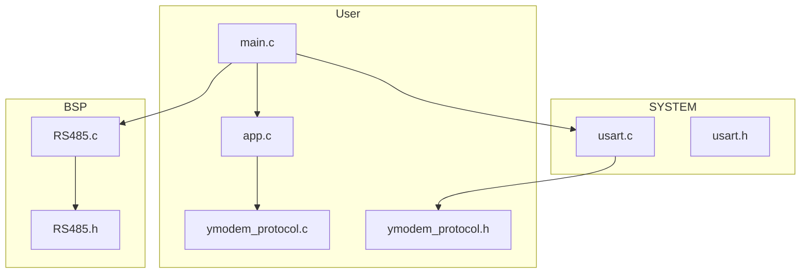
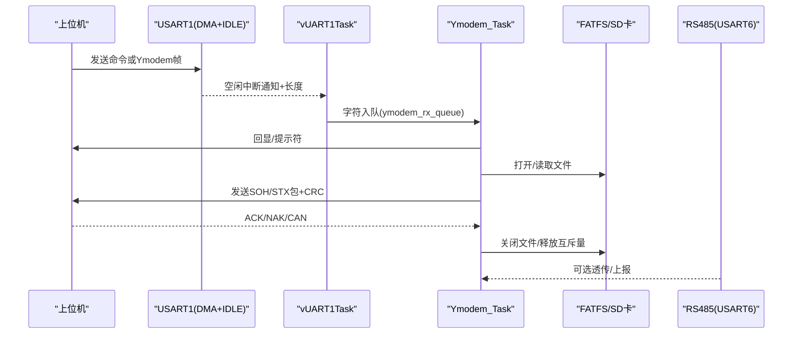
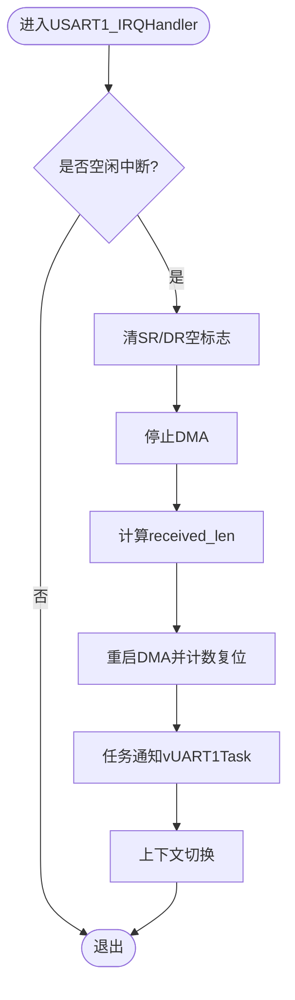
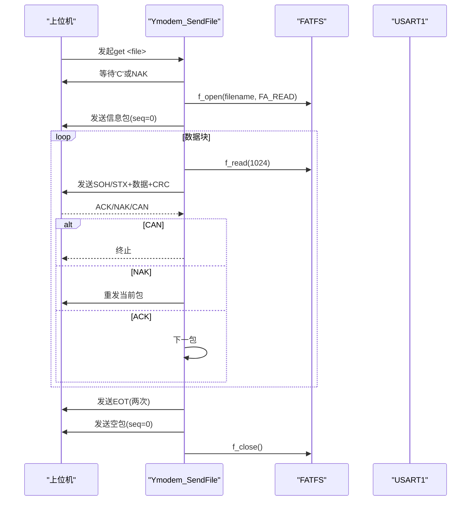
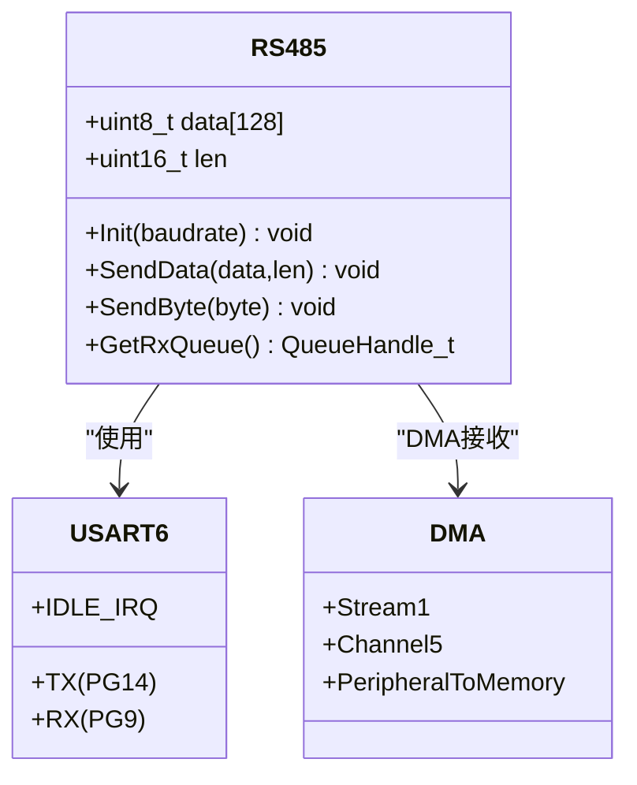
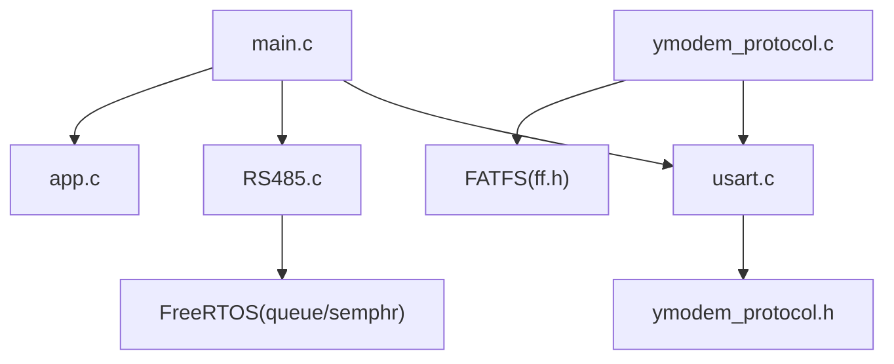

# 通信接口系统

<cite>
**本文引用的文件**   
- [main.c](file://_gbk_backup/User/main.c)
- [usart.c](file://_gbk_backup/Driver/SYSTEM/usart.c)
- [usart.h](file://_gbk_backup/Driver/SYSTEM/usart.h)
- [RS485.c](file://_gbk_backup/Driver/BSP/RS485.c)
- [RS485.h](file://_gbk_backup/Driver/BSP/RS485.h)
- [ymodem_protocol.c](file://_gbk_backup/User/ymodem_protocol.c)
- [ymodem_protocol.h](file://_gbk_backup/User/ymodem_protocol.h)
- [app.c](file://_gbk_backup/User/app.c)
</cite>

## 目录
1. [简介](#简介)
2. [项目结构](#项目结构)
3. [核心组件](#核心组件)
4. [架构总览](#架构总览)
5. [详细组件分析](#详细组件分析)
6. [依赖关系分析](#依赖关系分析)
7. [性能与流量控制](#性能与流量控制)
8. [故障排查指南](#故障排查指南)
9. [结论](#结论)
10. [附录：协议与数据格式](#附录协议与数据格式)

## 简介
本技术文档面向基于 STM32F407 + FreeRTOS 的通信接口系统，覆盖以下关键能力：
- UART 串口通信配置与使用（波特率、中断、DMA）
- Ymodem 文件传输协议实现（上传/下载流程、数据包格式、错误重传）
- RS485 半双工通信接口配置与多节点网络支持
- 各通信接口的数据格式定义与协议规范
- 上位机软件集成指南与调试方法
- 通信性能优化、流量控制与异常处理策略

## 项目结构
本项目采用分层组织方式：
- BSP 层：硬件抽象（RS485、LCD、RTC、CAN 等）
- SYSTEM 层：基础外设驱动（USART、延时、系统初始化）
- User 层：应用逻辑（任务调度、Ymodem 协议、业务记录与显示）
- DebugConfig：调试器配置文件

图表来源
- [main.c:34-59](file://_gbk_backup/User/main.c#L34-L59)
- [usart.c:101-166](file://_gbk_backup/Driver/SYSTEM/usart.c#L101-L166)
- [RS485.c:15-102](file://_gbk_backup/Driver/BSP/RS485.c#L15-L102)
- [app.c:529-541](file://_gbk_backup/User/app.c#L529-L541)

章节来源
- [main.c:34-59](file://_gbk_backup/User/main.c#L34-L59)
- [app.c:529-541](file://_gbk_backup/User/app.c#L529-L541)

## 核心组件
- UART1 通信栈：提供 DMA+空闲中断接收、printf 重定向、命令识别与队列分发。
- Ymodem 协议栈：实现文件列表、目录切换、Ymodem 发送流程、CRC 校验与重传。
- RS485 半双工通信：USART6 + DMA + 空闲中断，RE 引脚控制收发方向，FreeRTOS 队列解耦。
- 任务与队列：UART 接收任务、Ymodem 交互任务、SD 卡写入任务、LCD 显示任务等。

章节来源
- [usart.c:101-166](file://_gbk_backup/Driver/SYSTEM/usart.c#L101-L166)
- [ymodem_protocol.c:125-158](file://_gbk_backup/User/ymodem_protocol.c#L125-L158)
- [RS485.c:15-102](file://_gbk_backup/Driver/BSP/RS485.c#L15-L102)
- [app.c:529-541](file://_gbk_backup/User/app.c#L529-L541)

## 架构总览
系统以 FreeRTOS 为调度核心，通过 DMA 与空闲中断高效采集串口数据，交由任务处理；Ymodem 协议在独立任务中解析命令并执行文件传输；RS485 作为外部总线接口，通过队列与上层解耦。

图表来源
- [usart.c:185-205](file://_gbk_backup/Driver/SYSTEM/usart.c#L185-L205)
- [usart.c:269-283](file://_gbk_backup/Driver/SYSTEM/usart.c#L269-L283)
- [ymodem_protocol.c:303-428](file://_gbk_backup/User/ymodem_protocol.c#L303-L428)
- [RS485.c:160-198](file://_gbk_backup/Driver/BSP/RS485.c#L160-L198)

## 详细组件分析

### UART 串口通信（USART1）
- 初始化要点
  - 时钟：GPIOA、USART1、DMA2
  - GPIO：PA9(TX)、PA10(RX)，复用功能
  - USART：8N1，无硬件流控，RX/TX 同时使能
  - DMA：Stream5 Channel4，循环模式，内存递增，高优先级
  - 中断：空闲中断 IDLE，NVIC 抢占优先级 6
- 接收流程
  - DMA 持续将字节写入环形缓冲 dma_rx_buffer
  - 空闲中断触发后，停止 DMA，计算 received_len，重启 DMA，并通过任务通知唤醒 vUART1Task
  - vUART1Task 将缓冲区内容逐字节推入 ymodem_rx_queue，同时可转发至 LCD 显示队列
- 发送函数
  - 阻塞等待 TXE 标志位，单字节发送
  - 字符串发送封装

图表来源
- [usart.c:185-205](file://_gbk_backup/Driver/SYSTEM/usart.c#L185-L205)

章节来源
- [usart.c:101-166](file://_gbk_backup/Driver/SYSTEM/usart.c#L101-L166)
- [usart.c:185-205](file://_gbk_backup/Driver/SYSTEM/usart.c#L185-L205)
- [usart.c:269-301](file://_gbk_backup/Driver/SYSTEM/usart.c#L269-L301)
- [usart.h:13-35](file://_gbk_backup/Driver/SYSTEM/usart.h#L13-L35)

### Ymodem 文件传输协议
- 协议常量与状态
  - SOH/STX/EOT/ACK/NAK/CAN/CRC_CHAR
  - 128/1024 字节包体，序列号 seq 取模 0xFF
  - 上下文包含状态、序列号、包大小、文件大小、已发送字节、重试次数、是否 CRC 模式
- 发送流程
  - 等待对端 'C'（CRC 模式）或 NAK（校验模式）
  - 发送文件信息包（文件名\0文件大小\0），seq=0
  - 循环读取文件数据，按 128/1024 分片发送，附带 CRC
  - 收到 ACK 继续，NAK 重传，CAN 取消
  - 结束阶段发送两次 EOT，最终发送空包并清理
- 错误与重传
  - 每包最多重试 10 次，超时返回失败
  - 对端取消直接终止
- 文件系统访问
  - 使用 FATFS f_open/f_read/f_close
  - 通过互斥量 xSDCardMutex 保护 SD 卡访问

图表来源
- [ymodem_protocol.c:125-158](file://_gbk_backup/User/ymodem_protocol.c#L125-L158)
- [ymodem_protocol.c:196-227](file://_gbk_backup/User/ymodem_protocol.c#L196-L227)
- [ymodem_protocol.c:232-298](file://_gbk_backup/User/ymodem_protocol.c#L232-L298)
- [ymodem_protocol.c:303-428](file://_gbk_backup/User/ymodem_protocol.c#L303-L428)

章节来源
- [ymodem_protocol.h:15-60](file://_gbk_backup/User/ymodem_protocol.h#L15-L60)
- [ymodem_protocol.c:75-82](file://_gbk_backup/User/ymodem_protocol.c#L75-L82)
- [ymodem_protocol.c:125-158](file://_gbk_backup/User/ymodem_protocol.c#L125-L158)
- [ymodem_protocol.c:196-227](file://_gbk_backup/User/ymodem_protocol.c#L196-L227)
- [ymodem_protocol.c:232-298](file://_gbk_backup/User/ymodem_protocol.c#L232-L298)
- [ymodem_protocol.c:303-428](file://_gbk_backup/User/ymodem_protocol.c#L303-L428)

### RS485 半双工通信
- 硬件与引脚
  - USART6：PG14(TX)、PG9(RX)
  - RE 控制：PG10，输出高为发送，低为接收
  - DMA：DMA2 Stream1 Channel5，从外设到内存
- 初始化流程
  - 使能时钟：GPIOG、USART6、DMA2
  - 配置 GPIO 复用与 RE 输出
  - 默认设为接收模式（RE=低）
  - USART：8N1，无硬件流控，RX/TX 使能
  - 开启空闲中断与 DMA 接收
  - DMA：正常模式，非循环，缓冲区大小 128
  - NVIC：USART6 IRQ 优先级 5
  - 创建 FreeRTOS 队列用于接收数据包
- 收发流程
  - 发送：置 RE 高，轮询 TXE/TC，完成后拉低 RE
  - 接收：空闲中断触发，停止 DMA，清零 DMA 标志，计算长度，拷贝到 RxPacket，入队，重置 DMA 计数器并重启

图表来源
- [RS485.h:8-33](file://_gbk_backup/Driver/BSP/RS485.h#L8-L33)
- [RS485.c:15-102](file://_gbk_backup/Driver/BSP/RS485.c#L15-L102)
- [RS485.c:110-135](file://_gbk_backup/Driver/BSP/RS485.c#L110-L135)
- [RS485.c:160-198](file://_gbk_backup/Driver/BSP/RS485.c#L160-L198)

章节来源
- [RS485.h:8-52](file://_gbk_backup/Driver/BSP/RS485.h#L8-L52)
- [RS485.c:15-102](file://_gbk_backup/Driver/BSP/RS485.c#L15-L102)
- [RS485.c:110-135](file://_gbk_backup/Driver/BSP/RS485.c#L110-L135)
- [RS485.c:160-198](file://_gbk_backup/Driver/BSP/RS485.c#L160-L198)

### 任务与队列（FreeRTOS）
- 任务
  - vUART1Task：接收中断通知后，将数据推入 ymodem_rx_queue
  - Ymodem_Task：从队列取字符，回显并解析命令，调用 Ymodem_SendFile
  - SDCard_WriteTask：累积数据并按扇区或超时写入 SD 卡
  - vLCDDisplayTask：批量刷新 LCD
- 队列与互斥量
  - ymodem_rx_queue：字符级队列
  - lcd_display_queue：LCD 显示队列
  - xSDCardWriteQueue：SD 写入请求队列
  - xSDCardMutex：SD 卡访问互斥量

图表来源
- [usart.c:185-205](file://_gbk_backup/Driver/SYSTEM/usart.c#L185-L205)
- [usart.c:269-283](file://_gbk_backup/Driver/SYSTEM/usart.c#L269-L283)
- [ymodem_protocol.c:711-748](file://_gbk_backup/User/ymodem_protocol.c#L711-L748)
- [app.c:311-366](file://_gbk_backup/User/app.c#L311-L366)

章节来源
- [app.c:529-541](file://_gbk_backup/User/app.c#L529-L541)
- [ymodem_protocol.c:711-748](file://_gbk_backup/User/ymodem_protocol.c#L711-L748)
- [app.c:311-366](file://_gbk_backup/User/app.c#L311-L366)

## 依赖关系分析
- 模块耦合
  - main.c 负责外设初始化与任务创建，耦合 usart、rs485、app
  - usart.c 依赖 ymodem_protocol.h 中的命令常量
  - ymodem_protocol.c 依赖 FATFS、FreeRTOS 队列/信号量、USART1 发送接口
  - RS485.c 依赖 FreeRTOS 队列与 DMA/USART6
- 潜在循环依赖
  - usart.h 包含 ymodem_protocol.h，ymodem_protocol.c 反向引用 usart 发送函数，属于跨模块 API 引用，不构成编译期循环依赖
- 外部依赖
  - FATFS（ff.h）用于 SD 卡文件操作
  - FreeRTOS（task/queue/semphr/timers）

图表来源
- [main.c:34-59](file://_gbk_backup/User/main.c#L34-L59)
- [usart.h:1-35](file://_gbk_backup/Driver/SYSTEM/usart.h#L1-L35)
- [ymodem_protocol.c:9-19](file://_gbk_backup/User/ymodem_protocol.c#L9-L19)
- [RS485.c:1-8](file://_gbk_backup/Driver/BSP/RS485.c#L1-L8)

章节来源
- [main.c:34-59](file://_gbk_backup/User/main.c#L34-L59)
- [usart.h:1-35](file://_gbk_backup/Driver/SYSTEM/usart.h#L1-L35)
- [ymodem_protocol.c:9-19](file://_gbk_backup/User/ymodem_protocol.c#L9-L19)
- [RS485.c:1-8](file://_gbk_backup/Driver/BSP/RS485.c#L1-L8)

## 性能与流量控制
- DMA 与空闲中断
  - UART1 使用 DMA 循环接收，空闲中断触发时计算长度，避免 CPU 轮询
  - RS485 使用 DMA 正常模式，空闲中断触发后停止 DMA，计算长度，再重启
- 队列与批处理
  - ymodem_rx_queue 字符级队列，适合命令流与 Ymodem 帧流
  - LCD 显示任务批量刷新，降低刷屏频率
  - SD 卡写入任务按扇区或超时合并写入，减少频繁 I/O
- 超时与重试
  - Ymodem 每包最大重试 10 次，超时返回失败
  - 等待对端 'C'/NAK 设置超时，避免死等
- 资源保护
  - SD 卡访问通过互斥量保护，避免并发写冲突
- 建议优化
  - 根据链路质量调整 Ymodem 超时与重试次数
  - 增大 ymodem_rx_queue 深度以降低丢包风险
  - 合理设置 DMA 缓冲区大小与队列深度，平衡内存与吞吐

章节来源
- [usart.c:101-166](file://_gbk_backup/Driver/SYSTEM/usart.c#L101-L166)
- [RS485.c:15-102](file://_gbk_backup/Driver/BSP/RS485.c#L15-L102)
- [ymodem_protocol.c:163-191](file://_gbk_backup/User/ymodem_protocol.c#L163-L191)
- [ymodem_protocol.c:232-298](file://_gbk_backup/User/ymodem_protocol.c#L232-L298)
- [app.c:311-366](file://_gbk_backup/User/app.c#L311-L366)

## 故障排查指南
- 串口无法接收
  - 检查 DMA 是否启动、空闲中断是否使能、NVIC 优先级是否正确
  - 确认 PA9/PA10 复用映射正确
- Ymodem 传输失败
  - 确认上位机选择 CRC 模式并发送 'C'
  - 检查文件路径与权限，确保 FATFS 挂载成功
  - 观察 ACK/NAK/CAN 响应，定位丢包或超时位置
- RS485 通信异常
  - 检查 RE 引脚电平切换时序，确保发送前拉高、发送后拉低
  - 确认 DMA 标志位清除与计数器复位
  - 核对波特率一致，避免多节点冲突
- 日志与调试
  - 使用 printf 输出关键状态（如“Waiting for receiver...”、“Transfer cancelled by receiver”）
  - 按键短按打印任务栈使用情况，长按关闭背光，便于功耗与稳定性测试

章节来源
- [ymodem_protocol.c:332-361](file://_gbk_backup/User/ymodem_protocol.c#L332-L361)
- [ymodem_protocol.c:397-428](file://_gbk_backup/User/ymodem_protocol.c#L397-L428)
- [RS485.c:160-198](file://_gbk_backup/Driver/BSP/RS485.c#L160-L198)
- [app.c:368-412](file://_gbk_backup/User/app.c#L368-L412)

## 结论
本通信接口系统在 STM32F407 + FreeRTOS 平台上实现了稳定高效的 UART 与 RS485 通信，并通过 Ymodem 协议完成可靠的文件传输。DMA 与空闲中断结合、队列与互斥量解耦、超时与重试机制完善，满足工业现场对可靠性与实时性的要求。后续可根据实际链路质量与负载进一步调优参数，提升吞吐与鲁棒性。

## 附录：协议与数据格式

### UART 数据格式
- 帧格式：8N1（8 数据位、无校验、1 停止位）
- 波特率：USART1 初始化为 115200；RS485 初始化为 9600
- 流控：无硬件流控

章节来源
- [usart.c:124-131](file://_gbk_backup/Driver/SYSTEM/usart.c#L124-L131)
- [RS485.c:52-58](file://_gbk_backup/Driver/BSP/RS485.c#L52-L58)
- [main.c:38-49](file://_gbk_backup/User/main.c#L38-L49)

### Ymodem 数据包格式
- 包头
  - SOH：128 字节包体
  - STX：1024 字节包体
- 包结构
  - Header[3]：码类型 + 序列号 + ~序列号
  - Data[N]：数据载荷（不足补 0）
  - CRC[2]：CRC16（高位在前）
- 控制字符
  - ACK：确认
  - NAK：请求重传
  - CAN：取消传输
  - 'C'：CRC 模式协商
  - EOT：传输结束

章节来源
- [ymodem_protocol.h:15-26](file://_gbk_backup/User/ymodem_protocol.h#L15-L26)
- [ymodem_protocol.c:125-158](file://_gbk_backup/User/ymodem_protocol.c#L125-L158)

### RS485 数据包结构
- 接收包结构
  - data[128]：原始字节
  - len：有效长度

章节来源
- [RS485.h:39-43](file://_gbk_backup/Driver/BSP/RS485.h#L39-L43)

### 上位机集成与调试
- 终端工具
  - 使用 Xshell 或其他支持 Ymodem 的终端
  - 在“Transfer -> Ymodem -> Receive”中选择目标文件并启动
- 命令交互
  - help：帮助信息
  - ls：列出当前目录
  - cd <dir>：切换目录
  - pwd：显示当前目录
  - get <file>：通过 Ymodem 下载文件
  - settime YYYY-MM-DD HH:MM:SS：设置 RTC 时间
  - exit：退出命令模式
- 调试要点
  - 确认上位机与设备波特率一致
  - 观察终端提示符“STM32>”与“Waiting for receiver...”
  - 若出现“Transfer cancelled by receiver”，检查对端是否主动取消

章节来源
- [ymodem_protocol.c:568-584](file://_gbk_backup/User/ymodem_protocol.c#L568-L584)
- [ymodem_protocol.c:589-685](file://_gbk_backup/User/ymodem_protocol.c#L589-L685)
- [ymodem_protocol.c:332-361](file://_gbk_backup/User/ymodem_protocol.c#L332-L361)