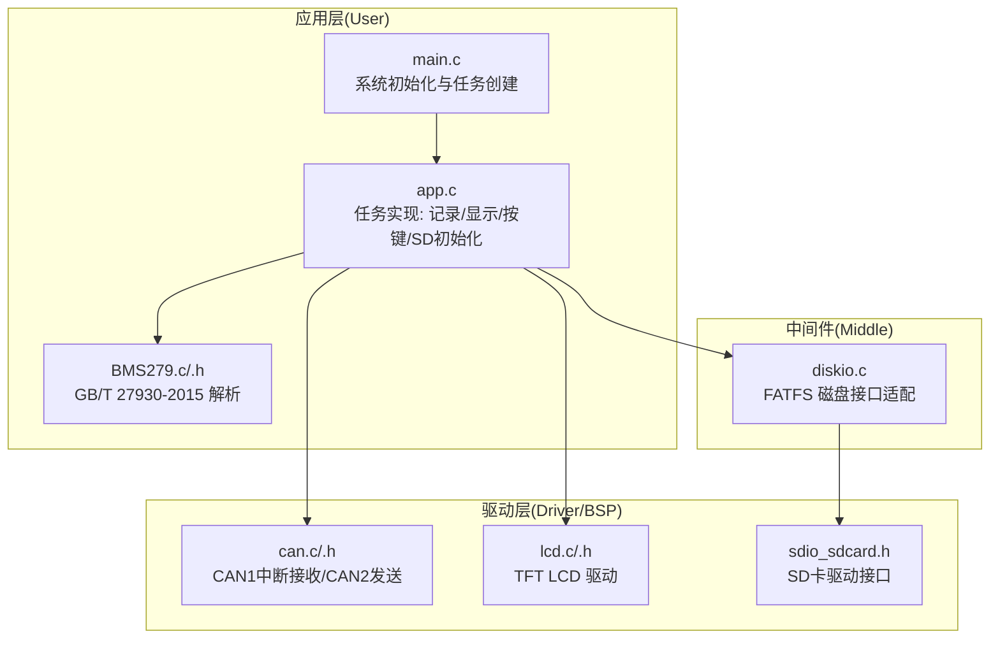
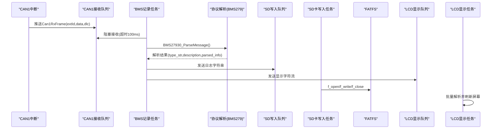
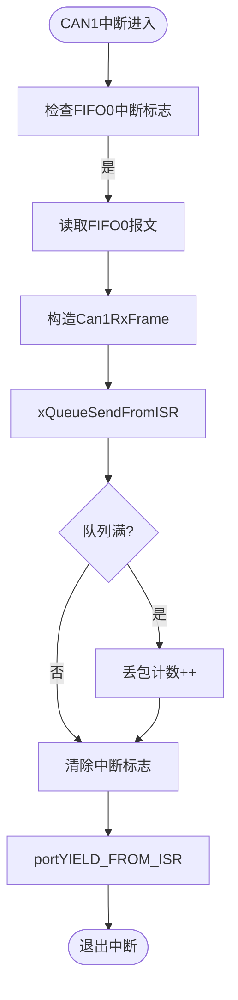
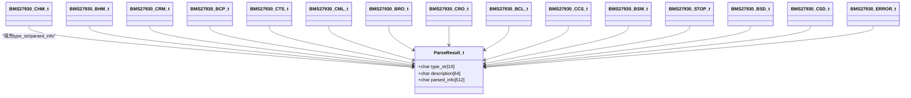
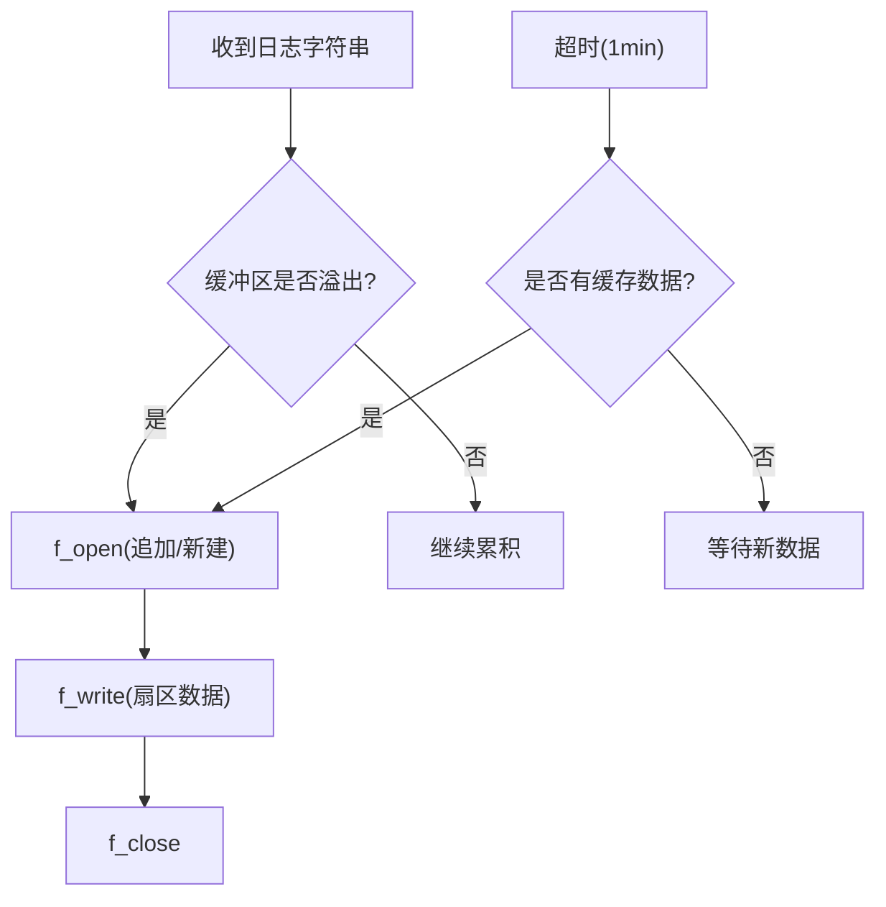
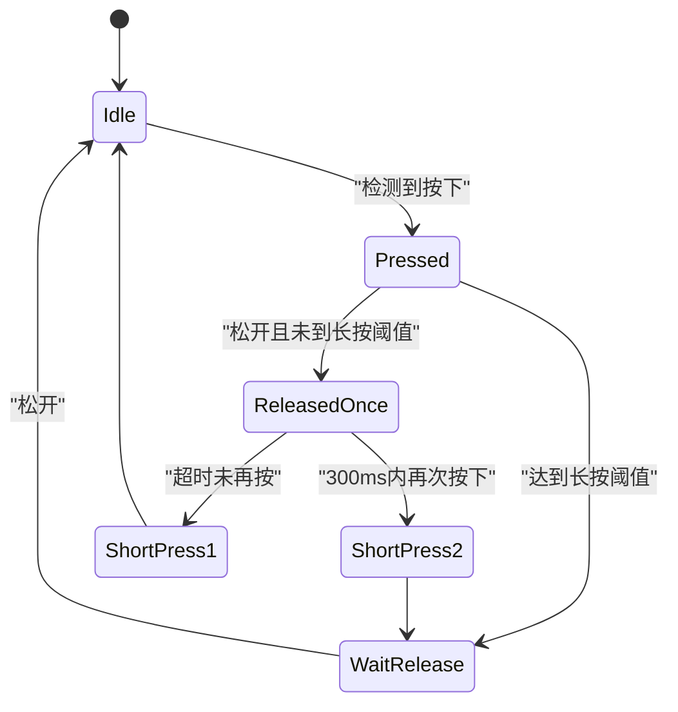
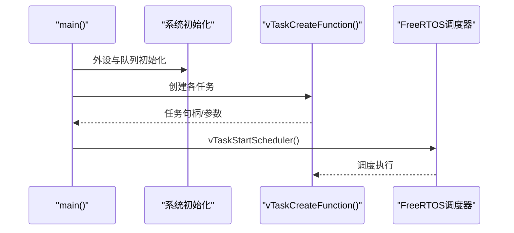
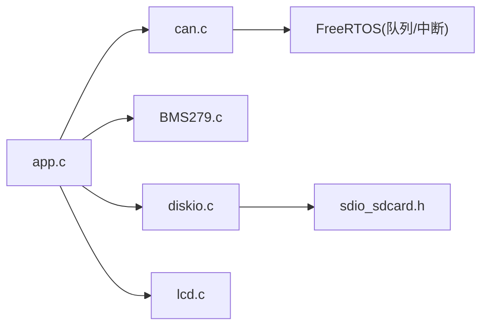

# 项目概述

<cite>
**本文引用的文件**   
- [main.c](file://_gbk_backup/User/main.c)
- [app.c](file://_gbk_backup/User/app.c)
- [can.c](file://_gbk_backup/Driver/BSP/can.c)
- [can.h](file://_gbk_backup/Driver/BSP/can.h)
- [BMS279.c](file://_gbk_backup/User/BMS279.c)
- [BMS279.h](file://_gbk_backup/User/BMS279.h)
- [FreeRTOSConfig.h](file://_gbk_backup/User/FreeRTOSConfig.h)
- [diskio.c](file://_gbk_backup/Middle/FATFS/diskio.c)
- [sdio_sdcard.h](file://_gbk_backup/Driver/BSP/sdio_sdcard.h)
- [lcd.c](file://_gbk_backup/Driver/BSP/LCD/lcd.c)
- [lcd.h](file://_gbk_backup/Driver/BSP/LCD/lcd.h)
</cite>

## 目录
1. [引言](#引言)
2. [项目结构](#项目结构)
3. [核心组件](#核心组件)
4. [架构总览](#架构总览)
5. [详细组件分析](#详细组件分析)
6. [依赖关系分析](#依赖关系分析)
7. [性能与可靠性](#性能与可靠性)
8. [故障排查指南](#故障排查指南)
9. [结论](#结论)
10. [附录：硬件与开发环境](#附录硬件与开发环境)

## 引言
本项目面向电动汽车充电场景，基于 STM32F407 实现 BMS（电池管理系统）数据追踪器。系统实时采集并记录充电过程中的 CAN 总线报文，按 GB/T 27930-2015 协议解析关键帧，同时支持 J1939 多包传输的组包与解析。系统采用 FreeRTOS 进行任务调度，使用 FATFS 将日志持久化到 SD 卡，并通过 LCD/OLED 提供本地显示；串口用于调试与 YMODEM 升级交互。

核心目标
- 实时采集 CAN 总线数据，低丢包、低延迟
- 解析 GB/T 27930-2015 协议报文，输出可读信息
- 将原始与解析后的数据落盘为 CSV 日志，便于离线分析
- 通过 LCD 实时展示关键状态，按键控制背光与系统诊断
- 提供 YMODEM 通信能力，便于固件或配置更新

技术栈与设计决策
- MCU：STM32F407，具备丰富外设与较高主频，适合实时数据采集与处理
- RTOS：FreeRTOS，抢占式调度，队列/信号量/定时器完善，满足多任务并发
- 文件系统：FATFS，轻量稳定，适配 SDIO 存储
- 协议：GB/T 27930-2015 + J1939 扩展，覆盖主流充电链路报文
- 存储策略：扇区级缓冲+超时刷写，降低频繁写入对 SD 卡的磨损

## 项目结构
仓库采用分层组织方式：
- User：应用层任务、协议解析、系统初始化入口
- Driver/BSP：底层驱动（CAN、LCD、SD、RTC、电源管理等）
- Middle：中间件（FATFS、内存管理）
- DebugConfig：调试器配置文件

图表来源
- [main.c:34-60](file://_gbk_backup/User/main.c#L34-L60)
- [app.c:529-541](file://_gbk_backup/User/app.c#L529-L541)
- [can.c:40-106](file://_gbk_backup/Driver/BSP/can.c#L40-L106)
- [diskio.c:38-49](file://_gbk_backup/Middle/FATFS/diskio.c#L38-L49)
- [sdio_sdcard.h:141-149](file://_gbk_backup/Driver/BSP/sdio_sdcard.h#L141-L149)
- [lcd.c:1-43](file://_gbk_backup/Driver/BSP/LCD/lcd.c#L1-L43)

章节来源
- [main.c:34-60](file://_gbk_backup/User/main.c#L34-L60)
- [app.c:529-541](file://_gbk_backup/User/app.c#L529-L541)

## 核心组件
- FreeRTOS 任务模型
  - 按键扫描与处理任务
  - BMS 报文记录任务（CAN 接收→解析→格式化→队列分发）
  - SD 卡写入任务（扇区缓冲+超时刷写）
  - LCD 显示任务（批量刷新）
  - YMODEM 任务（串口升级交互）
  - LED 定时任务（低功耗检测与指示灯）
- CAN 子系统
  - CAN1：中断接收，消息入队，支持扩展帧
  - CAN2：仅发送，用于测试或回环
- 协议解析
  - GB/T 27930-2015：握手、辨识、参数、状态、统计、错误等
  - J1939：连接管理与数据传输的多包组包
- 存储子系统
  - FATFS 挂载 SD 卡，CSV 日志按日期命名
  - 扇区缓冲与互斥保护，避免频繁写入
- 人机交互
  - LCD 显示关键信息，按键控制背光与诊断
  - OLED 与 RS485 预留扩展

章节来源
- [app.c:94-152](file://_gbk_backup/User/app.c#L94-L152)
- [app.c:201-309](file://_gbk_backup/User/app.c#L201-L309)
- [app.c:313-366](file://_gbk_backup/User/app.c#L313-L366)
- [app.c:454-521](file://_gbk_backup/User/app.c#L454-L521)
- [can.c:186-224](file://_gbk_backup/Driver/BSP/can.c#L186-L224)
- [BMS279.c:42-114](file://_gbk_backup/User/BMS279.c#L42-L114)

## 架构总览
系统从 CAN 中断开始，经 FreeRTOS 队列传递至记录任务，完成协议解析后，分别写入 SD 卡与 LCD 显示队列。YMODEM 任务负责串口升级，按键任务统一处理用户输入。

图表来源
- [can.c:186-224](file://_gbk_backup/Driver/BSP/can.c#L186-L224)
- [app.c:201-309](file://_gbk_backup/User/app.c#L201-L309)
- [app.c:313-366](file://_gbk_backup/User/app.c#L313-L366)
- [app.c:454-521](file://_gbk_backup/User/app.c#L454-L521)
- [diskio.c:83-98](file://_gbk_backup/Middle/FATFS/diskio.c#L83-L98)

## 详细组件分析

### CAN 驱动与中断流程
- 初始化
  - 时钟使能、GPIO复用、CAN控制器参数配置（波特率、过滤器、模式）
  - NVIC 中断优先级设置，启用 FIFO0 接收中断
- 中断服务函数
  - 读取 FIFO0 报文，构造 Can1RxFrame，通过 xQueueSendFromISR 发送到队列
  - 若队列满则丢弃并计数丢包
- 应用接口
  - can1_receive_msg：阻塞/非阻塞接收，返回 DLC
  - can1_send_msg：发送扩展帧

图表来源
- [can.c:186-224](file://_gbk_backup/Driver/BSP/can.c#L186-L224)
- [can.h:24-28](file://_gbk_backup/Driver/BSP/can.h#L24-L28)

章节来源
- [can.c:40-106](file://_gbk_backup/Driver/BSP/can.c#L40-L106)
- [can.c:116-141](file://_gbk_backup/Driver/BSP/can.c#L116-L141)
- [can.c:150-179](file://_gbk_backup/Driver/BSP/can.c#L150-L179)
- [can.c:186-224](file://_gbk_backup/Driver/BSP/can.c#L186-L224)
- [can.h:17-52](file://_gbk_backup/Driver/BSP/can.h#L17-L52)

### GB/T 27930-2015 与 J1939 协议解析
- 主解析函数根据 CAN ID 分派到具体报文解析器
- 支持的报文类型包括：CHM、BHM、CRM、CTS、CML、BRO、CRO、BCL、CCS、BSM、BMV、BMT、BSP、BST、CST、BSD、CSD、BEM、CEM
- J1939 多包传输：连接管理(CM)、确认(CM_ACK)、数据传输(DT)，支持 BRM/BCP/BCS 等 PGN 的组包与解析

图表来源
- [BMS279.h:46-51](file://_gbk_backup/User/BMS279.h#L46-L51)
- [BMS279.h:53-191](file://_gbk_backup/User/BMS279.h#L53-L191)
- [BMS279.c:42-114](file://_gbk_backup/User/BMS279.c#L42-L114)

章节来源
- [BMS279.c:42-114](file://_gbk_backup/User/BMS279.c#L42-L114)
- [BMS279.c:119-710](file://_gbk_backup/User/BMS279.c#L119-L710)
- [BMS279.h:21-44](file://_gbk_backup/User/BMS279.h#L21-L44)

### 数据存储与文件系统
- FATFS 挂载
  - 在独立任务中延迟初始化，确保 SD 卡就绪
  - 使用互斥量保护文件操作，避免多任务竞争
- 写入策略
  - 累积缓冲区（512字节扇区大小），达到阈值或超时（默认1分钟无新数据）即写入
  - 文件名按日期生成，追加写入，减少文件碎片

图表来源
- [app.c:35-71](file://_gbk_backup/User/app.c#L35-L71)
- [app.c:313-366](file://_gbk_backup/User/app.c#L313-L366)
- [diskio.c:38-49](file://_gbk_backup/Middle/FATFS/diskio.c#L38-L49)

章节来源
- [app.c:35-71](file://_gbk_backup/User/app.c#L35-L71)
- [app.c:415-450](file://_gbk_backup/User/app.c#L415-L450)
- [diskio.c:83-98](file://_gbk_backup/Middle/FATFS/diskio.c#L83-L98)

### 用户界面与交互
- LCD 显示任务
  - 从队列批量读取字符，按行缓存，每100ms刷新一次屏幕
  - 过滤不可打印字符，超长行截断或替换
- 按键处理
  - 短按1次：点亮背光
  - 短按2次：打印任务列表与栈高水位
  - 长按：关闭背光
- LED 定时任务
  - 周期翻转 LED，监测 VBAT 电压，低于阈值进入低功耗模式

图表来源
- [app.c:94-152](file://_gbk_backup/User/app.c#L94-L152)
- [app.c:454-521](file://_gbk_backup/User/app.c#L454-L521)
- [app.c:155-198](file://_gbk_backup/User/app.c#L155-L198)

章节来源
- [app.c:94-152](file://_gbk_backup/User/app.c#L94-L152)
- [app.c:454-521](file://_gbk_backup/User/app.c#L454-L521)
- [app.c:155-198](file://_gbk_backup/User/app.c#L155-L198)

### 系统初始化与任务创建
- main 函数
  - 中断优先级分组、延时初始化、串口初始化
  - RTC、OLED、按键、LED、LCD、RS485、CAN 初始化
  - 创建队列与互斥量，启动 FreeRTOS 调度器
- 任务创建
  - LED 定时任务、串口任务、按键扫描/处理、SD 初始化、BMS 记录、SD 写入、YMODEM、LCD 显示

图表来源
- [main.c:34-60](file://_gbk_backup/User/main.c#L34-L60)
- [app.c:529-541](file://_gbk_backup/User/app.c#L529-L541)

章节来源
- [main.c:34-60](file://_gbk_backup/User/main.c#L34-L60)
- [app.c:529-541](file://_gbk_backup/User/app.c#L529-L541)

## 依赖关系分析
- 模块耦合
  - app.c 依赖 can.c、BMS279.c、FATFS(diskio.c)、LCD 驱动
  - can.c 依赖 FreeRTOS 队列与 NVIC
  - diskio.c 依赖 sdio_sdcard.h 提供的 SD 驱动接口
- 外部依赖
  - FreeRTOS：任务、队列、信号量、定时器
  - FATFS：文件系统 API
  - STM32 HAL/标准库：外设寄存器访问

图表来源
- [app.c:1-22](file://_gbk_backup/User/app.c#L1-L22)
- [can.c:11-15](file://_gbk_backup/Driver/BSP/can.c#L11-L15)
- [diskio.c:10-14](file://_gbk_backup/Middle/FATFS/diskio.c#L10-L14)

章节来源
- [app.c:1-22](file://_gbk_backup/User/app.c#L1-L22)
- [can.c:11-15](file://_gbk_backup/Driver/BSP/can.c#L11-L15)
- [diskio.c:10-14](file://_gbk_backup/Middle/FATFS/diskio.c#L10-L14)

## 性能与可靠性
- 实时性
  - CAN 中断快速入队，记录任务以 100ms 超时阻塞接收，平衡吞吐与功耗
  - LCD 批量刷新，降低刷屏频率，提升显示流畅度
- 可靠性
  - SD 写入互斥保护，避免多任务竞争导致文件损坏
  - 扇区缓冲与超时刷写，减少频繁写入对 SD 卡的磨损
  - 丢包计数与队列监控，便于定位瓶颈
- 资源占用
  - FreeRTOS 堆大小 30KB，任务栈按需分配
  - 队列深度合理配置，避免内存浪费与拥塞

优化建议
- 提高 CAN 接收队列深度或增加 DMA 接收以降低丢包
- 调整 LCD 刷新周期与缓冲区大小，平衡实时性与刷新质量
- 针对高频报文，可考虑采样降频或选择性记录

章节来源
- [FreeRTOSConfig.h:12-41](file://_gbk_backup/User/FreeRTOSConfig.h#L12-L41)
- [app.c:313-366](file://_gbk_backup/User/app.c#L313-L366)
- [can.c:186-224](file://_gbk_backup/Driver/BSP/can.c#L186-L224)

## 故障排查指南
常见问题与定位
- SD 卡挂载失败
  - 检查 SD 卡初始化返回值与 FATFS 挂载错误码
  - 确认互斥量创建成功
- 无法写入 SD 卡
  - 检查 f_open/f_write 返回值与写入字节数
  - 确认文件名生成逻辑与路径正确
- CAN 丢包严重
  - 观察 can1_rx_lost_count 增长情况
  - 增大队列深度或优化记录任务处理逻辑
- LCD 显示异常
  - 检查队列使用率与缓冲区大小
  - 确认刷新周期与字符过滤逻辑

章节来源
- [app.c:415-450](file://_gbk_backup/User/app.c#L415-L450)
- [app.c:35-71](file://_gbk_backup/User/app.c#L35-L71)
- [can.c:186-224](file://_gbk_backup/Driver/BSP/can.c#L186-L224)
- [app.c:454-521](file://_gbk_backup/User/app.c#L454-L521)

## 结论
本项目以 STM32F407 为核心，结合 FreeRTOS 与 FATFS，构建了稳定的 BMS 数据追踪系统。通过 CAN 中断与队列机制实现低延迟数据采集，GB/T 27930-2015 与 J1939 协议解析覆盖主流充电场景，SD 卡扇区缓冲与超时刷写保障存储可靠性，LCD 与按键提供直观的人机交互。整体架构清晰、模块化良好，便于后续扩展与维护。

## 附录：硬件与开发环境
- 硬件要求
  - STM32F407 最小系统板
  - CAN 收发器与终端电阻
  - TFT LCD（MCU 接口，ILI9341/ST7796 等）
  - SD 卡模块（SPI 或 SDIO）
  - 按键、LED、蜂鸣器（可选）
  - 串口调试（USB/UART）
- 开发环境
  - IDE：Keil MDK（工程文件 uvprojx/uvoptx）
  - 工具链：ARM Compiler / GCC
  - 调试器：ST-Link/J-Link
- 基本功能特性
  - 实时 CAN 数据采集与 GB/T 27930-2015 解析
  - J1939 多包组包与解析
  - SD 卡 CSV 日志记录（按日期命名）
  - LCD 实时显示与按键控制
  - YMODEM 串口升级
  - 低功耗模式（VBAT 低电量检测）

章节来源
- [main.c:34-60](file://_gbk_backup/User/main.c#L34-L60)
- [app.c:529-541](file://_gbk_backup/User/app.c#L529-L541)
- [lcd.c:1-43](file://_gbk_backup/Driver/BSP/LCD/lcd.c#L1-L43)
- [sdio_sdcard.h:141-149](file://_gbk_backup/Driver/BSP/sdio_sdcard.h#L141-L149)